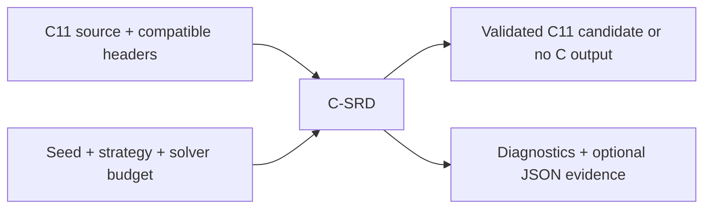
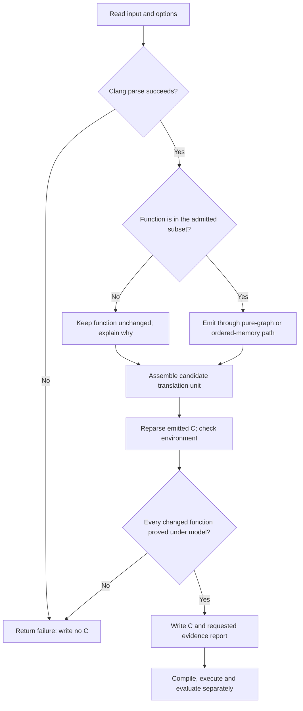

# C-SRD — Verified Semantic and Representation Diversification for C

**Technical specification · implemented baseline 0.6 · reviewed 2026-11-10**

Personal research project maintained by [DeadKennedyx](https://github.com/DeadKennedyx).
Repository: [DeadKennedyx/C-SRD](https://github.com/DeadKennedyx/C-SRD).
Contact: `juan.dw.ft@gmail.com`. License: [MIT](LICENSE).

C-SRD is a working C11-to-C11 research compiler built with C++17, Clang
LibTooling and Z3. It changes computational representations, validates the
actual emitted functions, and measures correctness, structure, cost and defensive
recognition separately. Generated C needs no C-SRD runtime library.

This specification follows an evidence-driven cycle: **observe → gather data →
define the problem → state a falsifiable hypothesis → design an experiment →
model and prototype → specify → implement → measure → revise**. The process is
a rule for conducting this project, not an experimental claim of its own universal
effectiveness. Failed experiments and inconclusive proofs remain evidence.

**Status:** bounded prototypes of M0–M5 exist. Full C11 coverage, a formally
verified compiler, cryptographic confidentiality and research novelty are not
claimed. Transformation covers admitted pure functions and the first bounded
[pointer/buffer extension](docs/buffer-contract.md), with separate contracts.
An opt-in [private-region prototype](docs/private-regions.md) also transforms
unsigned declarations and assignments inside richer functions while checking
surrounding code and declaration bindings.

**Software-protection objective:** automate diversification of legitimate
software and measure the effort needed to reconstruct its implementation.
Correctness, compiled-code differences, analysis effort and memory exposure are
separate claims. The [protection contract](docs/protection.md) defines the scope
and compiled-code audit. AV/security-detection evasion and anti-debugging remain
excluded; encoded source values do not imply debugger-resistant confidentiality.

| Start here | Purpose |
| --- | --- |
| [Build and usage](docs/getting-started.md) | Dependencies, all implemented CLI options and reproducible commands |
| [Semantic contract](docs/semantics.md) | Exact accepted language and observations preserved |
| [Validation record](reports/roadmap-validation.md) | Historical commands, results, raw data and limitations |
| [Compiled-code audit](reports/protection-audit-validation.md) | Current paired audit, preprocessing controls and observed optimization effects |
| [Linked validation matrix and observers](docs/validation-matrix.md) | Declared build profiles, compiled candidate selection, independent recovery and bounded runtime observation |
| [Matrix and recovery results](reports/validation-matrix.md) | Actual linked-build, held-out and runtime results, commands, limitations and archived evidence |
| [Decompiler reconstruction protocol](docs/decompiler-audit.md) | Known-interface Ghidra observer, verified reconstruction and opt-in parity-split experiment |
| [Decompiler and split results](reports/decompiler-control-flow.md) | 826 final build cells, 112 Ghidra observations, failed pilot and explicit observer gaps |
| [Reconstruction effort measurements](docs/effort-measurements.md) | Paired CPU, memory, time, query/trace budget sweeps, recovery accuracy, controls and human-session tooling |
| [Reconstruction effort results](reports/reconstruction-effort.md) | 540 measured attempts, paired cost intervals, false reconstructions, observed coverage gaps and raw evidence |
| [Richer benchmark corpus](docs/rich-benchmarks.md) | Eight functional contracts, reserved families, independent oracles and controls |
| [Rich corpus validation](reports/rich-benchmarks.md) | 156 compiled runs, proof controls, a retained timeout and deliberate false fingerprints |
| [Positional representation prototype](docs/limb-representation.md) | Two-piece arithmetic, bitwise operations, explicit correctness rules and limitations |
| [Broad candidate comparison](reports/limb-exploration.md) | Compiler survival, application costs, reconstruction measurements and retained failures |
| [Compositional emitted-C validation](docs/compositional-validation.md) | Scalable limb proofs with checked graph mappings, local invariants and actual return validation |
| [Saved-query circuit validation](docs/circuit-validation.md) | Optional ABC grading with independently parsed, universally checked Boolean gate contracts |
| [Jenkins follow-up evidence](reports/compositional-validation.md) | Unchanged candidate newly verified, 100 build cells, runtime/size costs and unresolved reconstruction-grading limits |
| [Saved-answer grading follow-up](reports/circuit-grading.md) | Ten earlier inconclusive answers resolved, thirteen controls passed, and failed solver prototypes preserved |
| [Bounded control-flow reconstruction](reports/pcode-control-flow.md) | Fixed-loop and merge recovery, reserved observer checks, CPU/RSS measurements and four explicitly unresolved proof grades |
| [Byte and nibble representations](docs/positional-widths.md) | Fixed 8/4-bit pieces, actual-C carry proofs, operation coverage and validation assumptions |
| [Positional-width comparison](reports/positional-widths.md) | 500 validated build cells, 800 measured observer attempts, separate proof follow-ups, runtime/size/CPU/RSS costs and no established protection winner |
| [Wide-value observer follow-up](reports/pcode-wide-values.md) | All 200 measured reconstructions proved after separate grading; 2,011 arithmetic/vector obligations per host, hardware controls, CPU/RSS trade-offs and retained failed pilots; input-C coverage stays unchanged |
| [Persistent reconstruction sessions](docs/persistent-sessions.md) | Separate native-decompiler, JVM/export and adapter costs; cached-session controls, request-bound evidence and independent source grading |
| [Persistent-session results](reports/persistent-sessions.md) | 120 sessions, all 33 answer contracts recovered under model; nibble native CPU grows 2.7–39.9× per request, with application costs and unresolved JVM warmup effects |
| [Broader C-SRD support](docs/broader-c-support.md) | One coverage sequence informed by published designs, with validation inside every extension |
| [Bounded buffers](docs/buffer-contract.md) | Fixed-index pointer loads/stores, arbitrary aliases, encoded scalar regions and explicit caller preconditions |
| [Buffer validation](reports/buffers-validation.md) | Actual-C memory proofs, compiled differential checks, independent CBMC controls and compiled-code audit |
| [Buffer reconstruction and runtime observation](docs/buffer-reconstruction.md) | Ordered binary recovery, memory-aware grading, resource counters and bounded register/stack/caller-memory observation |
| [Buffer observer results](reports/buffer-reconstruction.md) | Reconstruction results, retained measurement failures and explicitly scoped runtime evidence |
| [Fourteen coverage increments](docs/coverage-increments.md) | Authorized development sequence, current status and acceptance gates |
| [Private computation regions](docs/private-regions.md) | Partial transformation inside richer functions, private-state proof and unchanged effect boundaries |
| [Private-region evidence](reports/private-regions.md) | Actual frame/event validation, matched linked-build costs and explicit protection measurement gaps |
| [Private declaration extension](reports/private-declarations.md) | Scope and shadowing validation, compiler controls and matched declaration-workload evidence |
| [Research journal](docs/journal/README.md) | Questions, observations, decisions, deviations and handoffs |
| [Experimental protocol](experiments/README.md) | Controls, measurements, decision rules and reporting |
| [Task backlog](docs/backlog.md) | Dependencies and measurable exit criteria for subsequent work |

Uppercase MUST, MUST NOT, SHOULD and MAY express requirement levels using
[RFC 2119](https://www.rfc-editor.org/rfc/rfc2119) and
[RFC 8174](https://www.rfc-editor.org/rfc/rfc8174). These requirements are scoped
to this specification; a requirement is not evidence that it has been proved.

## 1. Problem discovery

### Observations and data gathering

1. An encoded computation needs correct operation laws, C integer semantics,
   conversion boundaries and source rewriting; matching a few outputs cannot
   establish all of those properties.
2. Encoding and decoding every operation introduces conversions that adjacent
   compatible computations may share or avoid.
3. Source changes need not survive optimization. In the recorded experiment,
   seven of eight uniform-affine variants had byte-identical code sections to
   their originals under each tested Clang at `-O2`.
4. Finite functional fingerprints can falsely group different functions. The
   deliberate rare-input mutation caused 32 false-positive artifact pairs in
   each recorded discovery configuration.

Observations 3 and 4 come from the [2026-11-08 experiments](reports/roadmap-validation.md),
including raw [native](reports/roadmap-macos-evaluation.json) and
[Linux](reports/roadmap-linux-evaluation.json) results. They are observations on
a small curated corpus, not general performance or recognition conclusions.

This README organizes the implemented baseline retrospectively. It does not
pretend its hypotheses or acceptance criteria were preregistered before those
experiments. The [dated journal entry](docs/journal/2026-11-09-specification-and-publication.md)
records that distinction and the sources used to reconstruct the specification.

### Questions and analysis

Can multiple operations remain encoded while preserving the complete behavior
of an admitted function? Which conversions are necessary? Which differences
survive compilation? Can independent recognition still recover functionality?
The [nine research questions](docs/research-questions.md) separate these concerns.
No one metric, such as conversion count or source size, answers all of them.

## 2. Problem definition and constraints

**Generate alternative C11 implementations of admitted `uint32_t`
functions, with artifact-bound evidence that each emitted implementation
preserves the specified behavior.**

Let P be an admitted function and T(P,s) its candidate under configuration s.
For n scalar arguments in the pure model, the contract requires identical returns for every input in
`D = {0,...,2^32−1}^n`, termination on both sides and an empty external-effect
trace. Private writes to automatic locals and by-value parameters are allowed.
This is why return equality suffices here; it would not suffice for arbitrary C.
The buffer contract instead requires equal returns and entire final memory
for every admitted initial state and alias arrangement, under its explicit
object, bounds, initialization and lifetime preconditions.

| Constraint | Current boundary |
| --- | --- |
| Frontend | Clang C11 parsing and typing; no regex-based C parser |
| Target types | Host target with 32-bit `int` and `unsigned int`; canonical `uint32_t` must be unsigned int |
| Values/statements | Unqualified uint32 parameters/return/locals, initialized declarations, assignments and one final return |
| Operations | Unsigned add/subtract, multiplication by a literal, bitwise operations, literal shifts 0–31, comparisons and uint32 selections |
| Control | Assignment-only branches and canonical finite loops with literal trip counts 0–32 |
| Objects | Local literal lookup arrays of 1–16 elements; indexes must have proved static bounds; no writes or escapes |
| Resource limits | At most 4096 graph nodes before pruning; planned mode at most 512 live nodes; exact optimization at most 16 choice nodes |
| Preprocessing | Functions containing macros/directives are excluded; generated keyword macros are rejected conservatively |
| Buffer path | `uint32_t*`/`const uint32_t*` parameters; literal indexes 0–15 or dereference; straight-line add/subtract/literal scale; identity or affine; ordinary external memory |
| Unsupported | General pointer operations, dynamic indexes/allocation, external calls/I/O, signed/wider arithmetic, floating point, recursion, arbitrary loops, volatile/atomics and concurrency |
| Environment | Compatible target, headers and preprocessing; output location may change include resolution or untransformed `__FILE__` |
| Research boundary | Benign programs and defensive analysis; no evasion objectives or confidentiality guarantee |

The complete whitelist, including qualifiers, casts, storage classes, loop-index
rules and array-bound reasoning, is normative in [semantics](docs/semantics.md).
Pointer functions use [the separate buffer whitelist](docs/buffer-contract.md),
which does not yet admit the pure path's branches, loops or bitwise operations.
An excluded function MUST stay unchanged with a reason. Invalid C MUST prevent
output. Any candidate that fails translation validation MUST prevent C output.

## 3. Hypothesis and experimental design

**H-01:** Maintaining compatible affine or XOR representations across an
admitted computation can preserve its specified behavior while executing
multiple operations without reconstructing ordinary intermediate values.

A concrete semantic counterexample refutes the corresponding candidate. A
compiler rejection, unexpected skip or changed external interface fails its
engineering acceptance criteria. Solver `unknown` or timeout is inconclusive,
never support for equivalence. A counterexample caused by a faulty implementation
also triggers investigation of the relevant analysis, emission or model.

| Design component | Protocol |
| --- | --- |
| Experimental units | Individual benign source functions and generated artifacts; variants of one source are correlated observations |
| Treatments | Identity graph lowering, uniform affine, uniform XOR, independent operation encoding and planned representations |
| Baseline | Untransformed original compiled under the same compiler, target and flags |
| Controlled factors | Source bytes, seed, compiler/options, input sequence and declared semantic contract |
| Noise/confounders | Optimization, machine load, code layout, solver/resource budgets, compiler versions and generated-versus-curated corpus selection |
| Correctness responses | Compilation outcome, coverage, proof status, counterexamples, memory/UB sanitizer findings and differential mismatches |
| Cost/diversity responses | Conversions, ordinary value nodes, runtime samples, compilation/verification time, code-section bytes and separate AST/CFG/IR/object metrics |
| Positive controls | Independently written equivalent functions and admitted identity transformations |
| Negative controls | Incorrect arithmetic law, non-equivalent candidate algorithm, unrelated functions and a rare-input mutation |
| Decision | Keep supported candidates with discharged obligations; reject failing candidates; retain inconclusive evidence and stated scope |

The existing arithmetic suite uses 81 boundary pairs plus 20,000 deterministic
random pairs per function. The expanded suite checks five representation
strategies and two seeds. Both compile separate original/variant objects with
GCC and Clang at `-O0`/`-O2`, with selected Clang ASan/UBSan configurations.

The evaluator uses different discovery/held-out random seeds and a documented
manual challenge for the rare mutation. That challenge is an adversarial
negative control, not unbiased generalization evidence. Its default performance
protocol uses seven repetitions of one million calls, separate compilation,
warmup, observable checksums and reproducibly shuffled variant order.

Future cost-benefit hypotheses MUST define matched coverage, input populations,
comparison units and a decision rule before measurement. Current conversion
totals alone do not establish an advantage at matched coverage. See
[experimental protocol](experiments/README.md) and [evaluation](docs/evaluation.md).

## 4. Search for solutions, modeling and prototypes

| Candidate approach | Decision and reason |
| --- | --- |
| Identifier renaming alone | Does not investigate computation in alternative representations |
| Encode/decode each operation | Implemented as the `independent` comparison baseline |
| Keep one encoding across compatible operations | Implemented affine/XOR baselines; simple rules and explicit incompatible-operation boundaries |
| Choose representations over a dependency graph | Implemented exact small-graph solver and labeled heuristic fallback; allows shared conversions |
| Replace selected algorithms | Implemented opt-in serial/SWAR low-byte population-count candidates; every replacement must validate |
| Search algebraic rule templates | Implemented finite coefficient enumeration followed by universal rule validation; rediscovers known laws |
| Transform arbitrary memory and effects immediately | Deferred until a richer semantic contract and independent checks exist |

The [prior-art comparison](docs/prior-art.md) covers Tigress, LLVM, Alive2,
Frama-C, CBMC, e-graphs, affine/residue representations, CompCert, white-box
encoding networks and software diversification. Maintaining encoded
intermediates and composing compatible encodings are established ideas.
No head-to-head prior-system experiment or novelty result is claimed.

The original prototype was deliberately simplified around pure functions. Known
prototype failures—including solver timeouts and warning-producing emission—
and their corrections are recorded in the [validation record](reports/roadmap-validation.md).
A prototype's successful run is evidence within its domain, not permission to
silently widen that domain.

## 5. Solution proposal and theory of operation

The compiler extracts a conservative region, converts its computations into a
versioned value graph, chooses legal representations, emits ordinary C11 and
reparses that output. An independent region interpreter creates a bit-vector
equivalence obligation for the original and actual candidate. Only successful
validation permits writing transformed C.
For buffer functions, an ordered emitter keeps memory effects outside the pure
graph and a shared-memory interpreter checks the complete post-state. Caller
storage stays ordinary; scalar intermediates remain encoded across operations.

### Black box



| Module | Receives | Produces |
| --- | --- | --- |
| Frontend | C source, includes, host target | Typed AST, source ranges, preprocessing events and input hashes |
| Analysis | Function AST | Admitted pure/buffer region with its contract, or located rejection |
| Graph lowering | Ordered region | Versioned values, dependencies and return node |
| Representation planning | Graph, strategy, coverage/objective | Legal node labels, conversions, costs and planning status |
| Code generation | Graph, labels, seed parameters, reserved identifiers | Candidate C body and counters |
| Ordered memory generation | Buffer region, representation, reserved identifiers | Candidate with ordered effects and encoded scalars |
| Translation validation | Original region and reparsed candidate region | Proof under the model, counterexample, unsupported or inconclusive |
| Defensive evaluator | Original/generated files and independent input protocols | Fingerprints, confusion counts, structural measures and cost samples |

### Flow diagram



At use time the researcher supplies the input and configuration, reads located
diagnostics and the JSON report, then compiles the output independently. Exit
success alone is not a coverage claim: a file containing only unsupported
functions may be copied unchanged successfully.

## 6. Functional specification

| Interface | Behavior |
| --- | --- |
| `csrd transform input.c -o output.c` | Transform admitted functions; default strategy `affine` and seed `0` |
| `--scope functions\|private-regions` | Transform/analyze scope; default whole functions; private regions support affine/identity declaration and assignment arithmetic with separate contextual validation |
| `--strategy identity\|affine\|xor\|independent\|planned\|limbs16\|limbs8\|limbs4` | Select an implemented representation; [16-bit](docs/limb-representation.md) and [8/4-bit](docs/positional-widths.md) positional splits are fixed experiments |
| `--seed UINT64` | Select deterministic affine/XOR parameters |
| `--coverage 0..100` | Planned-only minimum encoded percentage of eligible live arithmetic/bitwise nodes; default 50 |
| `--objective balanced\|runtime\|size` | Planned-only cost proxy; default balanced |
| `--algorithm popcount8-serial\|popcount8-swar` | Propose a known low-byte population-count algorithm for admitted unary functions; equivalence is checked, not inferred from names |
| `--control-flow none\|split-scale` | Experimental parity split of constant multiplication; actual emitted C must validate; reports how many eligible nodes split |
| `csrd verify original.c candidate.c [--function NAME]` | Validate selected original functions against candidate definitions; no rewriting |
| `csrd analyze input.c [--function NAME]` | Report source AST/CFG metrics and subset support; JSON to stdout unless a report is requested |
| `--report PATH` | Write JSON decisions, hashes, metrics and available proof evidence |
| `--timeout-ms 1..600000` | Transform/verify solver budget; default 10000; not a whole-process wall-clock limit |
| `--help`, `--version` | Report the implemented interface/version |

Input, output and report paths MUST be distinct, including symlink/hardlink
aliases. In-place rewriting is rejected. Output files are written only after
parsing and required semantic checks; file-system I/O can still fail.

| Exit code | Meaning |
| --- | --- |
| 0 | Command processed successfully; inspect per-function transformation coverage |
| 1 | Parse or transformation-validation failure; generated C is not written |
| 2 | CLI or I/O error |
| 3 | Standalone `verify` includes a function not proved under the model |

Proof states are `proved-under-model`, `counterexample`, `inconclusive`,
`unsupported` and `not-verified`. Empirical reports separately use `tested-pass`.
An individual compositional step can report `local-counterexample`; its abstract
operand values are not necessarily reachable function inputs.
The supplemental CBMC adapter reports `bounded-checked` only after an actual
successful run for its declared finite buffer layout. Planning states `optimized`
and `heuristic` describe cost selection, not semantic proof strength.

## 7. Technical specification

### Representation rules and integer semantics

All arithmetic below is modulo 2^32. For affine `E(x)=a*x+b`, a MUST be odd.
With inverse i satisfying `i*a=1`, decoding is `D(z)=i*(z-b)`.

| Operation | Affine implementation |
| --- | --- |
| Constant c | `a*c+b`, evaluated during transformation |
| x+y | `E(x)+E(y)-b` |
| x−y | `E(x)-E(y)+b` |
| k*x, literal k | `k*E(x)+(1-k)*b` |

For XOR representation `X=x^m`, `Y=y^m`, encoding and decoding are XOR with m.

| Operation | XOR implementation |
| --- | --- |
| x^y | `X^Y^m` |
| x&y | `(X&Y)^((X^Y)&m)` |
| x\|y | `(X\|Y)^((X^Y)&m)` |
| ~x | `~X` |
| x<<k | `(X<<k)^(m<<k)^m`, k<32 |
| x>>k | `(X>>k)^(m>>k)^m`, k<32, unsigned logical shift |

Generated arithmetic operands MUST retain unsigned semantics and generated
integer literals MUST fit uint32 with a `u` suffix. Unsupported encoded
operations require an explicit compatible conversion or rejection. An encoding
is reversible arithmetic, not a confidentiality mechanism.

The inverse is computed by five Newton updates `i=i*(2-a*i)` starting at one.
Parameter derivation uses a 64-bit FNV-1a hash of function-name bytes, XOR with
the seed, then two SplitMix64 outputs. Low bits of the first output form odd a;
1 is replaced by 3. The second supplies b. The XOR mask is `a^b`, with zero
replaced by one. Exact constants and wrap semantics are in
[representation.cpp](src/representation/representation.cpp); no path or clock
enters parameter selection. Solver versions/resource outcomes remain relevant
to reproducibility of planned code.

### Analysis, graph and emission algorithms

The following graph algorithm applies to pure functions. The buffer path
preserves statement order, emits each load once, and uses the same affine rules
for locals between memory boundaries. It bypasses graph pruning and validates
shared-memory post-states; see [its specification](docs/buffer-contract.md).

1. Resolve object identities and canonical types through Clang. Track initialized
   definitions, reject unmodeled effects and check preprocessing boundaries.
2. Build ordered region statements and pure expression trees. Array indexes
   require static upper bounds; invalidate non-invariant scalar bounds at loop
   entry and merge branch bounds conservatively.
3. Give each assignment a new graph value. Merge branches using selections;
   exactly unroll admitted loops; remove nodes unreachable from the return.
   Eager branch evaluation and this pruning are legal only because operations
   are admitted as pure and total.
4. Label arithmetic nodes identity/affine, bitwise nodes identity/XOR, and
   selection/table results with a legal compatible representation. Conditions,
   comparisons and table indexes use ordinary values.
5. Share conversions by `(producer, destination representation)`. Encode constants
   at transformation time and decode observable output. Independent mode instead
   computes each eligible operation encoded and immediately decodes its result.
6. Materialize operations in fresh `csrd_value_N` identifiers reserved against
   preprocessor and raw source identifiers. Preserve signatures, surrounding
   source and physical line counts; replaced-body comments need not survive.

The normative implementation interfaces are [region IR](include/csrd/ir.hpp),
[graph](include/csrd/graph.hpp), [representations](include/csrd/representation.hpp),
[planner](include/csrd/planner.hpp) and [emitter](include/csrd/graph_emitter.hpp).

### Planning and cost model

Let A be estimated scalar operations, C conversion events and S materialized
temporaries. The primary objectives are A (`runtime`), S (`size`) and A+2C+S
(`balanced`), followed lexicographically by conversion count, ordinary operation
nodes and a weighted representation-label sum. These are source-level proxies,
not promises about execution time or binary size.

Exact small-graph Optimize results require matching lower/upper objective bounds.
Larger supported graphs and inconclusive exact solves use deterministic
coverage-preserving local search from three initial labelings, explicitly marked
heuristic. Neither optimality nor a complete Pareto frontier is claimed for that
path. Costs and limits are specified in [planning](docs/planning.md).

### Verification and evidence protocol

Reparse the actual candidate at the original virtual source path. Confirm target
and included-buffer hashes for transformations. Symbolically execute original
and candidate ordered regions independently of the planner/emitter; submit the
existence of a return mismatch to Z3. Alternatively, the
[compositional limb path](docs/compositional-validation.md) checks the
source-to-graph mapping, every actual fragment's value/range invariant and the
actual return. All obligations must be `unsat` before that path establishes
equivalence under the model and its documented trusted implementation boundary.

The solver first tries simplification, bit-blasting and SAT with up to
`min(1000, max(1, timeout/4))` milliseconds. If inconclusive and budget remains,
it can next split inputs into independent 16-bit halves, then try conditional-term
lifting, simplification and SMT. A compositional attempt first receives at most
half the per-function budget, leaving the remainder for this fallback. A concrete model
records inputs and both outputs; unknown never becomes success.

JSON schema version 2 records `csrd_version`, `action`, decimal-string `seed`,
`target`, source/candidate SHA256, dependencies and candidate dependencies,
Clang/Z3 versions, per-function `semantic_model`, options and `output_written`.
The models are `pure-u32-c11-v2` and `buffers-u32-c11-v1`; buffer parameters
include constness, minimum required element counts and load/store counts.
Each function records decision/location, source metrics, proof status/reason,
available SMT-LIB and its hash, solver strategy, concrete counterexample if any,
and transformation/graph counters where applicable. A failed candidate can be
reported as a transformation attempt with `output_written: false`.
Compositional reports include the rebound partition and a `steps` array of
individual queries/hashes. Byte/nibble scale proofs nest actual partial and
digit/carry checks beneath a whole-word algebraic bridge; see their
[contract](docs/positional-widths.md). They do not substitute a single synthetic whole-function
query. Failed attempts remain available under `prior_attempts`.

An optional [saved-query circuit checker](docs/circuit-validation.md) exports a
recorded mismatch to a Boolean circuit, validates every actual gate, then asks
ABC to check it. Its separate report binds the query/circuit/tool bytes and
measures grader resources. It adds no C coverage and does not alter the mandatory
transformation gate or confer machine-code equivalence.

`verify` checks selected original definitions and does not establish whole-file
equivalence or validate extra candidate functions. Timing, debug information,
side channels and arbitrary external build environments are outside the
functional contract. Full trust boundaries: [verification](docs/verification.md).

## 8. Implementation and reproducible execution

| Component | Code |
| --- | --- |
| Clang/frontend and metrics | [src/frontend](src/frontend) |
| Admission and graph lowering | [src/analysis](src/analysis) |
| Representation laws and costs | [src/representation](src/representation) |
| Planning and candidate algorithms | [src/transforms](src/transforms) |
| C emission | [src/codegen](src/codegen) |
| Translation and rule verification | [src/verification](src/verification) |
| Independent evaluation/synthesis | [tools](tools) |
| Automated acceptance evidence | [tests](tests) and [reports](reports) |

Build on Ubuntu 24.04:

```sh
sudo apt-get update
sudo apt-get install -y cmake ninja-build clang-18 llvm-18-dev libclang-18-dev libclang-cpp18-dev libclang-rt-18-dev gcc g++ python3 z3 libz3-dev
cmake -S . -B build -G Ninja -DCMAKE_PREFIX_PATH=/usr/lib/llvm-18 \
  -DCMAKE_C_COMPILER=clang-18 -DCMAKE_CXX_COMPILER=clang++-18 -DCMAKE_BUILD_TYPE=Debug
cmake --build build --parallel 4
CSRD_TEST_COMPILERS=clang-18:gcc CSRD_REQUIRE_BOTH_COMPILERS=1 \
  ctest --test-dir build --output-on-failure
```

Run the real transformation and independent verification:

```sh
build/csrd transform benchmarks/arithmetic/calculate.c -o build/calculate.c \
  --seed 42 --report build/calculate.json
build/csrd verify benchmarks/arithmetic/calculate.c build/calculate.c \
  --report build/calculate-proof.json
clang-18 -std=c11 -pedantic-errors -Wall -Wextra -c build/calculate.c -o build/calculate.o
```

macOS, Docker, optional frontend-free builds, all strategy examples and experiment
commands are in [getting started](docs/getting-started.md). Changes or deviations
from this specification MUST be recorded in a dated journal entry, with the
affected assumption and the evidence needed to reconsider it.

### Acceptance criteria and traceability

| ID | Requirement | Existing check/evidence |
| --- | --- | --- |
| AC-01 | Parse real C with Clang and preserve excluded functions | [CLI integration tests](tests/integration/test_cli.py) |
| AC-02 | Perform nontrivial multi-operation encoded computation with a compatible interface | [arithmetic differential suite](tests/differential/run.py), [saved example](reports/calculate-v05-seed42.c) |
| AC-03 | Discharge every changed function's actual-candidate obligation before C output | [translation validation tests](tests/integration/test_verification.py) |
| AC-04 | Block non-equivalent candidates and expose counterexamples | [verification tests](tests/integration/test_verification.py), [algorithm tests](tests/integration/test_algorithms.py) |
| AC-05 | Respect representation rules, coverage and planner-status claims | [numeric rules](tests/unit/representation_test.cpp), [symbolic contracts](tools/verify_rules.py), [planner tests](tests/integration/test_planning.py) |
| AC-06 | Compile and compare admitted expansions under available GCC/Clang configurations | [expanded differential suite](tests/differential/expanded.py) |
| AC-07 | Report false matches and separate empirical/formal evidence | [evaluation controls](tests/integration/test_evaluation.py), [evaluation protocol](docs/evaluation.md) |
| AC-08 | Preserve reproducibility inputs and report resource limitations | [source snapshot](reports/roadmap-source-snapshot.json), [validation record](reports/roadmap-validation.md) |
| AC-09 | Audit actual compiled differences without inferring analysis resistance | [audit tests](tests/integration/test_protection_audit.py), [audit evidence](reports/protection-audit-validation.md) |

New implementation work uses the [contribution workflow](CONTRIBUTING.md),
[experiment issue template](.github/ISSUE_TEMPLATE/research-experiment.yml) and
[task backlog](docs/backlog.md). Templates do not imply that any issue, peer
review or external experiment has already happened.

## 9. Data analysis and current decisions

The following are **historical results from 2026-11-08**, not new runs performed
while writing this specification:

| Evidence | Observed result | Interpretation boundary |
| --- | --- | --- |
| Full native and Linux Release suites | 9/9 groups passed in each environment | Native arm64 and an arm64 container share one physical host |
| Compiled differential suites | 22,731,692 native and 14,839,859 Linux comparisons without mismatches | Executed comparisons include repeated inputs/configurations; finite evidence |
| Native numeric representation checks | 1,998,026 passed | Empirical implementation checks, distinct from symbolic laws |
| Discovery fingerprint controls | 96 TP, 368 TN, 32 FP, 0 FN per configuration | 496 correlated artifact pairs, not independent programs |
| Challenge-augmented held-out split | 96 TP, 400 TN, 0 FP, 0 FN | Manual challenge resolves a known rare difference; no universal accuracy claim |
| Conversions across eight sources | 18 affine, 42 independent, 16 planned | Strategies have different coverage choices; no matched-coverage or speedup conclusion |
| Clang `-O2` object comparison | 7/8 affine variants byte-identical to their originals in each Clang environment | Source differences often disappear under optimization in this corpus |

H-01 has artifact-specific proof and compiled-test support in the admitted
model. This does not prove the whole compiler. A universal claim that finite
fingerprints establish equivalence is rejected by the negative control.
Claims of confidentiality, broad performance benefit, general C support or
novelty remain unsupported. Raw timings and size ratios are available in the
[full validation record](reports/roadmap-validation.md), with noise and scope
limitations; no new aggregate speedup is asserted here.

Historical commit IDs in reports predate normalization to the personal Git
identity. [Publication history](reports/publication-history.json) maps them to
published commits and records unchanged tree hashes. Measurements and original
source snapshots have not been rewritten to claim new experiments.

Separate publication checks on 2026-11-09 passed all nine existing CTest groups
and the documented transform/verify/Clang/GCC example commands. See the
[fresh test log](reports/publication-2026-11-09-ctest.log),
[command results](reports/publication-2026-11-09-smoke.json) and
[journal interpretation](docs/journal/2026-11-09-specification-and-publication.md).
No new performance study was conducted for publication.

## 10. Planning for the future

The active sequence broadens C-SRD using published designs and explicit
contracts. The first fixed-index buffer slice is implemented. Every further
extension includes correctness, compiled-code and applicable reconstruction
measurements, with runtime/size tradeoffs explored before choosing cost limits.
Reserved families stay closed until the relevant observer/protocol is frozen.

| Order | Proposed work | Evidence required before acceptance |
| --- | --- | --- |
| C1 | Extend the implemented bounded buffer slice when its contract supports it | Bounds, aliases, effects and entire memory validation; independent controls |
| C2 | Known direct calls and I/O boundaries | Call/environment summaries, argument and event-order preservation |
| C3 | Selected dynamic allocation | Allocation failure, object identity, lifetime and release behavior |
| C4 | Input-dependent loops, then recursion | State/effect relations, progress and explicit bound/depth controls |
| C5 | Selected signed arithmetic | Promotions, conversions and defined overflow/shift conditions |
| C6–C7 | Floating point, then concurrency | Separate numerical/environment and C11 memory-order contracts |

No completion dates or resource estimates are invented. Dependencies, task
states and exit criteria are maintained in [backlog](docs/backlog.md); broader
boundaries are in [roadmap](docs/roadmap.md). Each experiment ends with an
evidence-based decision, unresolved questions and a reproducible handoff.

## References and supporting specifications

* [Research charter](docs/research-charter.md) and [research questions](docs/research-questions.md).
* [Architecture](docs/architecture.md), [semantics](docs/semantics.md), [planning](docs/planning.md), [verification](docs/verification.md) and [evaluation](docs/evaluation.md).
* [Prior-art comparison with primary sources](docs/prior-art.md); published guarantees remain scoped to their respective systems.
* [RFC 2119](https://www.rfc-editor.org/rfc/rfc2119) and [RFC 8174](https://www.rfc-editor.org/rfc/rfc8174) for requirement language.
* Evidence-driven methodology and journal prompts supplied by the project owner on 2026-11-09; adapted here without claims of organizational affiliation or unperformed research.
