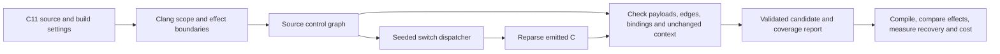

# C-SRD

C11-to-C11 experimental compiler for semantics-preserving computational
representations. Built with C++17, Clang LibTooling and Z3. Generated programs
need no C-SRD runtime library. This is software-diversification research for
benign programs, not cryptographic protection or security-product evasion.

The engineering goal is a general-purpose C-to-C obfuscator: reusable passes
that operate on real program build configurations, with explicit coverage and
correctness contracts. Broad input support and resistance to reconstruction are
separate requirements. Evaluation tasks measure the resulting tool across programs;
they do not restrict its implementation to one algorithm or benchmark. The current
release remains a prototype with the scoped transformation coverage listed below.

## Build and test

Linux requires CMake 3.20+, Clang/LLVM development libraries, Z3, Python 3,
GCC and Clang. The supported validation image supplies these dependencies:

```sh
docker build -f tools/Dockerfile -t csrd-dev:validation .
docker run --rm -v "$PWD:/work" -w /work csrd-dev:validation sh -c '
  cmake -S . -B build-linux -G Ninja -DCMAKE_PREFIX_PATH=/usr/lib/llvm-18 -DCMAKE_BUILD_TYPE=Release &&
  cmake --build build-linux --parallel 2 &&
  ctest --test-dir build-linux --output-on-failure'
```

For a native build, configure the installed LLVM/Clang and Z3 CMake/library
paths, then run `cmake --build build` and
`ctest --test-dir build --output-on-failure`. On macOS, Homebrew LLVM/Z3 and
the Xcode command-line tools are supported. GCC/Clang differential tests include
optimization and sanitizer configurations; optional external tools report skips.

## Use

```sh
build/csrd transform input.c -o output.c --seed 42
build/csrd transform input.c -o output.c --scope private-regions --seed 42
build/csrd transform input.c -o output.c --scope control-regions --seed 42
build/csrd analyze input.c --scope private-regions --report build/analysis.json
build/csrd --help
```

Version 0.14.1 adds `--target TRIPLE`, `--sysroot DIRECTORY`, repeatable
`--include-dir DIRECTORY` and repeatable `--define NAME[=VALUE]` to all commands.
An explicit target never inherits the host SDK. Transformations and their emitted
C are parsed with identical settings; reports record the flags and header hashes.
`preprocess` uses Clang to freeze one build configuration into a `.i` file, retaining
line markers. This enables analysis of expanded macros without rewriting macro
definitions. Preprocessing itself is trusted compiler behavior, not formally proved.

For example, with a MinGW Windows sysroot installed:

```sh
build/csrd preprocess input.c -o build/input.i \
  --target x86_64-w64-windows-gnu \
  --sysroot "$(x86_64-w64-mingw32-gcc -print-sysroot)" \
  --report build/preprocessing.json
build/csrd transform build/input.i -o build/output.i --scope private-regions \
  --target x86_64-w64-windows-gnu \
  --sysroot "$(x86_64-w64-mingw32-gcc -print-sysroot)" \
  --seed 42 --report build/transformation.json
```

Frozen input/output must use the recorded target and configuration; `.i` files
are not portable source packages. Version 0.15.0 adds compilation-database import,
which accepts either
a `compile_commands.json` file or its directory. Relative paths, command quoting,
response files and the working directory come from that command. Cross-compiler
names contribute their target, while explicit target flags take precedence.
Ambiguous configurations require an explicit zero-based database entry index:

```sh
build/csrd transform input.c -o build/output.c --scope private-regions \
  --compilation-database project/build --compile-command 0 --seed 42 \
  --report build/transformation.json
```

Manual target/include/macro overrides cannot be mixed with database settings.
Reports bind the database hash, original/expanded arguments and the settings used
to reparse emitted C. `compile-command` exports this metadata without parsing the
source or claiming verification. Unsupported semantic settings such as `-fwrapv`,
`-ftrapv`, pre-C11 modes and OpenMP are rejected by source analysis. Opaque
frontend extensions, plugins, PCH and modules are currently rejected. Imported
commands also reject unknown pragmas/attributes instead of silently ignoring
compiler-specific semantics, including GCC's per-function optimization settings.

`tools/transform_project.py` runs trusted GCC/Clang C compile commands, freezes
each selected translation unit with its **original compiler**, validates every
requested transformation pass, compiles the resulting objects and executes
explicit link recipes. A compilation database contains no link commands, so the
runner does not infer them ([Clang database format](https://clang.llvm.org/docs/JSONCompilationDatabase.html)).
A minimal `project.json` beside a project build is:

```json
{
  "schema_version": 1,
  "compilation_database": "build/compile_commands.json",
  "commands": [0, 1],
  "links": [{
    "name": "application",
    "directory": "build",
    "arguments": ["cc", "{object:0}", "{object:1}", "-o", "{output}"]
  }]
}
```

```sh
python3 tools/transform_project.py project.json --csrd build/csrd \
  --output build/project-experiment
```

The destination must be new. Original, frozen, identity and affine controls are
built by default. Optional `variants` entries have `name` and an ordered `passes`
array; each pass accepts the implemented `scope`, `strategy`, `seed`,
`control_flow`, `algorithm` and `call_contracts` settings. Every pass is validated
separately; unsupported configurations fail with retained reports. CPU, wall
time, peak process RSS, object/executable sizes, source/frozen hashes and pass
coverage are recorded. Successful builds are explicitly **not** labeled as
whole-program correctness or protection results.

Optional `transform_commands` selects a subset of the compiled entry indexes.
Excluded units are frozen/recompiled by their original compiler, with explicit
manifest status stating that C-SRD did not parse, transform or verify them. This
allows partial-project adoption without disguising coverage gaps. Selected units
still fail on frontend/verification errors; the runner never silently falls back.

Current project limits: one C source per direct compiler invocation, explicit
link argv, and a stable source/header/build environment during the run. Compiler
wrappers, arbitrary build scripts, archive recipes, plugins/PCH/modules and some
driver flags need further integration. Frozen GCC extensions must also be
accepted by Clang; compiler-specific declarations can still stop analysis.
No shell is invoked; these trusted build commands are not sandboxed. Compilation
and preprocessing remain trusted toolchain behavior. This broadens build
integration without adding new arithmetic, memory or control-flow passes.

`--scope functions` is the default. It admits pure `uint32_t` arithmetic,
selected bitwise operations, selections, bounded loops and lookup tables, plus
a separate ordered byte/`uint32_t` buffer and contracted-call path. `--scope private-regions` selects
private integer declarations/assignments inside richer functions. Calls, loops
and memory boundaries outside those frames remain unchanged and are reported.
Unsupported syntax is diagnosed; failed translation validation prevents output.

Version 0.16.0 adds `--scope control-regions`: seeded switch dispatchers for
eligible structured statement regions. Conditions, calls, assignments and return
expressions are copied without changing their value representation. This broadens
control-flow diversification around pointer, allocation, I/O, signed, floating
and recursive operations under the sequential contract below; it does not add
encoded arithmetic rules for those operations. Combine passes by transforming
the previous pass's output, or by listing ordered project `passes`.

The private integer model covers `_Bool` and standard signed/unsigned types
through 64 bits, with C promotions and selected casts/operators. It requires
8-bit bytes, 16-bit short, 32-bit int, 32/64-bit long and 64-bit long long;
signed semantics assume two's complement, modulo signed narrowing and arithmetic
negative right shift. Signed overflow is excluded. Execution validation currently
covers LP64 ARM64. This is not support for arbitrary C11 programs.

The buffer path admits 8-bit character types, bounded runtime indexes (0..255),
captured local pointer views and byte/word aliases. Reports state the required
initialized, live, aligned prefixes of ordinary storage. Arithmetic stays `uint32_t`; only
provably nonnegative, nonoverflowing byte promotions are admitted. Character
signedness and word byte order follow the frontend target. Signed byte narrowing
assumes modulo conversion. String literals and their storage are unchanged.
Verification compares the return and entire shared byte memory. Pointer
reinterpretation and unbounded indexing remain unsupported.

`--call-contracts tests/fixtures/calls.json` enables declared direct calls in
straight-line `uint32_t` functions. Callees may return `uint32_t` or `void` and take scalar or
bounded buffer arguments. Verification compares callees, arguments and all
pre-call memory at each event, then allows arbitrary shared memory/return values
before continuing encoded computation. Contracts assert synchronous execution,
no callbacks/reentry, retained pointers, nonlocal jumps, frame inspection or
invalidation of caller buffers. Callee implementations are not proved by their
declarations. Nested call expressions and varargs remain unsupported.

`--call-contracts tests/fixtures/guarded_calls.json` selects `opaque-guarded-v2`:
calls in branches and bounded loops, calls through explicitly contracted function-pointer
parameters, and direct self-recursion with a decreasing unsigned entry rank.
Code pointers and call interfaces stay ordinary. The verifier checks executed
target identities, arguments, pre-call memory and order, including when two
callback parameters designate the same function. No local code-pointer aliases,
mutual/indirect recursion, reentrant callbacks or mixing owned heaps with opaque
calls are admitted. Recursive contracts must cover the function's own buffer
footprint; self-calls must bind to that definition and sufficient stack storage is assumed.

Transformations use rank induction and preserve self-call events, with declared
maximum ranks through 32. For compiler-generated inlining, verification-only
`--recursion-observation bounded-body` compares returns, whole memory and external
events while excluding internal self-call events. It uses the stronger induction
proof when sufficient, otherwise checked body expansion across every entry-rank
partition, including all out-of-range inputs. This supplemental mode currently
requires a maximum rank of at most 8; it never weakens transformation validation.

`--call-contracts tests/fixtures/stdio_calls.json` selects `opaque-stdio-v3`:
caller-owned `FILE *` parameters and `fgetc`, `fputc`, `fflush`, `feof`, `ferror`
and `clearerr` in admitted branches and bounded loops. Library `int` results
require explicit conversion to `uint32_t`; `fputc` character arguments must be
proved nonnegative and representable as `int`. Handles and call interfaces stay
ordinary. Verification compares executed call order, stream identities (including
aliases), character arguments, pre-call user memory, return and final user memory.
Identical traces preserve external effects under coupled standard-library behavior.
Streams must be valid for each operation; all library-managed storage, including
`errno`, FILE internals and `setvbuf` buffers, must be disjoint from admitted user
memory. No interposition, reentry, concurrency, opening/closing, formatted/block
I/O or local handle aliases are admitted. EOF and error outcomes are included in
transformation validation.

The record/state path admits named, padding-free structs/unions with 1..16
`uint32_t` fields, bounded record-pointer views, and mutable file-scope scalar or
record objects. Public storage and initializers stay ordinary; arithmetic between
loads and stores is diversified. Proofs compare return values and persistent
state from equal incoming states. Globals denote distinct complete objects;
record pointers designate complete records, while scalar pointers may alias
fields. Aligned word-only accesses use an exact word projection of byte memory;
small index ranges are proved before enumeration. Nested/padded records, bitfields,
whole-record assignments, local statics and TLS remain outside this increment.

The control-flow path admits call-free memory branches, early returns and
`for` loops with fresh `uint32_t` counters, `++`, and immutable scalar trip limits
bounded by 32. Private locals can be declared inside these bodies. Verification
checks guarded memory effects and every loop exit; finite expansion is never
silently truncated. Break/continue and while loops are excluded; conditional
calls require the separate `opaque-guarded-v2` contract above.

The owned-heap path admits local, nonescaping `uint32_t` arrays of at most 32
elements through `malloc`, `calloc`, positive-size `realloc` and `free`. It
checks every allocation outcome, initialized reads, bounds, aliases, lifetime
and cleanup on every return. Private heap values stay encoded; caller memory
and return values remain ordinary. Zero-size `malloc`/`calloc` can succeed or
fail; zero-size `realloc`, pointer-address observations and mixing heap objects
with opaque calls are excluded. Standard C11 library behavior is assumed.
Allocator events are matched by executed order across branches.

Verification normally compares allocator events as well as returns and public
memory. Compilers can eliminate private allocations, remove `free(NULL)` or
replace `realloc(NULL, n)` with `malloc(n)`. The verification-only option
`--heap-observation successful-private` provides a separate, narrower comparison:
all allocations succeed and allocator events are excluded. It never applies to
transformation validation, and its results do not cover allocation failures.

For `n`-bit integers, affine encoding is `E(x) = a*x+b mod 2^n`, with odd `a`.
Addition, subtraction and constant scaling can remain encoded. The seed selects
reproducible parameters; it is not a secret key. Emitted C is reparsed and checked
against explicit semantic models. Solver success is proof under those models and
their assumptions, not proof of the compiler, machine code or whole environment.

## Coverage roadmap

Each increment needs implementation, negative controls, compiler checks and
matched reconstruction/runtime/size measurements. Parsing a construct or leaving
it unchanged does not count as transforming it. These are scoped increments,
not a promise of universal C support.

| # | Increment | State |
| --- | --- | --- |
| 1 | Buffer reconstruction and runtime observation | Scoped checkpoint measured |
| 2 | Private regions inside larger functions | Scoped checkpoint measured |
| 3 | Integer widths, promotions and operators | Scoped checkpoint measured |
| 4 | Byte/string buffers, runtime indexes, richer pointers | Scoped checkpoint measured |
| 5 | Direct calls and effect contracts | Scoped checkpoint measured |
| 6 | Structs/unions, globals, persistent state | Scoped checkpoint measured |
| 7 | Branches, exits, input-dependent loops | Scoped checkpoint measured; two reconstruction proof gaps |
| 8 | Allocation, failure and lifetime | Scoped checkpoint measured; four reconstruction coverage gaps |
| 9 | Recursion and indirect calls | Scoped checkpoint measured; four affine value-fitting gaps |
| 10 | File/console I/O and ordered events | Scoped checkpoint measured; transfer-loop reconstruction proofs inconclusive |
| 11 | Networking, partial transfers and failures | Pending |
| 12 | Exact floating-point behavior | Pending |
| 13 | Thread-local/shared/atomic/volatile behavior | Pending |
| 14 | Multi-file builds, preprocessing, combined coverage | Compilation-database import and multi-file runner added; broader project validation in progress |

Tests are executable contracts under `tests/`; compiler-profile catalogs and
benign programs are under `benchmarks/`. `tools/` contains verification,
differential execution, compiled-code comparison, Ghidra reconstruction and
bounded GDB value-recovery tooling. Write generated measurements to ignored
`build*/` directories. CPU/RSS, recovery correctness and application costs are
separate measurements; fingerprints and finite tests are not equivalence proofs.

The full Linux regression passed all 56 test groups. The stdio checkpoint
(0.14.0) passed 216,832 differential comparisons across
132 native and 88 Linux compiler/strategy cells, including available optimization,
LTO and sanitizer profiles. Checks cover returns, caller memory, file contents,
positions, status flags, errno and flush/close outcomes. Linux cases include real
read failures and immediate/deferred write failures. These tests do not establish
universal equivalence; transformation proofs use the explicit stream model above.

The compiled-code audit uses six functions, Clang 18/GCC 13, `-O0`/`-O2`, and
original, identical-copy, identity and affine variants: 96 binary cases. Ghidra
12.2 plus the revised adapter produced candidates for all 96; three repetitions
agreed. The original audit's eight stream-merge coverage gaps remain recorded.
Of 50 distinct reference/answer pairs, 39 passed source-model proofs and 11
transfer-loop answers remained inconclusive, including originals. This is a
solver limitation, not evidence of protection. All 50 answers passed 56,000
compiled oracle checks with both compilers; corruption controls were rejected
across 141,120 executions. No proof of binary lifting is claimed. GCC binaries
use native GCC preprocessing while source-model grading uses separately bound
Clang input; cross-preprocessor equivalence is not proved.

All 4,608 runtime traces matched independent return/memory/stream-state/call-event
oracles. The protocol uses 24 vectors, two initial EOF states and a 1,024-step cap
(maximum observed: 477). Library interiors are stepped over. This runtime corpus
covers successful I/O and EOF on Linux/glibc; recovery on failure paths and aliased
stream handles remains unmeasured. Four unexecuted target/layout cases per variant
are excluded explicitly. Affine fitting recovered 90/92 intermediate cases versus
89/92 originals, and every variant recovered all 48 public-return cases. No
informative negative control validated; 16 constant-label cases per variant have
uninformative shuffled controls and are excluded from false-positive counts.
Three fitting repetitions agreed; artifact/proof bindings and oracles were checked.

Ordinary intermediates were visible in 2,120/2,184 affine target/trace pairs versus
2,170/2,184 originals. Static reconstruction uses no target executions; fitting uses
known labels, with 12 training and 12 heldout traces per initial state. Fit replays
make no new queries. Missing fixed-location fits do not establish that values are
hidden. These experiments do not measure blind discovery or human effort, and
**no useful protection advantage was demonstrated on this corpus**.

Median matched `-O2` ratios against originals on Linux ARM64:

| Compiler | Adapter CPU | Fit CPU | Fit peak RSS | Application CPU | Function bytes |
| --- | --- | --- | --- | --- | --- |
| Clang 18 | 1.01 | 1.39 | 1.16 | 1.009 | 1.37 |
| GCC 13 | 1.01 | 1.57 | 1.25 | 1.027 | 1.70 |

Adapter CPU includes Python startup and excludes Ghidra (six matched functions).
Fit ratios use twelve function/initial-state pairs; affine fitting took median
246/298 ms including startup and trace loading. Copy-control fit CPU ratios were
1.007/0.993. Application timing uses seven repetitions of one million calls, with
real stdio and target flushes inside the clock; preparation and content checksums
are outside it. Copy-control application ratios were 1.002/1.000. Cold Ghidra CPU
ratios were 1.009/0.994, with only one collection per binary. None of the twelve
optimized affine cases retained identical function bytes or opcode sequences;
eleven identity controls retained identical bytes. Structural change did not
prevent reconstruction or value recovery.

Run the stdio checks and a reconstruction collection inside the Linux validation
environment, with Ghidra installed and `GHIDRA_HEADLESS` pointing to `analyzeHeadless`:

```sh
ctest --test-dir build --output-on-failure -R 'stdio_call|stdio_observation|pcode_memory|buffer_runtime|observer_evidence_links'
python3 tools/audit_buffer_reconstruction.py --csrd build/csrd \
  --headless "$GHIDRA_HEADLESS" --compiler clang=clang-18 --compiler gcc=gcc \
  --source tests/fixtures/stdio_calls.c --call-contracts tests/fixtures/stdio_calls.json \
  --repetitions 1 --output-dir build/stdio-matrix
```

Run collectors serially. Use the resulting `reconstruction.json` with
`tools/replay_buffer_observers.py` (three adapter repetitions), then its `replay.json`
with `tools/grade_byte_reconstruction.py --corpus stdio`. Run
`tools/observe_buffer_runtime.py --corpus stdio --step-limit 1024`, binding both
reports with `--reconstruction-report` and `--replay-report`. Use its `runtime.json`
with `tools/replay_buffer_fits.py` (three repetitions). Finally run
`tools/measure_byte_costs.py --corpus stdio` (seven repetitions, one million calls)
and `tools/inspect_region_binaries.py` against the same collection/replay.
`tools/check_buffer_evidence.py` checks these reconstruction/runtime bindings and
replays saved fits. Each tool exposes `--help`; generated reports record commands,
seeds, budgets, implementation hashes and precise observation scopes. Outputs belong
under ignored `build*/` directories, with original failed attempts retained.

The same tools accept `--corpus byte`, `call`, `record`, `control`, `heap` and
`dispatch` for earlier scoped fixtures. Heap and recursion grading have the
supplemental observation modes described above; keep strict reports unchanged.
Ghidra ARM64 signed-byte lifting requires the checked overlay produced by
`tools/patch_ghidra_signed_byte.py`. The networking increment remains pending,
including partial transfers, EOF/failures and matched correctness/recovery/cost
measurements. The four-part development path is real-project build support,
broader reusable transformation passes, safe pass composition, and evaluation on
varied programs. Scoped build integration and the structured-control prototype
below are implemented; wider build coverage and additional data/function-structure
passes remain work to do. Correctness, pass combinations and
application/reconstruction costs are evaluated at each meaningful increment,
not deferred until all four areas are finished.

## Benign AES recognition checkpoint (0.14.0)

`tools/audit_crypto_recognition.py` compares pinned tiny-AES-C AES-256 builds
with current C-SRD output and a no-crypto input/output control. It uses the seven
Windows x64 profiles and rule revisions from the
[published hidden-tiny-aes methodology](https://deadkennedyx.github.io/ST_M1CH43L/posts/hide-encryption-signatures-from-analysis-part-2.html),
with a separate runtime-input harness: GCC 16.2 `-O0/-O2/-Os/-O2 -flto` and
Apple Clang 17 `-O0/-O2/-Os`, linked with MinGW. Sources, rules, capa signatures,
tool versions, commands, hashes and raw findings are recorded. This is a fixed
recognition experiment; scanner feedback does not select transformations.

The completed run used YARA 4.5.8 and capa 9.4.0/Vivisect. Each cell counts builds
with an AES-specific match; these are crypto classifications, not malware verdicts.

| Implementation | Yara-Rules | findcrypt-yara | crypto-detection | capa/Vivisect |
| --- | --- | --- | --- | --- |
| Stock tiny-AES-C | 7/7 | 7/7 | 7/7 | 7/7 |
| C-SRD raw-source output, unchanged | 7/7 | 7/7 | 7/7 | 7/7 |
| No-crypto control | 0/7 | 0/7 | 0/7 | 0/7 |

All 84 scanner invocations completed. Both transformation scopes leave all 20
original functions unchanged; paired Windows binaries are byte-identical.
Native preprocessing permits two `KeyExpansion` regions, totaling five encoded
index-arithmetic operations, with contextual proofs under the integer model.
The AES tables and rounds remain unchanged. That partial transformation is not
included in the Windows table: the frontend has no cross-target configuration,
and its native LP64 output must not be treated as Windows LLP64 output.

Native original/pass-through/partially transformed cases passed 4,690 executions
against OpenSSL 3.6.4, comparing complete key-schedule/IV state between variants,
plus 84 upstream known-answer checks, including Clang ASan/UBSan builds. Only
the six proper upstream tests are called; its verbose demonstration uses a
16-byte key even under AES-256. These tests cover fixed 64-byte buffers and do
not prove arbitrary AES executions. Windows binaries were scanned, not executed.
No protection advantage is demonstrated, and the historical Part 1/2 variants
were not rerun. The seven compiler profiles are not independent program samples.

Reproduce on the macOS toolchain above (MinGW, GCC 16, LLVM Clang, OpenSSL and
YARA installed); `--fetch` downloads only pinned public sources/rules/signatures:

```sh
python3.12 -m venv build-aes-recognition/venv
build-aes-recognition/venv/bin/python -m pip install 'flare-capa==9.4.0'
python3 tools/audit_crypto_recognition.py --fetch \
  --output build-aes-recognition/reproduction --deps build-aes-recognition \
  --capa build-aes-recognition/venv/bin/capa \
  --mingw-sysroot "$(x86_64-w64-mingw32-gcc -print-sysroot)"
python3 tests/integration/test_crypto_recognition.py
```

The local completed artifacts are in `build-aes-recognition/run-2/`; the initial
run is retained in `run-1/`. The latter exposed missing capa library signatures
and GNU strip reinserting PE timestamps. The runner now supplies pinned signatures
and `SOURCE_DATE_EPOCH=0`, checks the PE layout, and records errors separately
from negative matches. Five automated measurement-control tests pass. Scanner
results and native transformation coverage must remain separate when extending
this experiment.

The subsequent 0.14.1 build-compatibility check in
`build-frontend-targets/checkpoint-2/` exercises the new target/preprocessing path.
It validates two Windows `KeyExpansion` regions (five index-arithmetic operations)
under the LLP64 model, and compiles original/transformed inputs in all seven
Windows profiles: 14 builds. Windows execution and new recognition measurements
are not claimed. Native preprocessing/transformation passes 2,010 executions
against the saved OpenSSL references, preserving full key-schedule/IV state, and
36 upstream known-answer checks across `-O0`, `-O2` and ASan/UBSan configurations.
Six frontend integration tests cover LP64/LLP64 differences, header/definition
settings, provenance and failure handling. All nine selected native regression
groups pass. All 58 Linux CTest groups also pass with LLVM 18; nine optional checks
were skipped there (one MinGW, six CBMC and two live Ghidra checks). The native
MinGW test ran successfully. This advances build compatibility, with AES
transformation coverage still limited to index arithmetic.

## Project integration checkpoint (0.15.0)

The full Linux regression passed **60/60 CTest groups** in 329.91 seconds, with
the same nine optional MinGW/CBMC/live-Ghidra checks skipped. Seven selected
native regression groups also passed. The final compilation-database and project
groups were rerun on both platforms after adding semantic-option guards and
explicit per-file selection: ten configuration tests and four project tests pass.

The new fixture in `benchmarks/projects/buffer_pipeline/` has three source files,
forced headers, paths containing spaces and compiler-dependent macro branches.
It uses cross-file calls, buffer iteration, allocation and file output. Five
arithmetic operations in `adjust` and `reduce_values` are transformed. These are
private-frame proofs; the surrounding loops, pointers and I/O are preserved.
The combination control runs affine followed by identity, validates both passes,
and actually transforms generated statements on its second pass. It is not a
new protection technique or evidence for arbitrary pass combinations.

The first attempts in `build-project-integration/checkpoint-1/` and
`linux-checkpoint-1/` exposed real frontend interoperability limits. GCC 16's
macOS `stddef.h` expands a `__float128` field unsupported by Clang on that target.
GCC 13's Linux `stdio.h` expands argument-bearing `malloc` attributes unsupported
by the installed Clang frontend. Both attempts fail conservatively, with commands
and diagnostics retained. The unchanged native GCC original/frozen baseline
subsequently compiled and passed eight execution checks; no transformed GCC 16
macOS result is claimed. Earlier configuration testing also caught and fixed
missing cross-target inference before accepting the command importer.

The next experiment explicitly selects files 0 and 1 for transformation and
keeps file 2, the I/O entry point, outside C-SRD analysis. This selection is
recorded in every manifest and used consistently across all controls. The
native and Linux `*-checkpoint-2/` matrices cover Apple Clang 17, Linux Clang 18
and Linux GCC 13, each with `-O0`, `-O2`, `-O3`, `-Os`, `-O2 -flto`, and
`-O1 -fsanitize=address,undefined`. Original, frozen, identity, affine,
affine-then-identity and identical-binary controls all pass. Across 18 cells:

- 32 deterministic vectors per variant produce **3,456 checked executions**.
- **108 file-open failure checks** preserve exit status and output behavior.
- **540 timed executions** also match the independent Python oracle, including
  the full output buffer, guard word, stdout and return status.
- Timing uses five randomized matched repetitions and 500,000 internal iterations
  over 64 values. Whole-process CPU/wall/RSS include startup, allocation and I/O.
  Different-input oracle controls are rejected; these are grader checks, not
  estimates of recognition false-positive rates.

Measured affine results at `-O2` (ratios to the original):

| Environment | Linked text bytes identical? | Text size | Application CPU | Copy-control CPU |
| --- | --- | --- | --- | --- |
| macOS ARM64 / Apple Clang 17 | Yes | 1.000 | 0.983 | 0.985 |
| Linux ARM64 / Clang 18 | Yes | 1.000 | 1.007 | 1.001 |
| Linux ARM64 / GCC 13 | No | 1.188 | 3.044 | 1.000 |

Clang also produces identical text for the affine and combined variants at
`-O3`, `-Os`, LTO and the sanitizer profile. At `-O0`, affine text grows about
25–31% across the three environments and application CPU rises about 3.07–4.40×.
GCC retains code differences at optimized levels; this does not establish
increased reconstruction effort. Peak process RSS medians are unchanged on this
small fixture. Ratios near one are descriptive measurements with copy-control
noise, not speedup claims. Text measurements include linked startup/instrumentation
code; sanitizer timings are not production performance estimates.

Manifests retain source/frozen hashes, compiler versions, executable snapshots,
per-pass proof/coverage reports, commands and CPU/wall/RSS collection. Compiler
preprocessing, transformation plus validation, compilation and linking are separate
command measurements; solver-only timing is not isolated. Raw-to-frozen compilation
cost differences must not be mistaken for reduced total transformation cost.
**Reconstruction and runtime-value recovery are unmeasured on this project. No
protection gain is established.** This checkpoint advances project integration
and the experiment harness; broader reusable passes and their recovery evaluation
remain the next development work.

Reproduce the Linux matrix in the validation container (use a fresh output path):

```sh
ctest --test-dir build-linux-integers --output-on-failure
python3 tools/audit_project_pipeline.py --csrd build-linux-integers/csrd \
  --compiler clang=clang-18 --compiler gcc=gcc \
  --profile O0 --profile O2 --profile O3 --profile Os --profile lto --profile sanitize \
  --transform-command 0 --transform-command 1 --objdump /usr/bin/objdump \
  --repetitions 5 --iterations 500000 --cases 24 \
  --output-dir build-project-integration/reproduction
```

This is one project, with repeated configurations and controls. Broader program
coverage, complete GCC-header interoperability and measurements of recovery
effort remain open. The four development areas are not complete.

## Structured control regions (0.16.0)

**Problem and hypothesis.** Private integer encoding leaves surrounding control
flow untouched and can disappear during optimization. A reusable control-flow
pass may retain more compiled structure across broader functions. Whether that
increases reconstruction or runtime-value recovery effort is an experimental
question, separate from correctness and code-size growth.

The prototype implements the classic switch-dispatch form described in
[Tigress's published flattening design](https://tigress.wtf/flatten.html).
It does not import Tigress code or claim a new obfuscation technique. C-SRD's
engineering contribution here is a conservative Clang region selector, checking
the actual emitted dispatch graph, and measuring individual and composed passes.
No protection advantage follows merely from implementing this known design.



The implementation in `src/analysis/control_regions.cpp` lowers eligible
expression statements, `if`, `while`, `do`, expression-initialized `for`, returns,
breaks and continues into a graph. It does not impose a runtime iteration bound.
Declarations stay in their original blocks; declaration-containing scopes,
switches and compound literals form boundaries. Nested eligible blocks can still
be transformed. In particular, a `for` declaration is not hoisted to a different
scope, and a compound literal is not relocated into a short-lived case block.

`src/codegen/control_emitter.cpp` assigns unique nonreserved state numbers and
shuffles cases deterministically from the seed, function name and source offset.
Each state evaluates its original expression once, then transfers to the state
specified by the source graph. The pass preserves external break/continue
targets, early returns and physical line counts, and avoids generated identifier
collisions. A constant `while (1)` dispatcher preserves the intended infinite-loop
model; replacing it with a variable condition can introduce C's termination
assumption ([WG14 discussion of C11 6.8.5](https://open-std.org/JTC1/SC22/WG14/issues/c11c17/issue0436.html)).
Inputs must still satisfy the original program's C11 progress requirements;
nonterminating executions of loops subject to that assumption are not a new
guarantee supplied by this pass.

`src/verification/control.cpp` checks the **reparsed candidate AST**, including
its initial state, case uniqueness, every edge and branch direction, exact
payload text/locations, private controller object, exit handling and declaration
bindings. Restoring the original fragments must reproduce the entire original
source hash. Header hashes, target and frontend arguments must also match.
The checker rejects altered effects/returns/conditions/edges and accepts harmless
syntax variation such as `while(01)`; it is not just a comparison with an emitter
template. Source-CFG construction and the Clang frontend remain trusted.

The reported status is **`proved-under-model`**, with model
`opaque-effects-control-graph-c11-v1`. This is graph/trace correspondence under
explicit assumptions, not a whole-C11, compiler, machine-code or protection
proof. Original expressions are opaque effects whose internal safety is assumed.
The argument pairs source graph steps with finite dispatcher bookkeeping and
preserves paths, effect order and graph divergence. Differential execution tests
provide additional finite evidence for the tested compiler configurations.

The model requires defined sequential execution and ordinary call/return behavior.
External calls must behave consistently for corresponding logical objects and
inputs. Numeric addresses, stack/frame inspection, timing, resource exhaustion,
signals, nonlocal jumps and concurrent observations are outside that contract.
Explicit pointer-to-integer casts, thread-local references, volatile/atomic access,
goto/labels, assembly, statement expressions, function/local attributes and
recognized nonlocal-jump/compiler builtins reject the whole function. Raw macro
expansions remain excluded; use a recorded frozen configuration when appropriate.
Opaque callees and callbacks are assumptions, not exhaustively inspected for
hidden stack inspection or nonlocal control. Floating expressions are preserved;
their representation is not encoded or newly proved. Debuggers used by evaluation
remain able to inspect execution; this pass supplies no anti-debug mechanism.

**Prototype findings.** The first emitter caused missing-return and switch
fallthrough warnings because its structure obscured mandatory exits. Reachable
exit analysis now emits unconditional outer exits where justified and omits
unreachable normal-exit guards. It does not invent a return value. GCC still
reports some `maybe-uninitialized` diagnostics for validated dispatcher paths.
The differential/audit harness keeps those warnings visible but makes that one
warning nonfatal; the transformer itself never changes a user's warning policy
or initializes their locals to silence it. Builds using stricter warning policies
can therefore fail even when the tested executions agree.

Tests cover 12,000 integer/memory/callback/allocation comparisons, 40 floating-bit
comparisons and 83 stream cases per main driver execution, including failures,
plus line preservation. An additional 18 nested loop/switch shapes exercise
break/continue destinations with 512 inputs each. Identity, affine, control,
affine-then-control and control-then-affine are compared with original and
identical-binary controls in the observer harness. Every actual transformation
pass has its own validation report; successful composition does not establish
that other pass combinations are correct.

**Validation checkpoint.** The full Linux run passed 61 of 62 CTest groups in
361.01 seconds. Its sole failure was a unit fixture lacking a final newline,
which Clang 18 rejects under `-pedantic-errors`. After fixing that fixture, the
four affected control/observer/project groups passed in 7.39 seconds. Six selected
native groups also passed, including GCC 16, Apple Clang 17 and LLVM Clang 23
execution cells where applicable. The final observer-report regression was run
on both platforms. Optional external-tool checks remain subject to their reported
skips; this is not a claim that every optional verifier ran.

The Linux ARM64 experiment uses three small arithmetic/callback source fixtures,
two functions each, GCC 13/Clang 18 and five build profiles: `-O0`, `-O2`, `-O3`,
`-Os`, and `-O2 -flto`. Seven variants, including controls, produce **210 built
artifacts** and **107,520 checked effect observations** (256 deterministic vectors
per function/artifact). Repeated configurations and controls are not independent
programs. All observations match the independent return, complete buffer and
ordered callback oracle. All three control recipes differ from original library
text in these 30 compiler/profile/fixture cells; text difference alone does not
establish a protection benefit.

The initial static recovery run is a separate `-O2` pilot: one fresh Ghidra 12.2 process per
function/artifact, known symbols and ABI, followed by the existing source-blind
P-code adapter. **79/84 candidates pass 80,896 heldout effect comparisons** under
both compilers. Five candidates remain unsupported because the adapter rejects
unresolved non-parameter inputs in Ghidra's export. Those are coverage gaps, not
wrong recovered functions or protection successes. Of 27 corruption controls,
25 produce mismatches and two flipped-branch controls exceed the harness's event
capacity (exit 70). No whole-function or binary-lifting proof is claimed.

Runtime recovery is measured on the assignments fixture at `-O2`: **504 traces**,
all effect-checked, with six training and six heldout queries per function/loop
case. Both compilers, zero/two loop iterations and all seven variants are included.
The observer knows the requested intermediate values during training; this is
supervised affine recovery, not blind discovery. Every variant recovers **26/26
target cases**, including from locations inside the target function. No false
heldout models or validated shuffled-label controls were observed. Query counts
are fixed by this protocol; the minimum queries needed for recovery is unmeasured.

Ratios below are against matched original binaries. Static CPU medians cover
12 function/compiler/fixture tasks; dynamic CPU/step medians cover six observed
function/compiler/loop cases. Application CPU ranges cover six `-O2` fixture/compiler
cells, each using five randomized matched repetitions of one million iterations.

| Recipe | Static candidates graded successfully | Ghidra process CPU | Debugger + fit CPU | Traced steps | Application CPU range | Library text range |
| --- | --- | --- | --- | --- | --- | --- |
| Control | 10/12 | 0.985× | 1.208× | 3.404× | 1.089–2.189× | 1.215–2.829× |
| Affine → control | 11/12 | 1.015× | 1.104× | 1.788× | 1.019–2.093× | 1.764–2.655× |
| Control → affine | 10/12 | 1.016× | 1.298× | 4.424× | 1.188–2.278× | 2.267–3.226× |
| Identical binary copy | 12/12 | 0.991× | 0.997× | 1.000× | 0.937–1.021× | 1.000× |

Ghidra CPU includes JVM startup, analysis and export. The separate decompiler
request wall time is retained but noisy (copy-control ratios span 0.33–1.60).
One control→affine task has 1.30× process CPU, but the median is near the copy
control; this single-run pilot establishes no general static-recovery cost increase.
Runtime observation does cost more for these dispatcher variants, largely through
more traced instructions. All named values remain recoverable, and application
cost also rises. These are costs for the specified automated observers, not human
reverse-engineering time or a confidentiality guarantee. No general useful
protection advantage is established.

The application cost run completes **1,050 timed executions** with matching
checksums. An initial memory reading was dominated by the launcher's process
high-water mark. The revised harness retains `getrusage` and also records Linux
[`VmHWM`](https://docs.kernel.org/filesystems/proc.html) after the timed region.
A separate launcher touches 64 MiB and then executes the same benchmark: the
reported `getrusage` peak rises to 72 MiB while `VmHWM` stays at 1,302,528 bytes
and the checksum stays equal. This validates the distinction between the counters.
The revised `-O2` executable peaks are about 1.23–1.25 MiB, including the loader
and harness. Kernel RSS accounting is approximate and page-granular; these numbers
do not isolate the pass's incremental stack or heap use. Dynamic-observer peak
process RSS median ratios are 1.010×, 1.003× and 1.011× for the three recipes;
individual control→affine cases reach 1.715×.

The separate three-file project matrix covers both Linux compilers at `-O0`,
`-O2`, `-O3`, `-Os`, LTO and ASan/UBSan. Files 0/1 are transformed and the I/O
entry point remains explicitly excluded, as in 0.15.0. Across its nine variants
and 12 cells, **3,456 functional checks, 108 open-failure checks and 540 timed
executions pass**. At `-O2`:

| Compiler / recipe | Text identical to original? | Linked text | Application CPU |
| --- | --- | --- | --- |
| Clang / control | No | 1.045× | 1.981× |
| Clang / affine → control | No | 1.050× | 2.078× |
| Clang / control → affine | No | 1.045× | 1.940× |
| GCC / control | **Yes** | 1.000× | 1.002× |
| GCC / affine → control | No | 1.188× | 3.103× |
| GCC / control → affine | No | 1.318× | 5.784× |

The GCC result is a direct counterexample to assuming this pass always survives
optimization. Other differences do not establish recovery resistance. Recovery
effort on this complete project, allocator/I/O/floating fixtures, other target
architectures and human analysts remains unmeasured. This checkpoint expands
reusable control transformations and validates two compositions; it does not
close every coverage or protection gap in the four-part development path.

Artifacts are retained under `build-control-regions/`: `checkpoint-1/` contains
the frozen builds and per-pass certificates; `reconstruction-1/` and `runtime-1/`
contain observer results; `costs-1/` preserves the initial memory-counter prototype
and its script snapshot; `costs-2/` contains revised application measurements;
`project-1/` contains the project matrix; `summary-1.json` binds the matched reports.
The summarizer distinguishes built profiles from observed profiles, missing
measurements from zero cost, and collector time budgets from actual durations.

Reproduce inside the Linux validation/observer environment with Ghidra mounted
at `/opt/ghidra` and debugger permissions enabled. Use new output directories:

```sh
python3 tools/audit_region_observers.py prepare --csrd build-linux-integers/csrd \
  --compiler clang-18 --compiler gcc --profile O0 --profile O2 --profile O3 \
  --profile Os --profile O2-lto --variant identity --variant affine-42 \
  --variant control-42 --variant affine-control-42 --variant control-affine-42 \
  --grade-cases 256 --output build-control-reproduction/builds
python3 tools/audit_region_observers.py reconstruct \
  --build build-control-reproduction/builds/build.json --profile O2 \
  --ghidra /opt/ghidra/support/analyzeHeadless --repetitions 1 --grade-cases 512 \
  --output build-control-reproduction/reconstruction
python3 tools/observe_region_runtime.py \
  --build build-control-reproduction/builds/build.json --profile O2 \
  --fixture assignments --step-limit 6000 --output build-control-reproduction/runtime
python3 tools/measure_region_costs.py \
  --build build-control-reproduction/builds/build.json --iterations 1000000 \
  --repetitions 5 --output build-control-reproduction/costs
python3 tools/summarize_region_observers.py \
  --build build-control-reproduction/builds/build.json \
  --reconstruction build-control-reproduction/reconstruction/reconstruction.json \
  --runtime build-control-reproduction/runtime/runtime.json \
  --costs build-control-reproduction/costs/costs.json \
  --output build-control-reproduction/summary.json
python3 tools/audit_project_pipeline.py --csrd build-linux-integers/csrd \
  --compiler clang=clang-18 --compiler gcc=gcc --control-regions \
  --profile O0 --profile O2 --profile O3 --profile Os --profile lto --profile sanitize \
  --transform-command 0 --transform-command 1 --objdump /usr/bin/objdump \
  --repetitions 5 --iterations 500000 --cases 24 \
  --output-dir build-control-reproduction/project
```

The guarded replay below addresses the five observer coverage gaps on additional
finite inputs. Extending recovery tasks beyond this small callback corpus and
measuring repeated/persistent decompilation remain next steps before claiming a
static cost increase. Further pass families and broader build support remain
active work; each requires its own contracts and combination tests.

## Guarded reconstruction checkpoint

**Observation and hypothesis.** All five unsupported exports in the first control
experiment contain a non-parameter entry register. Such a register can be carried
through a merge and overwritten before it affects observable behavior. Rejecting
the entire export can therefore hide a limitation in our observer. The testable
hypothesis is that explicit availability tracking can reconstruct the tested
executions without assuming any initial register value.

`tools/pcode_regions.py` now pairs affected scalar values with availability flags.
A missing register has an unavailable flag; the generated zero is only a storage
placeholder. Pure operations propagate availability. A merge selects both value
and flag from the incoming edge, following Ghidra's
[MULTIEQUAL semantics](https://ghidra.re/ghidra_docs/languages/html/additionalpcode.html).
All merge inputs are captured before any merge output is assigned, including on
self-loops. Before an unavailable value can choose a branch, become a call argument,
be stored or be returned, the candidate stops with exit 73. Unknown memory
addresses and indirect targets remain unsupported. This is **partial reconstruction**:
neither the flags nor successful grading prove that the failure guards are
unreachable for every input. A guarded exit is reported as `unresolved-input-used`,
never as equivalence or a protection success.

**Experimental design.** `tools/replay_region_reconstruction.py` reuses the exact
84 frozen exports, with build, binary, export, observer and grader hashes. It runs
three randomized, serial adapter repetitions per task, then grades each result
on 2,048 deterministic inputs using separate seeds per repetition. The original
binary is checked against the independent effects oracle before candidate grading.
Candidates are compiled with GCC 13/Clang 18 at `-O2`, plus Clang at `-O1` with
AddressSanitizer and UndefinedBehaviorSanitizer. Grading is outside the timed
adapter phase and checks return values, all three buffer words and ordered events.
No Ghidra process is rerun; copied export timings are excluded from the new summary.

**Results.** The initial five-case prototype passed 20,480 comparisons under the
two compilers. The full replay subsequently produced **252/252 tested-equivalent
observations and 1,548,288 passing candidate comparisons**, including sanitizer
executions. All five formerly unsupported cases pass in each repetition. These
are 84 tasks repeated three times, not 252 independent programs or exhaustive
input coverage. Of 27 rerun corruption controls, 25 mismatch and two flipped
branches exceed the event-capacity limit with exit 70. Unknown-value regressions
separately require exit 73 at observable uses, test simultaneous availability swaps,
and reject missing definitions, non-register inputs and indirect targets.

Median adapter CPU ratios are **1.001×** for control, **1.006×** for affine→control,
and **1.033×** for control→affine; the identical-binary control is **1.011×**.
Each ratio aggregates the three matched repetitions per task, then the 12 tasks
per variant. Median absolute adapter CPU is about 21 ms, including Python startup.
Peak process RSS median ratios are 1.000×, 1.004× and 1.009×; the copy control is
1.000×. This small, startup-inclusive replay establishes no useful general
reconstruction cost increase. It improves the observer and removes the five
earlier unsupported outcomes as apparent evidence of resistance on these inputs.
The earlier Ghidra, runtime-recovery and application-cost observations remain
separate historical measurements; they were not repeated or improved by this change.

The final observer regression suite passes **14 tests on each platform**: native
macOS in 5.126 seconds and Linux in 0.530 seconds. These checks also confirm that
replayed exports retain hash validation while contributing no new decompilation
samples. The compiler implementation is unchanged; its full CTest suite was not
rerun for this observer-only increment. Human effort, other observers, general
input equivalence and broader program coverage remain unmeasured here.

Raw artifacts are in `build-control-regions/guarded-prototype/`,
`guarded-replay-1/` and `guarded-summary-1.json`. The frozen regression export is
`tests/fixtures/pcode_region_guarded_input.json`. Reproduce after the earlier
build/reconstruction collection, inside the Linux environment, using fresh paths:

```sh
python3 tests/integration/test_region_observers.py
python3 tools/replay_region_reconstruction.py \
  --reconstruction build-control-reproduction/reconstruction/reconstruction.json \
  --repetitions 3 --grade-cases 2048 --sanitizers \
  --output build-control-reproduction/guarded-replay
python3 tools/summarize_region_observers.py \
  --build build-control-reproduction/builds/build.json \
  --reconstruction build-control-reproduction/guarded-replay/reconstruction.json \
  --runtime build-control-reproduction/runtime/runtime.json \
  --costs build-control-reproduction/costs/costs.json \
  --output build-control-reproduction/guarded-summary.json
```
