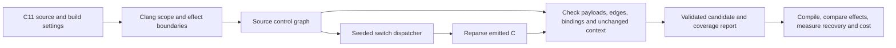

# C-SRD

C11-to-C11 experimental compiler for semantics-preserving computational
representations. Built with C++17, Clang LibTooling and Z3. Generated programs
need no C-SRD runtime library. This is software-diversification research for
benign programs, not cryptographic protection or security-product evasion.

The engineering goal is a general-purpose C-to-C obfuscator: reusable passes
that operate on real program build configurations, with explicit coverage and
correctness contracts. Broad input support and resistance to reconstruction are
separate requirements. Evaluation tasks measure the resulting tool across programs;
they do not restrict its implementation to one algorithm or benchmark. The current
release remains a prototype with the scoped transformation coverage listed below.

## Build and test

Linux requires CMake 3.20+, Clang/LLVM development libraries, Z3, Python 3,
GCC and Clang. The supported validation image supplies these dependencies:

```sh
docker build -f tools/Dockerfile -t csrd-dev:validation .
docker run --rm -v "$PWD:/work" -w /work csrd-dev:validation sh -c '
  cmake -S . -B build-linux -G Ninja -DCMAKE_PREFIX_PATH=/usr/lib/llvm-18 -DCMAKE_BUILD_TYPE=Release &&
  cmake --build build-linux --parallel 2 &&
  ctest --test-dir build-linux --output-on-failure'
```

For a native build, configure the installed LLVM/Clang and Z3 CMake/library
paths, then run `cmake --build build` and
`ctest --test-dir build --output-on-failure`. On macOS, Homebrew LLVM/Z3 and
the Xcode command-line tools are supported. GCC/Clang differential tests include
optimization and sanitizer configurations; optional external tools report skips.

For GCC-preprocessed system headers that Clang 18 rejects, the separate
`tools/Dockerfile.llvm23` environment is also tested. It preserves the expanded
headers rather than removing compiler attributes. Build commands, exact local
results and the remaining coverage limits are recorded in the
[compatibility investigation](#composition-and-build-compatibility-investigation--2026-11-13).

## Use

```sh
build/csrd transform input.c -o output.c --seed 42
build/csrd transform input.c -o output.c --scope private-regions --seed 42
build/csrd transform input.c -o output.c --scope control-regions --seed 42
build/csrd transform input.c -o output.c --scope outline-regions --seed 42
build/csrd analyze input.c --scope private-regions --report build/analysis.json
build/csrd --help
```

Version 0.14.1 adds `--target TRIPLE`, `--sysroot DIRECTORY`, repeatable
`--include-dir DIRECTORY` and repeatable `--define NAME[=VALUE]` to all commands.
An explicit target never inherits the host SDK. Transformations and their emitted
C are parsed with identical settings; reports record the flags and header hashes.
`preprocess` uses Clang to freeze one build configuration into a `.i` file, retaining
line markers. This enables analysis of expanded macros without rewriting macro
definitions. Preprocessing itself is trusted compiler behavior, not formally proved.

For example, with a MinGW Windows sysroot installed:

```sh
build/csrd preprocess input.c -o build/input.i \
  --target x86_64-w64-windows-gnu \
  --sysroot "$(x86_64-w64-mingw32-gcc -print-sysroot)" \
  --report build/preprocessing.json
build/csrd transform build/input.i -o build/output.i --scope private-regions \
  --target x86_64-w64-windows-gnu \
  --sysroot "$(x86_64-w64-mingw32-gcc -print-sysroot)" \
  --seed 42 --report build/transformation.json
```

Frozen input/output must use the recorded target and configuration; `.i` files
are not portable source packages. Version 0.15.0 adds compilation-database import,
which accepts either
a `compile_commands.json` file or its directory. Relative paths, command quoting,
response files and the working directory come from that command. Cross-compiler
names contribute their target, while explicit target flags take precedence.
Ambiguous configurations require an explicit zero-based database entry index:

```sh
build/csrd transform input.c -o build/output.c --scope private-regions \
  --compilation-database project/build --compile-command 0 --seed 42 \
  --report build/transformation.json
```

Manual target/include/macro overrides cannot be mixed with database settings.
Reports bind the database hash, original/expanded arguments and the settings used
to reparse emitted C. `compile-command` exports this metadata without parsing the
source or claiming verification. Unsupported semantic settings such as `-fwrapv`,
`-ftrapv`, pre-C11 modes and OpenMP are rejected by source analysis. Opaque
frontend extensions, plugins, PCH and modules are currently rejected. Imported
commands also reject unknown pragmas/attributes instead of silently ignoring
compiler-specific semantics, including GCC's per-function optimization settings.

`tools/transform_project.py` runs trusted GCC/Clang C compile commands, freezes
each selected translation unit with its **original compiler**, validates every
requested transformation pass, compiles the resulting objects and executes
explicit link recipes. A compilation database contains no link commands, so the
runner does not infer them ([Clang database format](https://clang.llvm.org/docs/JSONCompilationDatabase.html)).
A minimal `project.json` beside a project build is:

```json
{
  "schema_version": 1,
  "compilation_database": "build/compile_commands.json",
  "commands": [0, 1],
  "links": [{
    "name": "application",
    "directory": "build",
    "arguments": ["cc", "{object:0}", "{object:1}", "-o", "{output}"]
  }]
}
```

```sh
python3 tools/transform_project.py project.json --csrd build/csrd \
  --output build/project-experiment
```

The destination must be new. Original, frozen, identity and affine controls are
built by default. Optional `variants` entries have `name` and an ordered `passes`
array; each pass accepts the implemented `scope`, `strategy`, `seed`,
`control_flow`, `algorithm` and `call_contracts` settings. Every pass is validated
separately; unsupported configurations fail with retained reports. CPU, wall
time, peak process RSS, object/executable sizes, source/frozen hashes and pass
coverage are recorded. Successful builds are explicitly **not** labeled as
whole-program correctness or protection results.

Optional `transform_commands` selects a subset of the compiled entry indexes.
Excluded units are frozen/recompiled by their original compiler, with explicit
manifest status stating that C-SRD did not parse, transform or verify them. This
allows partial-project adoption without disguising coverage gaps. Selected units
still fail on frontend/verification errors; the runner never silently falls back.

Current project limits: one C source per direct compiler invocation, explicit
link argv, and a stable source/header/build environment during the run. Compiler
wrappers, arbitrary build scripts, archive recipes, plugins/PCH/modules and some
driver flags need further integration. Frozen GCC extensions must also be
accepted by Clang; compiler-specific declarations can still stop analysis.
No shell is invoked; these trusted build commands are not sandboxed. Compilation
and preprocessing remain trusted toolchain behavior. This broadens build
integration without adding new arithmetic, memory or control-flow passes.

`--scope functions` is the default. It admits pure `uint32_t` arithmetic,
selected bitwise operations, selections, bounded loops and lookup tables, plus
a separate ordered byte/`uint32_t` buffer and contracted-call path. `--scope private-regions` selects
private integer declarations/assignments inside richer functions. Calls, loops
and memory boundaries outside those frames remain unchanged and are reported.
Unsupported syntax is diagnosed; failed translation validation prevents output.

Version 0.16.0 adds `--scope control-regions`: seeded switch dispatchers for
eligible structured statement regions. Conditions, calls, assignments and return
expressions are copied without changing their value representation. This broadens
control-flow diversification around pointer, allocation, I/O, signed, floating
and recursive operations under the sequential contract below; it does not add
encoded arithmetic rules for those operations. Combine passes by transforming
the previous pass's output, or by listing ordered project `passes`.

Version 0.17.0 adds `--scope outline-regions`: eligible pure integer expressions
become ordinary static helpers with seeded scalar-parameter order. Translation
validation checks the typed expression, capture bindings and helper arguments.
This includes more integer operators than the affine representation supports;
moving an expression does not create a new encoded arithmetic rule. The compiled
pilot and recovery measurements below explicitly check whether the helpers survive
optimization and change reconstruction costs.

The private integer model covers `_Bool` and standard signed/unsigned types
through 64 bits, with C promotions and selected casts/operators. It requires
8-bit bytes, 16-bit short, 32-bit int, 32/64-bit long and 64-bit long long;
signed semantics assume two's complement, modulo signed narrowing and arithmetic
negative right shift. Signed overflow is excluded. Execution validation currently
covers LP64 ARM64. This is not support for arbitrary C11 programs.

The buffer path admits 8-bit character types, bounded runtime indexes (0..255),
captured local pointer views and byte/word aliases. Reports state the required
initialized, live, aligned prefixes of ordinary storage. Arithmetic stays `uint32_t`; only
provably nonnegative, nonoverflowing byte promotions are admitted. Character
signedness and word byte order follow the frontend target. Signed byte narrowing
assumes modulo conversion. String literals and their storage are unchanged.
Verification compares the return and entire shared byte memory. Pointer
reinterpretation and unbounded indexing remain unsupported.

`--call-contracts tests/fixtures/calls.json` enables declared direct calls in
straight-line `uint32_t` functions. Callees may return `uint32_t` or `void` and take scalar or
bounded buffer arguments. Verification compares callees, arguments and all
pre-call memory at each event, then allows arbitrary shared memory/return values
before continuing encoded computation. Contracts assert synchronous execution,
no callbacks/reentry, retained pointers, nonlocal jumps, frame inspection or
invalidation of caller buffers. Callee implementations are not proved by their
declarations. Nested call expressions and varargs remain unsupported.

`--call-contracts tests/fixtures/guarded_calls.json` selects `opaque-guarded-v2`:
calls in branches and bounded loops, calls through explicitly contracted function-pointer
parameters, and direct self-recursion with a decreasing unsigned entry rank.
Code pointers and call interfaces stay ordinary. The verifier checks executed
target identities, arguments, pre-call memory and order, including when two
callback parameters designate the same function. No local code-pointer aliases,
mutual/indirect recursion, reentrant callbacks or mixing owned heaps with opaque
calls are admitted. Recursive contracts must cover the function's own buffer
footprint; self-calls must bind to that definition and sufficient stack storage is assumed.

Transformations use rank induction and preserve self-call events, with declared
maximum ranks through 32. For compiler-generated inlining, verification-only
`--recursion-observation bounded-body` compares returns, whole memory and external
events while excluding internal self-call events. It uses the stronger induction
proof when sufficient, otherwise checked body expansion across every entry-rank
partition, including all out-of-range inputs. This supplemental mode currently
requires a maximum rank of at most 8; it never weakens transformation validation.

`--call-contracts tests/fixtures/stdio_calls.json` selects `opaque-stdio-v3`:
caller-owned `FILE *` parameters and `fgetc`, `fputc`, `fflush`, `feof`, `ferror`
and `clearerr` in admitted branches and bounded loops. Library `int` results
require explicit conversion to `uint32_t`; `fputc` character arguments must be
proved nonnegative and representable as `int`. Handles and call interfaces stay
ordinary. Verification compares executed call order, stream identities (including
aliases), character arguments, pre-call user memory, return and final user memory.
Identical traces preserve external effects under coupled standard-library behavior.
Streams must be valid for each operation; all library-managed storage, including
`errno`, FILE internals and `setvbuf` buffers, must be disjoint from admitted user
memory. No interposition, reentry, concurrency, opening/closing, formatted/block
I/O or local handle aliases are admitted. EOF and error outcomes are included in
transformation validation.

The record/state path admits named, padding-free structs/unions with 1..16
`uint32_t` fields, bounded record-pointer views, and mutable file-scope scalar or
record objects. Public storage and initializers stay ordinary; arithmetic between
loads and stores is diversified. Proofs compare return values and persistent
state from equal incoming states. Globals denote distinct complete objects;
record pointers designate complete records, while scalar pointers may alias
fields. Aligned word-only accesses use an exact word projection of byte memory;
small index ranges are proved before enumeration. Nested/padded records, bitfields,
whole-record assignments, local statics and TLS remain outside this increment.

The control-flow path admits call-free memory branches, early returns and
`for` loops with fresh `uint32_t` counters, `++`, and immutable scalar trip limits
bounded by 32. Private locals can be declared inside these bodies. Verification
checks guarded memory effects and every loop exit; finite expansion is never
silently truncated. Break/continue and while loops are excluded; conditional
calls require the separate `opaque-guarded-v2` contract above.

The owned-heap path admits local, nonescaping `uint32_t` arrays of at most 32
elements through `malloc`, `calloc`, positive-size `realloc` and `free`. It
checks every allocation outcome, initialized reads, bounds, aliases, lifetime
and cleanup on every return. Private heap values stay encoded; caller memory
and return values remain ordinary. Zero-size `malloc`/`calloc` can succeed or
fail; zero-size `realloc`, pointer-address observations and mixing heap objects
with opaque calls are excluded. Standard C11 library behavior is assumed.
Allocator events are matched by executed order across branches.

Verification normally compares allocator events as well as returns and public
memory. Compilers can eliminate private allocations, remove `free(NULL)` or
replace `realloc(NULL, n)` with `malloc(n)`. The verification-only option
`--heap-observation successful-private` provides a separate, narrower comparison:
all allocations succeed and allocator events are excluded. It never applies to
transformation validation, and its results do not cover allocation failures.

For `n`-bit integers, affine encoding is `E(x) = a*x+b mod 2^n`, with odd `a`.
Addition, subtraction and constant scaling can remain encoded. The seed selects
reproducible parameters; it is not a secret key. Emitted C is reparsed and checked
against explicit semantic models. Solver success is proof under those models and
their assumptions, not proof of the compiler, machine code or whole environment.

## Coverage roadmap

Each increment needs implementation, negative controls, compiler checks and
matched reconstruction/runtime/size measurements. Parsing a construct or leaving
it unchanged does not count as transforming it. These are scoped increments,
not a promise of universal C support.

| # | Increment | State |
| --- | --- | --- |
| 1 | Buffer reconstruction and runtime observation | Scoped checkpoint measured |
| 2 | Private regions inside larger functions | Scoped checkpoint measured |
| 3 | Integer widths, promotions and operators | Scoped checkpoint measured |
| 4 | Byte/string buffers, runtime indexes, richer pointers | Scoped checkpoint measured |
| 5 | Direct calls and effect contracts | Scoped checkpoint measured |
| 6 | Structs/unions, globals, persistent state | Scoped checkpoint measured |
| 7 | Branches, exits, input-dependent loops | Scoped checkpoint measured; two reconstruction proof gaps |
| 8 | Allocation, failure and lifetime | Scoped checkpoint measured; four reconstruction coverage gaps |
| 9 | Recursion and indirect calls | Scoped checkpoint measured; four affine value-fitting gaps |
| 10 | File/console I/O and ordered events | Scoped checkpoint measured; transfer-loop reconstruction proofs inconclusive |
| 11 | Networking, partial transfers and failures | Pending |
| 12 | Exact floating-point behavior | Pending |
| 13 | Thread-local/shared/atomic/volatile behavior | Pending |
| 14 | Multi-file builds, preprocessing, combined coverage | Compilation-database import and multi-file runner added; broader project validation in progress |

Tests are executable contracts under `tests/`; compiler-profile catalogs and
benign programs are under `benchmarks/`. `tools/` contains verification,
differential execution, compiled-code comparison, Ghidra reconstruction and
bounded GDB value-recovery tooling. Write generated measurements to ignored
`build*/` directories. CPU/RSS, recovery correctness and application costs are
separate measurements; fingerprints and finite tests are not equivalence proofs.

The full Linux regression passed all 56 test groups. The stdio checkpoint
(0.14.0) passed 216,832 differential comparisons across
132 native and 88 Linux compiler/strategy cells, including available optimization,
LTO and sanitizer profiles. Checks cover returns, caller memory, file contents,
positions, status flags, errno and flush/close outcomes. Linux cases include real
read failures and immediate/deferred write failures. These tests do not establish
universal equivalence; transformation proofs use the explicit stream model above.

The compiled-code audit uses six functions, Clang 18/GCC 13, `-O0`/`-O2`, and
original, identical-copy, identity and affine variants: 96 binary cases. Ghidra
12.2 plus the revised adapter produced candidates for all 96; three repetitions
agreed. The original audit's eight stream-merge coverage gaps remain recorded.
Of 50 distinct reference/answer pairs, 39 passed source-model proofs and 11
transfer-loop answers remained inconclusive, including originals. This is a
solver limitation, not evidence of protection. All 50 answers passed 56,000
compiled oracle checks with both compilers; corruption controls were rejected
across 141,120 executions. No proof of binary lifting is claimed. GCC binaries
use native GCC preprocessing while source-model grading uses separately bound
Clang input; cross-preprocessor equivalence is not proved.

All 4,608 runtime traces matched independent return/memory/stream-state/call-event
oracles. The protocol uses 24 vectors, two initial EOF states and a 1,024-step cap
(maximum observed: 477). Library interiors are stepped over. This runtime corpus
covers successful I/O and EOF on Linux/glibc; recovery on failure paths and aliased
stream handles remains unmeasured. Four unexecuted target/layout cases per variant
are excluded explicitly. Affine fitting recovered 90/92 intermediate cases versus
89/92 originals, and every variant recovered all 48 public-return cases. No
informative negative control validated; 16 constant-label cases per variant have
uninformative shuffled controls and are excluded from false-positive counts.
Three fitting repetitions agreed; artifact/proof bindings and oracles were checked.

Ordinary intermediates were visible in 2,120/2,184 affine target/trace pairs versus
2,170/2,184 originals. Static reconstruction uses no target executions; fitting uses
known labels, with 12 training and 12 heldout traces per initial state. Fit replays
make no new queries. Missing fixed-location fits do not establish that values are
hidden. These experiments do not measure blind discovery or human effort, and
**no useful protection advantage was demonstrated on this corpus**.

Median matched `-O2` ratios against originals on Linux ARM64:

| Compiler | Adapter CPU | Fit CPU | Fit peak RSS | Application CPU | Function bytes |
| --- | --- | --- | --- | --- | --- |
| Clang 18 | 1.01 | 1.39 | 1.16 | 1.009 | 1.37 |
| GCC 13 | 1.01 | 1.57 | 1.25 | 1.027 | 1.70 |

Adapter CPU includes Python startup and excludes Ghidra (six matched functions).
Fit ratios use twelve function/initial-state pairs; affine fitting took median
246/298 ms including startup and trace loading. Copy-control fit CPU ratios were
1.007/0.993. Application timing uses seven repetitions of one million calls, with
real stdio and target flushes inside the clock; preparation and content checksums
are outside it. Copy-control application ratios were 1.002/1.000. Cold Ghidra CPU
ratios were 1.009/0.994, with only one collection per binary. None of the twelve
optimized affine cases retained identical function bytes or opcode sequences;
eleven identity controls retained identical bytes. Structural change did not
prevent reconstruction or value recovery.

Run the stdio checks and a reconstruction collection inside the Linux validation
environment, with Ghidra installed and `GHIDRA_HEADLESS` pointing to `analyzeHeadless`:

```sh
ctest --test-dir build --output-on-failure -R 'stdio_call|stdio_observation|pcode_memory|buffer_runtime|observer_evidence_links'
python3 tools/audit_buffer_reconstruction.py --csrd build/csrd \
  --headless "$GHIDRA_HEADLESS" --compiler clang=clang-18 --compiler gcc=gcc \
  --source tests/fixtures/stdio_calls.c --call-contracts tests/fixtures/stdio_calls.json \
  --repetitions 1 --output-dir build/stdio-matrix
```

Run collectors serially. Use the resulting `reconstruction.json` with
`tools/replay_buffer_observers.py` (three adapter repetitions), then its `replay.json`
with `tools/grade_byte_reconstruction.py --corpus stdio`. Run
`tools/observe_buffer_runtime.py --corpus stdio --step-limit 1024`, binding both
reports with `--reconstruction-report` and `--replay-report`. Use its `runtime.json`
with `tools/replay_buffer_fits.py` (three repetitions). Finally run
`tools/measure_byte_costs.py --corpus stdio` (seven repetitions, one million calls)
and `tools/inspect_region_binaries.py` against the same collection/replay.
`tools/check_buffer_evidence.py` checks these reconstruction/runtime bindings and
replays saved fits. Each tool exposes `--help`; generated reports record commands,
seeds, budgets, implementation hashes and precise observation scopes. Outputs belong
under ignored `build*/` directories, with original failed attempts retained.

The same tools accept `--corpus byte`, `call`, `record`, `control`, `heap` and
`dispatch` for earlier scoped fixtures. Heap and recursion grading have the
supplemental observation modes described above; keep strict reports unchanged.
Ghidra ARM64 signed-byte lifting requires the checked overlay produced by
`tools/patch_ghidra_signed_byte.py`. The networking increment remains pending,
including partial transfers, EOF/failures and matched correctness/recovery/cost
measurements. The four-part development path is real-project build support,
broader reusable transformation passes, safe pass composition, and evaluation on
varied programs. Scoped build integration and the structured-control prototype
below are implemented; wider build coverage and additional data/function-structure
passes remain work to do. Correctness, pass combinations and
application/reconstruction costs are evaluated at each meaningful increment,
not deferred until all four areas are finished.

## Benign AES recognition checkpoint (0.14.0)

`tools/audit_crypto_recognition.py` compares pinned tiny-AES-C AES-256 builds
with current C-SRD output and a no-crypto input/output control. It uses the seven
Windows x64 profiles and rule revisions from the
[published hidden-tiny-aes methodology](https://deadkennedyx.github.io/ST_M1CH43L/posts/hide-encryption-signatures-from-analysis-part-2.html),
with a separate runtime-input harness: GCC 16.2 `-O0/-O2/-Os/-O2 -flto` and
Apple Clang 17 `-O0/-O2/-Os`, linked with MinGW. Sources, rules, capa signatures,
tool versions, commands, hashes and raw findings are recorded. This is a fixed
recognition experiment; scanner feedback does not select transformations.

The completed run used YARA 4.5.8 and capa 9.4.0/Vivisect. Each cell counts builds
with an AES-specific match; these are crypto classifications, not malware verdicts.

| Implementation | Yara-Rules | findcrypt-yara | crypto-detection | capa/Vivisect |
| --- | --- | --- | --- | --- |
| Stock tiny-AES-C | 7/7 | 7/7 | 7/7 | 7/7 |
| C-SRD raw-source output, unchanged | 7/7 | 7/7 | 7/7 | 7/7 |
| No-crypto control | 0/7 | 0/7 | 0/7 | 0/7 |

All 84 scanner invocations completed. Both transformation scopes leave all 20
original functions unchanged; paired Windows binaries are byte-identical.
Native preprocessing permits two `KeyExpansion` regions, totaling five encoded
index-arithmetic operations, with contextual proofs under the integer model.
The AES tables and rounds remain unchanged. That partial transformation is not
included in the Windows table: the frontend has no cross-target configuration,
and its native LP64 output must not be treated as Windows LLP64 output.

Native original/pass-through/partially transformed cases passed 4,690 executions
against OpenSSL 3.6.4, comparing complete key-schedule/IV state between variants,
plus 84 upstream known-answer checks, including Clang ASan/UBSan builds. Only
the six proper upstream tests are called; its verbose demonstration uses a
16-byte key even under AES-256. These tests cover fixed 64-byte buffers and do
not prove arbitrary AES executions. Windows binaries were scanned, not executed.
No protection advantage is demonstrated, and the historical Part 1/2 variants
were not rerun. The seven compiler profiles are not independent program samples.

Reproduce on the macOS toolchain above (MinGW, GCC 16, LLVM Clang, OpenSSL and
YARA installed); `--fetch` downloads only pinned public sources/rules/signatures:

```sh
python3.12 -m venv build-aes-recognition/venv
build-aes-recognition/venv/bin/python -m pip install 'flare-capa==9.4.0'
python3 tools/audit_crypto_recognition.py --fetch \
  --output build-aes-recognition/reproduction --deps build-aes-recognition \
  --capa build-aes-recognition/venv/bin/capa \
  --mingw-sysroot "$(x86_64-w64-mingw32-gcc -print-sysroot)"
python3 tests/integration/test_crypto_recognition.py
```

The local completed artifacts are in `build-aes-recognition/run-2/`; the initial
run is retained in `run-1/`. The latter exposed missing capa library signatures
and GNU strip reinserting PE timestamps. The runner now supplies pinned signatures
and `SOURCE_DATE_EPOCH=0`, checks the PE layout, and records errors separately
from negative matches. Five automated measurement-control tests pass. Scanner
results and native transformation coverage must remain separate when extending
this experiment.

The subsequent 0.14.1 build-compatibility check in
`build-frontend-targets/checkpoint-2/` exercises the new target/preprocessing path.
It validates two Windows `KeyExpansion` regions (five index-arithmetic operations)
under the LLP64 model, and compiles original/transformed inputs in all seven
Windows profiles: 14 builds. Windows execution and new recognition measurements
are not claimed. Native preprocessing/transformation passes 2,010 executions
against the saved OpenSSL references, preserving full key-schedule/IV state, and
36 upstream known-answer checks across `-O0`, `-O2` and ASan/UBSan configurations.
Six frontend integration tests cover LP64/LLP64 differences, header/definition
settings, provenance and failure handling. All nine selected native regression
groups pass. All 58 Linux CTest groups also pass with LLVM 18; nine optional checks
were skipped there (one MinGW, six CBMC and two live Ghidra checks). The native
MinGW test ran successfully. This advances build compatibility, with AES
transformation coverage still limited to index arithmetic.

## Project integration checkpoint (0.15.0)

The full Linux regression passed **60/60 CTest groups** in 329.91 seconds, with
the same nine optional MinGW/CBMC/live-Ghidra checks skipped. Seven selected
native regression groups also passed. The final compilation-database and project
groups were rerun on both platforms after adding semantic-option guards and
explicit per-file selection: ten configuration tests and four project tests pass.

The new fixture in `benchmarks/projects/buffer_pipeline/` has three source files,
forced headers, paths containing spaces and compiler-dependent macro branches.
It uses cross-file calls, buffer iteration, allocation and file output. Five
arithmetic operations in `adjust` and `reduce_values` are transformed. These are
private-frame proofs; the surrounding loops, pointers and I/O are preserved.
The combination control runs affine followed by identity, validates both passes,
and actually transforms generated statements on its second pass. It is not a
new protection technique or evidence for arbitrary pass combinations.

The first attempts in `build-project-integration/checkpoint-1/` and
`linux-checkpoint-1/` exposed real frontend interoperability limits. GCC 16's
macOS `stddef.h` expands a `__float128` field unsupported by Clang on that target.
GCC 13's Linux `stdio.h` expands argument-bearing `malloc` attributes unsupported
by the installed Clang frontend. Both attempts fail conservatively, with commands
and diagnostics retained. The unchanged native GCC original/frozen baseline
subsequently compiled and passed eight execution checks; no transformed GCC 16
macOS result is claimed. Earlier configuration testing also caught and fixed
missing cross-target inference before accepting the command importer.

The next experiment explicitly selects files 0 and 1 for transformation and
keeps file 2, the I/O entry point, outside C-SRD analysis. This selection is
recorded in every manifest and used consistently across all controls. The
native and Linux `*-checkpoint-2/` matrices cover Apple Clang 17, Linux Clang 18
and Linux GCC 13, each with `-O0`, `-O2`, `-O3`, `-Os`, `-O2 -flto`, and
`-O1 -fsanitize=address,undefined`. Original, frozen, identity, affine,
affine-then-identity and identical-binary controls all pass. Across 18 cells:

- 32 deterministic vectors per variant produce **3,456 checked executions**.
- **108 file-open failure checks** preserve exit status and output behavior.
- **540 timed executions** also match the independent Python oracle, including
  the full output buffer, guard word, stdout and return status.
- Timing uses five randomized matched repetitions and 500,000 internal iterations
  over 64 values. Whole-process CPU/wall/RSS include startup, allocation and I/O.
  Different-input oracle controls are rejected; these are grader checks, not
  estimates of recognition false-positive rates.

Measured affine results at `-O2` (ratios to the original):

| Environment | Linked text bytes identical? | Text size | Application CPU | Copy-control CPU |
| --- | --- | --- | --- | --- |
| macOS ARM64 / Apple Clang 17 | Yes | 1.000 | 0.983 | 0.985 |
| Linux ARM64 / Clang 18 | Yes | 1.000 | 1.007 | 1.001 |
| Linux ARM64 / GCC 13 | No | 1.188 | 3.044 | 1.000 |

Clang also produces identical text for the affine and combined variants at
`-O3`, `-Os`, LTO and the sanitizer profile. At `-O0`, affine text grows about
25–31% across the three environments and application CPU rises about 3.07–4.40×.
GCC retains code differences at optimized levels; this does not establish
increased reconstruction effort. Peak process RSS medians are unchanged on this
small fixture. Ratios near one are descriptive measurements with copy-control
noise, not speedup claims. Text measurements include linked startup/instrumentation
code; sanitizer timings are not production performance estimates.

Manifests retain source/frozen hashes, compiler versions, executable snapshots,
per-pass proof/coverage reports, commands and CPU/wall/RSS collection. Compiler
preprocessing, transformation plus validation, compilation and linking are separate
command measurements; solver-only timing is not isolated. Raw-to-frozen compilation
cost differences must not be mistaken for reduced total transformation cost.
**Reconstruction and runtime-value recovery are unmeasured on this project. No
protection gain is established.** This checkpoint advances project integration
and the experiment harness; broader reusable passes and their recovery evaluation
remain the next development work.

Reproduce the Linux matrix in the validation container (use a fresh output path):

```sh
ctest --test-dir build-linux-integers --output-on-failure
python3 tools/audit_project_pipeline.py --csrd build-linux-integers/csrd \
  --compiler clang=clang-18 --compiler gcc=gcc \
  --profile O0 --profile O2 --profile O3 --profile Os --profile lto --profile sanitize \
  --transform-command 0 --transform-command 1 --objdump /usr/bin/objdump \
  --repetitions 5 --iterations 500000 --cases 24 \
  --output-dir build-project-integration/reproduction
```

This is one project, with repeated configurations and controls. Broader program
coverage, complete GCC-header interoperability and measurements of recovery
effort remain open. The four development areas are not complete.

## Structured control regions (0.16.0)

**Problem and hypothesis.** Private integer encoding leaves surrounding control
flow untouched and can disappear during optimization. A reusable control-flow
pass may retain more compiled structure across broader functions. Whether that
increases reconstruction or runtime-value recovery effort is an experimental
question, separate from correctness and code-size growth.

The prototype implements the classic switch-dispatch form described in
[Tigress's published flattening design](https://tigress.wtf/flatten.html).
It does not import Tigress code or claim a new obfuscation technique. C-SRD's
engineering contribution here is a conservative Clang region selector, checking
the actual emitted dispatch graph, and measuring individual and composed passes.
No protection advantage follows merely from implementing this known design.



The implementation in `src/analysis/control_regions.cpp` lowers eligible
expression statements, `if`, `while`, `do`, expression-initialized `for`, returns,
breaks and continues into a graph. It does not impose a runtime iteration bound.
Declarations stay in their original blocks; declaration-containing scopes,
switches and compound literals form boundaries. Nested eligible blocks can still
be transformed. In particular, a `for` declaration is not hoisted to a different
scope, and a compound literal is not relocated into a short-lived case block.

`src/codegen/control_emitter.cpp` assigns unique nonreserved state numbers and
shuffles cases deterministically from the seed, function name and source offset.
Each state evaluates its original expression once, then transfers to the state
specified by the source graph. The pass preserves external break/continue
targets, early returns and physical line counts, and avoids generated identifier
collisions. A constant `while (1)` dispatcher preserves the intended infinite-loop
model; replacing it with a variable condition can introduce C's termination
assumption ([WG14 discussion of C11 6.8.5](https://open-std.org/JTC1/SC22/WG14/issues/c11c17/issue0436.html)).
Inputs must still satisfy the original program's C11 progress requirements;
nonterminating executions of loops subject to that assumption are not a new
guarantee supplied by this pass.

`src/verification/control.cpp` checks the **reparsed candidate AST**, including
its initial state, case uniqueness, every edge and branch direction, exact
payload text/locations, private controller object, exit handling and declaration
bindings. Restoring the original fragments must reproduce the entire original
source hash. Header hashes, target and frontend arguments must also match.
The checker rejects altered effects/returns/conditions/edges and accepts harmless
syntax variation such as `while(01)`; it is not just a comparison with an emitter
template. Source-CFG construction and the Clang frontend remain trusted.

The reported status is **`proved-under-model`**, with model
`opaque-effects-control-graph-c11-v1`. This is graph/trace correspondence under
explicit assumptions, not a whole-C11, compiler, machine-code or protection
proof. Original expressions are opaque effects whose internal safety is assumed.
The argument pairs source graph steps with finite dispatcher bookkeeping and
preserves paths, effect order and graph divergence. Differential execution tests
provide additional finite evidence for the tested compiler configurations.

The model requires defined sequential execution and ordinary call/return behavior.
External calls must behave consistently for corresponding logical objects and
inputs. Numeric addresses, stack/frame inspection, timing, resource exhaustion,
signals, nonlocal jumps and concurrent observations are outside that contract.
Explicit pointer-to-integer casts, thread-local references, volatile/atomic access,
goto/labels, assembly, statement expressions, function/local attributes and
recognized nonlocal-jump/compiler builtins reject the whole function. Raw macro
expansions remain excluded; use a recorded frozen configuration when appropriate.
Opaque callees and callbacks are assumptions, not exhaustively inspected for
hidden stack inspection or nonlocal control. Floating expressions are preserved;
their representation is not encoded or newly proved. Debuggers used by evaluation
remain able to inspect execution; this pass supplies no anti-debug mechanism.

**Prototype findings.** The first emitter caused missing-return and switch
fallthrough warnings because its structure obscured mandatory exits. Reachable
exit analysis now emits unconditional outer exits where justified and omits
unreachable normal-exit guards. It does not invent a return value. GCC still
reports some `maybe-uninitialized` diagnostics for validated dispatcher paths.
The differential/audit harness keeps those warnings visible but makes that one
warning nonfatal; the transformer itself never changes a user's warning policy
or initializes their locals to silence it. Builds using stricter warning policies
can therefore fail even when the tested executions agree.

Tests cover 12,000 integer/memory/callback/allocation comparisons, 40 floating-bit
comparisons and 83 stream cases per main driver execution, including failures,
plus line preservation. An additional 18 nested loop/switch shapes exercise
break/continue destinations with 512 inputs each. Identity, affine, control,
affine-then-control and control-then-affine are compared with original and
identical-binary controls in the observer harness. Every actual transformation
pass has its own validation report; successful composition does not establish
that other pass combinations are correct.

**Validation checkpoint.** The full Linux run passed 61 of 62 CTest groups in
361.01 seconds. Its sole failure was a unit fixture lacking a final newline,
which Clang 18 rejects under `-pedantic-errors`. After fixing that fixture, the
four affected control/observer/project groups passed in 7.39 seconds. Six selected
native groups also passed, including GCC 16, Apple Clang 17 and LLVM Clang 23
execution cells where applicable. The final observer-report regression was run
on both platforms. Optional external-tool checks remain subject to their reported
skips; this is not a claim that every optional verifier ran.

The Linux ARM64 experiment uses three small arithmetic/callback source fixtures,
two functions each, GCC 13/Clang 18 and five build profiles: `-O0`, `-O2`, `-O3`,
`-Os`, and `-O2 -flto`. Seven variants, including controls, produce **210 built
artifacts** and **107,520 checked effect observations** (256 deterministic vectors
per function/artifact). Repeated configurations and controls are not independent
programs. All observations match the independent return, complete buffer and
ordered callback oracle. All three control recipes differ from original library
text in these 30 compiler/profile/fixture cells; text difference alone does not
establish a protection benefit.

The initial static recovery run is a separate `-O2` pilot: one fresh Ghidra 12.2 process per
function/artifact, known symbols and ABI, followed by the existing source-blind
P-code adapter. **79/84 candidates pass 80,896 heldout effect comparisons** under
both compilers. Five candidates remain unsupported because the adapter rejects
unresolved non-parameter inputs in Ghidra's export. Those are coverage gaps, not
wrong recovered functions or protection successes. Of 27 corruption controls,
25 produce mismatches and two flipped-branch controls exceed the harness's event
capacity (exit 70). No whole-function or binary-lifting proof is claimed.

Runtime recovery is measured on the assignments fixture at `-O2`: **504 traces**,
all effect-checked, with six training and six heldout queries per function/loop
case. Both compilers, zero/two loop iterations and all seven variants are included.
The observer knows the requested intermediate values during training; this is
supervised affine recovery, not blind discovery. Every variant recovers **26/26
target cases**, including from locations inside the target function. No false
heldout models or validated shuffled-label controls were observed. Query counts
are fixed by this protocol; the minimum queries needed for recovery is unmeasured.

Ratios below are against matched original binaries. Static CPU medians cover
12 function/compiler/fixture tasks; dynamic CPU/step medians cover six observed
function/compiler/loop cases. Application CPU ranges cover six `-O2` fixture/compiler
cells, each using five randomized matched repetitions of one million iterations.

| Recipe | Static candidates graded successfully | Ghidra process CPU | Debugger + fit CPU | Traced steps | Application CPU range | Library text range |
| --- | --- | --- | --- | --- | --- | --- |
| Control | 10/12 | 0.985× | 1.208× | 3.404× | 1.089–2.189× | 1.215–2.829× |
| Affine → control | 11/12 | 1.015× | 1.104× | 1.788× | 1.019–2.093× | 1.764–2.655× |
| Control → affine | 10/12 | 1.016× | 1.298× | 4.424× | 1.188–2.278× | 2.267–3.226× |
| Identical binary copy | 12/12 | 0.991× | 0.997× | 1.000× | 0.937–1.021× | 1.000× |

Ghidra CPU includes JVM startup, analysis and export. The separate decompiler
request wall time is retained but noisy (copy-control ratios span 0.33–1.60).
One control→affine task has 1.30× process CPU, but the median is near the copy
control; this single-run pilot establishes no general static-recovery cost increase.
Runtime observation does cost more for these dispatcher variants, largely through
more traced instructions. All named values remain recoverable, and application
cost also rises. These are costs for the specified automated observers, not human
reverse-engineering time or a confidentiality guarantee. No general useful
protection advantage is established.

The application cost run completes **1,050 timed executions** with matching
checksums. An initial memory reading was dominated by the launcher's process
high-water mark. The revised harness retains `getrusage` and also records Linux
[`VmHWM`](https://docs.kernel.org/filesystems/proc.html) after the timed region.
A separate launcher touches 64 MiB and then executes the same benchmark: the
reported `getrusage` peak rises to 72 MiB while `VmHWM` stays at 1,302,528 bytes
and the checksum stays equal. This validates the distinction between the counters.
The revised `-O2` executable peaks are about 1.23–1.25 MiB, including the loader
and harness. Kernel RSS accounting is approximate and page-granular; these numbers
do not isolate the pass's incremental stack or heap use. Dynamic-observer peak
process RSS median ratios are 1.010×, 1.003× and 1.011× for the three recipes;
individual control→affine cases reach 1.715×.

The separate three-file project matrix covers both Linux compilers at `-O0`,
`-O2`, `-O3`, `-Os`, LTO and ASan/UBSan. Files 0/1 are transformed and the I/O
entry point remains explicitly excluded, as in 0.15.0. Across its nine variants
and 12 cells, **3,456 functional checks, 108 open-failure checks and 540 timed
executions pass**. At `-O2`:

| Compiler / recipe | Text identical to original? | Linked text | Application CPU |
| --- | --- | --- | --- |
| Clang / control | No | 1.045× | 1.981× |
| Clang / affine → control | No | 1.050× | 2.078× |
| Clang / control → affine | No | 1.045× | 1.940× |
| GCC / control | **Yes** | 1.000× | 1.002× |
| GCC / affine → control | No | 1.188× | 3.103× |
| GCC / control → affine | No | 1.318× | 5.784× |

The GCC result is a direct counterexample to assuming this pass always survives
optimization. Other differences do not establish recovery resistance. Recovery
effort on this complete project, allocator/I/O/floating fixtures, other target
architectures and human analysts remains unmeasured. This checkpoint expands
reusable control transformations and validates two compositions; it does not
close every coverage or protection gap in the four-part development path.

Artifacts are retained under `build-control-regions/`: `checkpoint-1/` contains
the frozen builds and per-pass certificates; `reconstruction-1/` and `runtime-1/`
contain observer results; `costs-1/` preserves the initial memory-counter prototype
and its script snapshot; `costs-2/` contains revised application measurements;
`project-1/` contains the project matrix; `summary-1.json` binds the matched reports.
The summarizer distinguishes built profiles from observed profiles, missing
measurements from zero cost, and collector time budgets from actual durations.

Reproduce inside the Linux validation/observer environment with Ghidra mounted
at `/opt/ghidra` and debugger permissions enabled. Use new output directories:

```sh
python3 tools/audit_region_observers.py prepare --csrd build-linux-integers/csrd \
  --compiler clang-18 --compiler gcc --profile O0 --profile O2 --profile O3 \
  --profile Os --profile O2-lto --variant identity --variant affine-42 \
  --variant control-42 --variant affine-control-42 --variant control-affine-42 \
  --grade-cases 256 --output build-control-reproduction/builds
python3 tools/audit_region_observers.py reconstruct \
  --build build-control-reproduction/builds/build.json --profile O2 \
  --ghidra /opt/ghidra/support/analyzeHeadless --repetitions 1 --grade-cases 512 \
  --output build-control-reproduction/reconstruction
python3 tools/observe_region_runtime.py \
  --build build-control-reproduction/builds/build.json --profile O2 \
  --fixture assignments --step-limit 6000 --output build-control-reproduction/runtime
python3 tools/measure_region_costs.py \
  --build build-control-reproduction/builds/build.json --iterations 1000000 \
  --repetitions 5 --output build-control-reproduction/costs
python3 tools/summarize_region_observers.py \
  --build build-control-reproduction/builds/build.json \
  --reconstruction build-control-reproduction/reconstruction/reconstruction.json \
  --runtime build-control-reproduction/runtime/runtime.json \
  --costs build-control-reproduction/costs/costs.json \
  --output build-control-reproduction/summary.json
python3 tools/audit_project_pipeline.py --csrd build-linux-integers/csrd \
  --compiler clang=clang-18 --compiler gcc=gcc --control-regions \
  --profile O0 --profile O2 --profile O3 --profile Os --profile lto --profile sanitize \
  --transform-command 0 --transform-command 1 --objdump /usr/bin/objdump \
  --repetitions 5 --iterations 500000 --cases 24 \
  --output-dir build-control-reproduction/project
```

The guarded replay below addresses the five observer coverage gaps on additional
finite inputs. Extending recovery tasks beyond this small callback corpus and
measuring repeated/persistent decompilation remain next steps before claiming a
static cost increase. Further pass families and broader build support remain
active work; each requires its own contracts and combination tests.

## Guarded reconstruction checkpoint

**Observation and hypothesis.** All five unsupported exports in the first control
experiment contain a non-parameter entry register. Such a register can be carried
through a merge and overwritten before it affects observable behavior. Rejecting
the entire export can therefore hide a limitation in our observer. The testable
hypothesis is that explicit availability tracking can reconstruct the tested
executions without assuming any initial register value.

`tools/pcode_regions.py` now pairs affected scalar values with availability flags.
A missing register has an unavailable flag; the generated zero is only a storage
placeholder. Pure operations propagate availability. A merge selects both value
and flag from the incoming edge, following Ghidra's
[MULTIEQUAL semantics](https://ghidra.re/ghidra_docs/languages/html/additionalpcode.html).
All merge inputs are captured before any merge output is assigned, including on
self-loops. Before an unavailable value can choose a branch, become a call argument,
be stored or be returned, the candidate stops with exit 73. Unknown memory
addresses and indirect targets remain unsupported. This is **partial reconstruction**:
neither the flags nor successful grading prove that the failure guards are
unreachable for every input. A guarded exit is reported as `unresolved-input-used`,
never as equivalence or a protection success.

**Experimental design.** `tools/replay_region_reconstruction.py` reuses the exact
84 frozen exports, with build, binary, export, observer and grader hashes. It runs
three randomized, serial adapter repetitions per task, then grades each result
on 2,048 deterministic inputs using separate seeds per repetition. The original
binary is checked against the independent effects oracle before candidate grading.
Candidates are compiled with GCC 13/Clang 18 at `-O2`, plus Clang at `-O1` with
AddressSanitizer and UndefinedBehaviorSanitizer. Grading is outside the timed
adapter phase and checks return values, all three buffer words and ordered events.
No Ghidra process is rerun; copied export timings are excluded from the new summary.

**Results.** The initial five-case prototype passed 20,480 comparisons under the
two compilers. The full replay subsequently produced **252/252 tested-equivalent
observations and 1,548,288 passing candidate comparisons**, including sanitizer
executions. All five formerly unsupported cases pass in each repetition. These
are 84 tasks repeated three times, not 252 independent programs or exhaustive
input coverage. Of 27 rerun corruption controls, 25 mismatch and two flipped
branches exceed the event-capacity limit with exit 70. Unknown-value regressions
separately require exit 73 at observable uses, test simultaneous availability swaps,
and reject missing definitions, non-register inputs and indirect targets.

Median adapter CPU ratios are **1.001×** for control, **1.006×** for affine→control,
and **1.033×** for control→affine; the identical-binary control is **1.011×**.
Each ratio aggregates the three matched repetitions per task, then the 12 tasks
per variant. Median absolute adapter CPU is about 21 ms, including Python startup.
Peak process RSS median ratios are 1.000×, 1.004× and 1.009×; the copy control is
1.000×. This small, startup-inclusive replay establishes no useful general
reconstruction cost increase. It improves the observer and removes the five
earlier unsupported outcomes as apparent evidence of resistance on these inputs.
The earlier Ghidra, runtime-recovery and application-cost observations remain
separate historical measurements; they were not repeated or improved by this change.

The final observer regression suite passes **14 tests on each platform**: native
macOS in 5.126 seconds and Linux in 0.530 seconds. These checks also confirm that
replayed exports retain hash validation while contributing no new decompilation
samples. The compiler implementation is unchanged; its full CTest suite was not
rerun for this observer-only increment. Human effort, other observers, general
input equivalence and broader program coverage remain unmeasured here.

Raw artifacts are in `build-control-regions/guarded-prototype/`,
`guarded-replay-1/` and `guarded-summary-1.json`. The frozen regression export is
`tests/fixtures/pcode_region_guarded_input.json`. Reproduce after the earlier
build/reconstruction collection, inside the Linux environment, using fresh paths:

```sh
python3 tests/integration/test_region_observers.py
python3 tools/replay_region_reconstruction.py \
  --reconstruction build-control-reproduction/reconstruction/reconstruction.json \
  --repetitions 3 --grade-cases 2048 --sanitizers \
  --output build-control-reproduction/guarded-replay
python3 tools/summarize_region_observers.py \
  --build build-control-reproduction/builds/build.json \
  --reconstruction build-control-reproduction/guarded-replay/reconstruction.json \
  --runtime build-control-reproduction/runtime/runtime.json \
  --costs build-control-reproduction/costs/costs.json \
  --output build-control-reproduction/guarded-summary.json
```

## Region passes across algorithm families

**Problem and experimental design.** Repeating the three callback fixtures across
many configurations does not establish generalization across algorithms. This
increment connects the region passes to the existing four development families in
`benchmarks/rich.json`: CRC-32 byte updates, Jenkins word hashing, Morton bit
interleaving and integer RGB weighting. The four reserved families remain unused
for reconstruction tuning. These are small kernels with neutral scalar interfaces,
not complete applications or an expansion of the transformer's C language coverage.

`tools/run_matrix.py --region-recipes ...` now applies private affine encoding,
control regions, and both ordered compositions to each compiler-preprocessed
profile. `tools/matrix_regions.py` checks each actual pass report against its input,
output, target, public interface, model and context-binding certificate. The
original's build input is admitted under the existing scalar model first; the
composed candidate is covered by the recorded per-pass contracts. A dispatcher is
not falsely reported as having passed the scalar whole-function SMT checker.
Unchanged passes require byte-identical source and remain visible as coverage
outcomes. The driver retains all candidates with `--no-select`; it does not rank
them using an assumed protection benefit or a runtime/size cutoff.

The matrix adds `--binary-copy-control`, which repeats an exact original executable.
The older identity-emission control can alter layout or unroll bounded source
loops, so it is not a substitute for this binary control. Every linked variant is
checked against the independent contract oracle, as well as the matched original.
A regression deliberately supplies two matching but incorrect programs and checks
that the independent oracle rejects them.

Region-matrix harnesses record timed-loop wall and process CPU, `getrusage` peak
RSS, and Linux executable `VmHWM`. Memory readings include the loader and harness;
the Linux counter is approximate, and the executable counter is explicitly
unavailable on macOS. It is never substituted with zero. The native prototype
initially failed because strict POSIX headers hide macOS's extended RSS field;
the resource harness now explicitly requests the Darwin header interface. This
changes the measurement harness, not generated user code. A 64 MiB launcher/exec
control checks the distinction between process high-water and executable memory.
Outer build/transform commands also retain CPU/wall/RSS observations. Baseline
validation's internal command log retains durations; it is not an isolated solver
CPU measurement.

**Build checkpoint.** On Linux ARM64, GCC 13 and Clang 18 cover `-O0`, `-O2`,
`-O3`, `-Os`, full LTO and ASan/UBSan profiles. All **336 cells, 205,884 oracle
comparisons and 1,680 timed executions pass**. The 288 region-pass applications
contain **264 validated transformations and 24 byte-identical unchanged outputs**;
unchanged outputs are not counted as diversified or newly proved transformations.
The seven variants and twelve profiles are repeated configurations of four families,
not 336 independent programs.

`tools/measure_code_size.py` now hashes the extracted linked text bytes in addition
to measuring section size. Across all 48 family/compiler/profile cells, control
alone has identical text in 14, including 12 unchanged-source cases and two cases
where an actual source transformation leaves identical text. Private affine alone
has six identical-text cases; control→private-affine has one; private-affine→control
has none. Text inequality is a structural observation, not evidence of protection.
Linked text includes harness/runtime code and padding, including sanitizer support.

**Reconstruction protocol.** The frozen `-O2` binaries supply 56 tasks. The first
fresh-process Ghidra run recovers 52 candidates whose source-model equivalence
checks pass. Two Jenkins/Clang control variants exceed the adapter's complete-CFG
expansion budget. Two CRC/GCC affine variants produce candidates whose equivalence
checks are inconclusive at the declared solver budget. These are analysis limits,
not wrong-function findings or protection successes; binary lifting remains trusted.

Persistent sessions use three fresh JVM/native sessions per task, eight initial
requests and five batches of sixteen requests, flushing the decompiler cache each
time. The JVM, native decompiler and Python adapter have separate process counters;
an empty batch measures protocol overhead. Requests and batches within a session
are correlated. `--retain-unsupported` records adapter refusals per request and
continues collecting; each refusal retains its export hash and reason without
inventing a recovered candidate. Summaries distinguish costs of all attempts from
costs paired only when reconstruction has passed source-model grading. Inconclusive
grades remain inconclusive when no optional circuit follow-up is supplied.

The initial one-million-iteration application samples are only a few milliseconds
for some originals. `tools/measure_matrix_costs.py` can repeat longer, interleaved
samples on those same frozen binaries without rebuilding or selecting candidates.
The session summarizer accepts these independently bound application measurements.
**Completed observations (2026-11-13).** All **168 persistent sessions** completed
with valid counters: 840 measured batches per stage and 13,440 measured requests.
Including initial requests, there are 14,784 attempts. These repeated requests
produce only **25 distinct reference/candidate source pairs**: 24 pass the source
equivalence checker and one remains inconclusive. The inconclusive answer is shared
by the two CRC/GCC affine variants. All 25 deliberately incorrect result-plus-one
controls produce counterexamples. No additional circuit-solver follow-up was run;
the original solver-budget outcome is retained.

Of the measured requests, **12,480 have source-model-proved answers, 480 have an
inconclusive grade and 480 are adapter refusals**. The two Jenkins/Clang control
variants consistently reach the adapter's complete-CFG expansion limit. The
summary includes their attempt costs but excludes them from successful recovery
ratios. All 56 cells remain in the report, including the four unresolved cells.
The native decompiler, JVM graph export and Python adapter are measured separately;
the combined CPU below is their sum, excluding session startup and later grading.

The longer application collection completed **392 timed executions**: seven
interleaved samples of ten million iterations for each of the 56 frozen `-O2`
binaries. Every paired checksum agrees. The following ranges are over cell medians,
not confidence intervals. Reconstruction ratios use the seven successfully graded
cells per transformed variant; application and size ratios retain all eight cells.
Each cell is one family/compiler pair; session pairing uses the same repetition.

| Variant | Source-graded cells | Observer CPU ratio range | Application CPU ratio range | Linked text size ratio range |
| --- | ---: | ---: | ---: | ---: |
| Exact original copy | 8/8 | 0.890–1.176 | 0.990–1.008 | 1.000 |
| Private affine | 7/8 | 0.854–2.995 | 0.984–11.434 | 1.000–1.266 |
| Control regions | 7/8 | 0.230–2.444 | 0.991–2.817 | 0.986–1.581 |
| Private affine → control | 7/8 | 0.914–3.036 | 1.035–11.404 | 1.056–1.552 |
| Control → private affine | 7/8 | 0.212–6.914 | 1.020–15.053 | 0.986–1.803 |

For example, GCC's Morton kernel with control→private-affine has a 6.914× paired
observer CPU ratio, with a median of 13.981 milliseconds of combined CPU per
request, while application CPU rises 7.947×. Jenkins/Clang with private-affine→control
has a 2.600× observer ratio and 1.438× application ratio. These are observations
worth following up, not declarations of a winning strategy: the observer still
recovers source-model-equivalent functions, the absolute costs are milliseconds,
and other cells become cheaper to reconstruct. The exact binary copy shows
substantial JVM/combined-CPU variability, so small differences need caution.

Executable `VmHWM` medians span **1,269,760–1,286,144 bytes** across the longer run;
they do not establish a material application-memory effect. In contrast,
`getrusage` records about **645 MB**, dominated by the collector's inherited
matrix-loading high-water before exec. The launcher/exec control distinguishes
this from the executable counter; it does not isolate a 64 MiB increase when the
inherited high-water already exceeds that allocation. Neither counter is private
kernel memory. Per-stage observer RSS, CPU, wall time and emitted-statement counts
remain available in the raw tables. The fixed number of repeated requests measures
cost, not a minimum number of queries required for recovery.

**Analysis and deviations.** This increment demonstrates that existing region
passes and their two orders can be evaluated on several algorithm families while
retaining correctness evidence, refusals, unchanged outputs and application cost.
It does not add a new protection technique. End-to-end summary export exposed a
schema mismatch between the older application summary and raw matrix costs; the
corrected join is regression-tested, and a completion summary is now written only
after all CSV exports succeed. The failed export remains in `summary-1/`; use the
completed `summary-2/` for these results. The earlier failed macOS header prototype
also remains recorded, rather than being counted as a successful run.

The affected suites pass **39 tests on Linux**. On macOS, **33 pass and six are
explicitly skipped** (Linux counters/protocols, live Ghidra and GDB availability):
18 matrix tests, ten session tests, eight effort tests and three rich-benchmark
tests in total. The final session suite includes the corrected summary join and
both successful-recovery and refusal CSV fields. Compiler implementation and
semantic observer rules are unchanged; the full compiler CTest suite was not
rerun for this measurement increment. CTest now runs the matrix suite serially.

Raw artifacts are under `build-control-algorithms/`: `checkpoint-1/matrix/`,
`sizes-1/`, `cold-1/`, `sessions-1/`, `session-grades-1/`, `costs-2/` and `summary-2/`.
`summary-2/summary.json` binds the source reports and tools;
`session-medians.json`, `batches.csv`, `calibration.csv` and `cells.csv` retain
absolute metrics and paired ratios. Refusals have attempt ratios and empty
successful-recovery ratios. Missing function-symbol size remains unknown; linked
text sizes come from the separate size report.

To reproduce, first use the Linux/Ghidra build environment described above, with
the repository at `/work`, Ghidra at `/opt/ghidra`, and the tools already built.
Run these commands serially with a fresh output directory:

```sh
CSRD_OUT=build-control-algorithms-reproduction
python3 tools/run_matrix.py --matrix benchmarks/rich.json \
  --csrd build-linux-integers/csrd --compiler clang=clang-18 --compiler gcc=gcc \
  --objdump llvm-objdump-18 --tier extended \
  --profile clang-O0 --profile gcc-O0 --profile clang-O2 --profile gcc-O2 \
  --profile clang-O3 --profile gcc-O3 --profile clang-Os --profile gcc-Os \
  --profile clang-O2-lto --profile gcc-O2-lto \
  --profile clang-O1-sanitizers --profile gcc-O1-sanitizers \
  --strategies identity --seeds 42 --no-select --binary-copy-control \
  --region-recipes private-affine control private-affine-control control-private-affine \
  --inputs 256 --iterations 1000000 --repetitions 5 --require-selected-profiles \
  --output-dir "$CSRD_OUT/matrix"
python3 tools/measure_code_size.py --matrix-report "$CSRD_OUT/matrix/matrix.json" \
  --output-dir "$CSRD_OUT/sizes"
python3 tools/measure_effort.py --matrix-report "$CSRD_OUT/matrix/matrix.json" \
  --csrd build-linux-integers/csrd --observer ghidra \
  --case crc32_byte --case jenkins_word --case morton16 --case rgb_luma8 \
  --profile clang-O2 --profile gcc-O2 \
  --variant original --variant identity \
  --variant private-affine-42 --variant control-42 \
  --variant private-affine-control-42 --variant control-private-affine-42 --variant original-copy \
  --repetitions 1 --warmups 0 --wall-budgets 90 --timeout-ms 10000 \
  --headless /opt/ghidra/support/analyzeHeadless --output-dir "$CSRD_OUT/cold"
python3 tools/measure_sessions.py --prior-cold "$CSRD_OUT/cold/effort.json" \
  --headless /opt/ghidra/support/analyzeHeadless --repetitions 3 \
  --batches 5 --calls 16 --warmup-calls 8 --retain-unsupported \
  --output-dir "$CSRD_OUT/sessions"
python3 tools/grade_session_answers.py --sessions "$CSRD_OUT/sessions/sessions.json" \
  --output-dir "$CSRD_OUT/grades"
python3 tools/measure_matrix_costs.py --matrix-report "$CSRD_OUT/matrix/matrix.json" \
  --profile clang-O2 --profile gcc-O2 --iterations 10000000 --repetitions 7 \
  --output-dir "$CSRD_OUT/costs"
python3 tools/summarize_sessions.py --sessions "$CSRD_OUT/sessions/sessions.json" \
  --grades "$CSRD_OUT/grades" --matrix-report "$CSRD_OUT/matrix/matrix.json" \
  --application-costs "$CSRD_OUT/costs/costs.json" --output-dir "$CSRD_OUT/summary"
python3 tests/integration/test_matrix.py build-linux-integers/csrd
CSRD_GHIDRA_HEADLESS=/opt/ghidra/support/analyzeHeadless \
  python3 tests/integration/test_sessions.py build-linux-integers/csrd
python3 tests/integration/test_effort.py build-linux-integers/csrd
python3 tests/integration/test_rich_benchmarks.py build-linux-integers/csrd
```

**Next experiment.** Freeze this implementation and compare the measured candidates
with an independent recovery method before using the reserved families to test
generalization. Runtime-value recovery for these four kernels, human effort,
other architectures and compiler versions, multiple transformation seeds and
whole-application recovery remain unmeasured. The two adapter refusals and the
inconclusive source grade remain open. Broader reusable pass families and realistic
project coverage are still required by the four-part development path; this
checkpoint closes a measurement gap, not the whole roadmap.

## Independent recovery and reserved-family protocol

**Question declared before reserved reconstruction.** Do the reconstruction-cost
increases observed with Ghidra survive an independent input/output observer, and
do the same frozen region passes behave similarly on the four reserved families?
The earlier result is specific to one observer; an increase in its work does not
establish an increase in the work needed by other methods.

The transformer, candidate recipes and semantic observers are frozen at commit
`581f1e9`. The existing `bitlinear` observer
learns an affine map over GF(2) using a zero input and single-bit basis inputs.
It receives the executable and scalar interface, not the source, family name or
representation seed. A fitted basis is only a hypothesis: separate probes can
reject it, and the source-model grader checks the frozen candidate afterward.
The development comparison uses all seven previous `-O2` variants, both compilers,
33/65/128-query budgets, three fresh-process repetitions, no warm-ups, a 30-second
worker wall budget and the existing ten-second source-grading budget. False
hypotheses, refusals and inconclusive grades remain separate outcomes.

The reserved experiment uses all four families already declared in
`benchmarks/rich.json`: Fletcher-16, Internet checksum, Gray decoding and FNV-1a.
It retains seed 42, all four region recipes, both orders, identity emission and an
exact original binary copy. No candidate is selected or retuned using reserved
results. The existing holdout catalog supplies six profiles: Clang/GCC `-O3` and
`-Oz`, Clang `-O3 -flto=thin` and GCC `-O3 -flto`. Every successful build must pass
the independent oracle and the same per-pass validation as development. Ghidra
and input/output reconstruction use the two non-LTO `-O3` profiles, with the
previous observer implementations and declared budgets. Repeated linked-harness
costs and exact linked-text comparisons use the same binaries; observer grades
remain separate from transformation correctness.

**Development observation.** The completed independent run contains **504 trials
and 37,968 training queries**. There are 168 source-model-proved recoveries,
84 incorrect submitted candidates and 252 trials without a candidate. Each table
entry below covers 42 runs: seven variants, two compilers and three repetitions.

| Family | 33 queries | 65 queries | 128 queries |
| --- | --- | --- | --- |
| CRC-32 byte update | Insufficient basis | 42 recoveries | 42 recoveries |
| Morton interleaving | Insufficient basis | 42 recoveries | 42 recoveries |
| Jenkins word hash | Insufficient basis | 42 incorrect candidates | No fitting candidate |
| Integer RGB weighting | 42 incorrect candidates | No fitting candidate | No fitting candidate |

An incorrect candidate means the observer guessed the wrong function; it does
not mean the transformed application failed. All 252 submitted candidates also
have a deliberately corrupted result-plus-one control, and every control is
rejected with a counterexample. Failure to fit the nonlinear functions occurs on
the originals as well, so it does not establish protection from diversification.

`tools/summarize_query_recovery.py` checks the collection's artifact bindings,
trial grid, saved answers, query transcripts, counters, candidate source grades
and negative controls before joining each trial to its original. It keeps a
matching incorrect hypothesis separate from a successful recovery. Across all
504 matched pairs, the query inputs and returned outputs agree. All 252 submitted
models and candidate C files are identical to the matched original's learned
answer, including the 84 incorrect hypotheses. Every successful pair uses the
same query count, a ratio of **1.000**. This is a result for the tested observer
and grid, not a theoretical minimum-query bound for arbitrary C functions.

Over the 24 successful matched runs per variant, median whole-observer CPU ratios
for the four region recipes span **0.997–1.011**, versus **0.997** for the exact
binary-copy control. Median absolute CPU is about 24–25 milliseconds. One exact
copy sample has a 1.719× ratio, illustrating host/process-start variability. These
measurements include Python startup and child query execution; they are not
directly comparable to the persistent Ghidra phase timings above. They do not
establish an increase in query-recovery cost for the linear families, despite
some larger Ghidra reconstruction costs on those same binaries.

The affected suite contains **nine tests**: all pass on Linux; eight pass on
macOS with one Linux-only test skipped. The integration test
uses real compiled binaries and source grading, then alters a saved trial and
checks that summary publication fails. A separate regression verifies that
matching incorrect guesses and absent transcripts cannot become successful
query-recovery evidence. This increment changes reporting and tests; the
transformer and semantic observer implementations remain frozen.

**Reserved observations.** All **168 build cells** complete with no unavailable
profiles: four reserved families, six profiles and seven variants. They pass
102,942 independent-oracle comparisons and 840 initial timed executions. All
144 region-pass applications report validated transformations (72 private-affine
and 72 control applications). The implementation, corpus manifest, transformer,
objdump and compiler executable hashes match the development collection. Across
the 24 family/profile cells, linked text is identical to the original in three
private-affine cases, two control cases and one control→private-affine case;
private-affine→control has none. Exact binary copies match in all 24 cells.
These collapses occur despite actual source transformations.

The reserved input/output collection also completes **504 trials and 37,968
training queries**. Gray decoding is recovered in all 126 runs, starting at the
33-query budget, with identical learned candidates and no increase in query count
for any variant. Fletcher, Internet checksum and FNV-1a each produce 42 incorrect
65-query hypotheses; the larger probe set rejects them before submission. Their
33-query runs lack a complete basis. Across the collection, this gives 126 proved
recoveries, 126 incorrect candidates and 252 trials without a candidate. All 252
corrupted-output controls are rejected. All 504 paired query transcripts agree;
all 252 submitted candidate files match the corresponding original's learned
candidate. Median successful paired observer CPU ratios for region recipes are
1.005–1.017, versus 0.993 for the exact copy; these small differences do not
establish an increase in recovery work.

The separate fresh-process Ghidra collection completes **56 trials**:

| Reserved family | Source-model-equivalent reconstructions | Adapter refusals |
| --- | ---: | ---: |
| Fletcher-16 | 0/14 | 14/14, including both originals and exact copies |
| FNV-1a | 14/14 | 0/14 |
| Gray decoding | 12/14 | 2/14 |
| Internet checksum | 14/14 | 0/14 |

Fletcher reaches the adapter's complete-control-flow expansion limits: eleven
terminal-path limits and three block limits. Gray's two Clang control variants
encounter an unsupported nonconstant shift. Ghidra produces an intermediate graph
in these cases; the C reconstruction adapter refuses it. The independent
input/output observer nevertheless recovers both Gray variants. All 40 submitted
Ghidra reconstructions pass source-model grading and all 40 corrupted controls
are rejected. No observer rules or budgets were adjusted after these outcomes.
This static collection has one fresh process per cell; it does not reproduce the
earlier persistent-session CPU-ratio measurements on the reserved corpus.

The longer application collection passes **392 executions** on the frozen
non-LTO `-O3` binaries, seven repetitions of ten million iterations per cell.
Paired checksums agree. Ratios below range over the eight family/compiler cell
medians and include every candidate, regardless of observer success.

| Variant | Application CPU ratio range | Linked text size ratio range |
| --- | ---: | ---: |
| Exact original copy | 0.992–1.013 | 1.000 |
| Private affine | 1.000–8.726 | 1.000–1.374 |
| Control regions | 1.003–3.147 | 0.964–1.521 |
| Private affine → control | 1.038–8.447 | 1.067–1.608 |
| Control → private affine | 0.995–10.769 | 1.000–1.717 |

Executable peak-RSS medians range from 1,273,856 to 1,286,144 bytes, including
the loader and harness. The memory counter control passes: after the 64 MiB
launcher allocation and exec, `getrusage` reports 75,628,544 bytes while executable
`VmHWM` reports 1,282,048 bytes. The distinction remains necessary; neither metric
isolates kernel memory or establishes a memory-analysis barrier.

**Interpretation and next implementation.** The tested region passes preserve the
reserved contracts, but their recovery-cost benefit does not generalize across
observers on the linear families. Some builds incur substantial application cost
or collapse under optimization. For Fletcher, both reconstruction methods are
limited even on the original, so this experiment cannot attribute their failure
to diversification. These are useful negative and coverage results; they neither
prove universal protection nor rule out other techniques.

The next implementation increment is a restricted, validated function-outlining
prototype, followed by its individual and composed-pass measurements. Outlining
regions into helper functions and passing live variables as parameters is
established in [Tigress's published Split design](https://tigress.wtf/split.html);
we make no novelty claim. The prototype must preserve the public interface,
validate parameter substitution and declaration bindings, and explicitly handle
the risk of compiler inlining erasing the split. It is not implemented by this
measurement checkpoint. Human effort, runtime-value recovery for these kernels,
other architectures, additional seeds and broad application coverage remain open.

**Artifacts and reproduction.** The development query reports are
`build-control-algorithms/bitlinear-1/` and `bitlinear-summary-2/`. Reserved reports
are `holdout-1/matrix/`, `holdout-sizes-1/`, `holdout-bitlinear-1/`,
`holdout-bitlinear-summary-2/`, `holdout-cold-1/` and `holdout-costs-1/` under that
same root. Earlier `*-summary-1/` files predate the final matrix/interface binding
checks; the final `*-summary-2/` files revalidate the same frozen measurements.
The new summarizer writes `pairs.json` and `summary.json`, including explicit
outcomes and unknown comparisons. The full compiler suite was not rerun for
these reporting-only changes; the final affected nine-test suite passes as above.

After reproducing the development matrix from the preceding section, use Bash
inside the same Linux container and run the following commands serially. Use fresh
output paths. The arrays only reduce repeated command-line text:

```bash
CSRD_DEV=build-control-algorithms-reproduction/matrix/matrix.json
CSRD_RECOVERY=build-region-recovery-reproduction
CSRD_VARIANTS=(--variant original --variant identity --variant private-affine-42
  --variant control-42 --variant private-affine-control-42
  --variant control-private-affine-42 --variant original-copy)
CSRD_QUERY=(--observer bitlinear --repetitions 3 --warmups 0 --wall-budgets 30
  --query-budgets 33 65 128 --timeout-ms 10000)
CSRD_RESERVED=(--case fletcher16_word --case internet_checksum
  --case gray_decode32 --case fnv1a_word --profile clang-O3 --profile gcc-O3)

python3 tools/measure_effort.py --matrix-report "$CSRD_DEV" \
  --csrd build-linux-integers/csrd --case crc32_byte --case jenkins_word \
  --case morton16 --case rgb_luma8 --profile clang-O2 --profile gcc-O2 \
  "${CSRD_VARIANTS[@]}" "${CSRD_QUERY[@]}" --output-dir "$CSRD_RECOVERY/development"
python3 tools/summarize_query_recovery.py \
  --effort-report "$CSRD_RECOVERY/development/effort.json" \
  --output-dir "$CSRD_RECOVERY/development-summary"
python3 tools/run_matrix.py --matrix benchmarks/rich.json \
  --csrd build-linux-integers/csrd --compiler clang=clang-18 --compiler gcc=gcc \
  --objdump llvm-objdump-18 --tier holdout --selection "$CSRD_DEV" \
  --profile clang-O3 --profile gcc-O3 --profile clang-Oz --profile gcc-Oz \
  --profile clang-O3-thinlto --profile gcc-O3-lto --strategies identity --seeds 42 \
  --region-recipes private-affine control private-affine-control control-private-affine \
  --binary-copy-control --no-select --inputs 256 --iterations 1000000 \
  --repetitions 5 --require-selected-profiles --output-dir "$CSRD_RECOVERY/matrix"
python3 tools/measure_code_size.py --matrix-report "$CSRD_RECOVERY/matrix/matrix.json" \
  --output-dir "$CSRD_RECOVERY/sizes"
python3 tools/measure_effort.py --matrix-report "$CSRD_RECOVERY/matrix/matrix.json" \
  --csrd build-linux-integers/csrd "${CSRD_RESERVED[@]}" "${CSRD_VARIANTS[@]}" \
  "${CSRD_QUERY[@]}" --output-dir "$CSRD_RECOVERY/reserved-query"
python3 tools/summarize_query_recovery.py \
  --effort-report "$CSRD_RECOVERY/reserved-query/effort.json" \
  --output-dir "$CSRD_RECOVERY/reserved-query-summary"
python3 tools/measure_effort.py --matrix-report "$CSRD_RECOVERY/matrix/matrix.json" \
  --csrd build-linux-integers/csrd "${CSRD_RESERVED[@]}" "${CSRD_VARIANTS[@]}" \
  --observer ghidra --repetitions 1 --warmups 0 --wall-budgets 90 --timeout-ms 10000 \
  --headless /opt/ghidra/support/analyzeHeadless --output-dir "$CSRD_RECOVERY/reserved-static"
python3 tools/measure_matrix_costs.py --matrix-report "$CSRD_RECOVERY/matrix/matrix.json" \
  --profile clang-O3 --profile gcc-O3 --iterations 10000000 --repetitions 7 \
  --output-dir "$CSRD_RECOVERY/costs"
python3 tests/integration/test_effort.py build-linux-integers/csrd
```

## Function outlining prototype and capture admission correction (0.17.0)

**Problem and hypothesis.** The previous passes change scalar representation and
structured control, but do not offer a reusable transformation of function
boundaries. The hypothesis is that moving pure integer expressions into helper
functions can affect compiled structure and recovery cost, including in combination
with existing passes. Correct source substitution is necessary; protection benefit
is an experimental question. This prototype follows the published
[Tigress Split design](https://tigress.wtf/split.html) at a much narrower expression
scope and makes no novelty claim. It adds neither anti-inlining attributes nor
debugger detection.

**Technical specification.** `--scope outline-regions` selects eligible integer
initializers, return expressions, and RHSs of plain assignment statements directly
inside compound blocks. Each selected expression moves into a fresh `static`
helper, with its private automatic integer inputs passed by value. The seed
determines helper identifiers and parameter order. The public signature and
surrounding memory accesses, calls and control flow remain in the caller. Multiple
helpers can be emitted across a translation unit. Generated C has no additional
runtime dependency. This is function-structure diversification, not a different
algorithm or a cryptographic encoding.

Eligibility requires at least two operators and one captured value. Limits are
16 captures and 256 operators per expression, depth 128, and 64 expressions per
function. Unqualified standard integer types through 64 bits are supported;
their original promotions, conversions and operators are retained. Moving an
existing signed operation, division or variable multiplication does **not** extend
the affine arithmetic rules. Undefined source executions remain outside the
contract. Pointer, floating, atomic, volatile, address-escaped and effectful
operands are not captured. Macros, function attributes, nonlocal control and
explicit compiler builtins are conservative boundaries. Main-file source-location
builtins disable outlining throughout that translation unit, including when used
in an enum or declaration outside a function. Original newline counts are retained.

The validator reparses the actual generated C and compares typed expression trees
under the captured-variable substitution. It checks operators, literal values,
conversion kinds, helper signatures, argument order, call targets, declaration
identities and the absence of additional helper statements/declarations.
Surrounding references must bind to the same declarations, and restoring selected
edits must reproduce the original source hash. Target, preprocessing dependencies
and compiler arguments are bound to the proof. `proved-under-model` here means
typed expression alpha-equivalence under **defined sequential C execution**, with
private scalar inputs and no observations of stack frames, raw addresses, timing,
resource exhaustion, signals or concurrent access. Clang and the downstream C
compiler are trusted. It is not a proof of arbitrary C programs or machine code.

**Research journal: a capture counterexample.** Admission review uncovered a real
gap in the older private-region pass:

```c
unsigned f(unsigned c) {
    unsigned x;
    unsigned y = c ? x + 1u : 0u;
    return y;
}
```

For `c == 0`, the original returns zero without reading `x`. The old pass eagerly
encoded `x` at frame entry, introducing a read of an uninitialized automatic
object. Its scalar-value proof did not establish that every captured source
object was initialized. The retained reproduction in
`build-outline/capture-regression/` shows the old tool reporting
`regions-transformed`/`proved-under-model`, and the corrected tool reporting
`unchanged`/`not-verified` with an initialization diagnostic. This is an admission
bug, not a failure of the affine arithmetic identities; previous model proofs
must not be read as unrestricted source-C correctness guarantees.

Private regions now admit an input only if it is a parameter or its entry value
is necessarily read by the original straight-line frame before an overwrite.
Conditional branches contribute only reads common to both branches. Outlining
uses the same conservative principle at expression boundaries. Nested assignment
RHSs are excluded: eager parameter capture there could introduce a read
unsequenced relative to an enclosing write. Regression controls cover both gaps.
This deliberately rejects some safe initialized-local cases until a stronger
initialization analysis exists.

**Integration and experimental status.** Project replay accepts outlining as an
ordered pass. Matrix recipes include outlining alone, both orders with private
affine/control passes, and two three-pass combinations. Matrix reports retain
coverage for every input helper as well as the public function; helper
transformations must also pass validation. Additional internal helpers do not
count as a public-interface change. Correctness tests check helper mutations,
declaration shadowing, integer edge cases, buffer writes, callback traces, seeded
reproducibility, preprocessing hazards and pass combinations.

**Validation results.** Linux LLVM 18 completed the 64 CTest groups: the initial
run passed 62 and failed two new tests (a missing C-file trailing newline and an
incorrect expectation that a one-statement helper would be control-transformed).
After correcting those test cases, both affected groups passed in 14.35 seconds.
The original full run took 357.73 seconds. CBMC is unavailable and live Ghidra was
not configured in that test invocation; their optional integration cases are
skipped, not successful external-tool checks. Z3 contract checks ran. Logs are
`build-outline/linux-tests.log` and `linux-retest.log`. The final five affected
native LLVM 23 groups (private capture validation, outline validation/differential
checks, project replay and matrix validation) pass in 85.50 seconds, recorded in
`build-outline/native-tests.log`. Output differential tests use GCC/Clang `-O0`
and `-O2`, plus Clang AddressSanitizer/UndefinedBehaviorSanitizer configurations.

**Compiled-code pilot.** The frozen Linux build was then measured serially on
CRC-32 byte updates, Jenkins word hashing, Morton interleaving and integer RGB
weighting. GCC 13 and Clang 18 each use `-O0` and `-O2`. Seven variants are retained:
original, identity emission, exact binary copy, control alone, outlining alone,
outline then control, and control then outline. Seed 42 is fixed. All **112 cells**
complete, with **68,628 independent-oracle comparisons** and **560 timed executions**
(five repetitions of one million harness iterations per cell).

| Outlining alone | GCC/Clang `-O0` (8 cells) | GCC/Clang `-O2` (8 cells) |
| --- | --- | --- |
| Linked `.text` identical to original | 0/8 | **7/8** |
| Linked `.text` size / original | 1.063–1.159 | 1.000 in every cell |
| Median paired application CPU ratio, range across cells | 1.032–1.775 | 0.997–1.012 |
| Exact-copy control CPU ratio, range | 0.996–1.009 | 0.990–1.024 |

The remaining different `-O2` text is GCC RGB weighting; a byte difference of the
same size does not demonstrate harder reconstruction. At `-O2`, control then
outline matches control-only text in 7/8 cells, and outline then control in 3/8.
Both composed recipes reach about 2.9 times baseline application CPU in this
pilot, similar to control alone. These are whole-harness costs, not attacker CPU
costs. Linux executable VmHWM for outlining alone ranges from 1,269,760 to
1,286,144 bytes across the two optimization levels, including the loader and
harness; this is not a measurement of memory-analysis resistance.

Artifacts are `build-outline/pilot-1/matrix/matrix.json` and
`build-outline/pilot-1/sizes/sizes.json`. The matrix's older fixed-basis/library
recovery observer fails on **all four original families** as well, so its failures
cannot be attributed to outlining. Independent Ghidra and bit-linear recovery-cost
comparisons, runtime-value recovery, private-affine compositions, other optimization
profiles, additional seeds and reserved families remain pending for this prototype.
Earlier region-pass recovery results above are not results for outlining. The
pilot falsifies preservation of a compiled structural difference in seven of the
eight optimized outlining-only cells; it establishes no protection advantage.
A decompiler adapter's inability to traverse a new helper call must likewise be
recorded as a coverage limitation, not evidence of protection. The next increment
is the independent recovery comparison on these frozen artifacts before adding
another transformation.

To reproduce the pilot in the Linux validation environment, use a fresh directory
and run each collector serially:

```sh
cmake -S . -B build-linux-outline -G Ninja \
  -DCMAKE_PREFIX_PATH=/usr/lib/llvm-18 -DCMAKE_BUILD_TYPE=Release
cmake --build build-linux-outline --parallel 2
ctest --test-dir build-linux-outline --output-on-failure -j 1
python3 tools/run_matrix.py --matrix benchmarks/rich.json \
  --csrd build-linux-outline/csrd --compiler clang=clang-18 --compiler gcc=gcc \
  --objdump llvm-objdump-18 --tier core \
  --profile clang-O0 --profile gcc-O0 --profile clang-O2 --profile gcc-O2 \
  --strategies identity --seeds 42 --no-select --binary-copy-control \
  --region-recipes control outline outline-control control-outline \
  --inputs 256 --iterations 1000000 --repetitions 5 --require-selected-profiles \
  --output-dir build-outline-reproduction/matrix
python3 tools/measure_code_size.py \
  --matrix-report build-outline-reproduction/matrix/matrix.json \
  --output-dir build-outline-reproduction/sizes
```

## Independent outlining recovery and runtime protocol

**Static and query observations.** The unchanged outlining pilot binaries were
given to the independent bit-linear observer and Ghidra adapter. The query run
(`build-outline/query-1/`, checked by `query-summary-1/`) completes **504 trials**
with **37,968 training queries**: **168** source-model-verified recoveries,
**84** wrong candidates and **252** no-candidate outcomes. All 504 matched
input/output transcripts agree with the originals. All 252 submitted models and
candidate C files match their original counterparts, including wrong hypotheses.
Successful recoveries use the same tested query budgets. This is evidence against
an advantage for these transforms under this observer, not proof of equivalence
from fingerprints. The 252 deliberately corrupted output controls are rejected.

The first Ghidra run (`build-outline/cold-1/`) completes **56** fresh-process `-O2`
tasks: **53** candidates are verified under the source model and three are refused
by the adapter's control-flow expansion budget. The refusals are Clang Jenkins
with control alone and with each outlining/control order. **All eight originals
and all eight outlining-only builds are recovered.** A refusal already present
with the control component is not an added outlining benefit. These single cold
trials include JVM startup and analysis; they do not establish stable CPU-cost
ratios. Persistent-session measurements remain a separate stage.

**Measurement gap and proposed test.** The older scalar runtime-effort collector
only specifies the sum in `calculate`; its results do not answer whether values
in CRC, Jenkins, Morton or RGB kernels remain observable. A new collector,
`tools/measure_matrix_runtime.py`, accepts these frozen matrix artifacts directly.
It uses prespecified numerical labels from `tools/matrix_runtime_tasks.py`:

| Family | Internal calibration targets |
| --- | --- |
| CRC-32 byte update | State after byte injection; state after four bit rounds |
| Jenkins word hash | State after the first byte; state before finalization |
| Morton interleave | Separately spread low bits of each input |
| Integer RGB weighting | Red component; weighted sum before division by 256 |

Public return values are visibility controls and are excluded from internal
recovery counts. These tasks assume known calibration values; they are not
unassisted discovery of a program's purpose or recovery of an unknown secret.
Target labels do not assume that every implementation materializes the named
intermediate. Missing a value in the original is a limitation of the task or
observer, not an effect attributable to diversification.

The fixed protocol covers all four families, both compilers, `-O0`/`-O2`, and all
seven pilot variants. Two matched input-seed repetitions use eight training and
twelve held-out inputs each. Collection is serial, with randomized variant order
within each case/profile/repetition block. Each trace gets 2,048 instruction steps
and a 60-second wall budget. A new GDB process records low 32 bits of general
registers, the 32-bit lanes of 128-bit SIMD registers, and 64 bytes at SP before
each instruction, including helper calls. Wider vectors, heap contents, the
remaining stack and unrelated threads are outside this observation scope. No
source debug variables or transformation parameters are supplied. Complete traced
returns must match the independent benchmark oracle.

**Model selection and controls.** A separate measured process receives only the
training traces and known training values. It fits invertible affine congruences
modulo 2^32 at locations common to the training runs. It freezes the first fitting
location in lexical order before grading on held-out data. Repeating that fitting
process three times measures its cost and checks deterministic answers; these are
replays of the same observations, not three new debugger experiments. Held-out
data may reject a selected model but cannot choose a replacement. Counts over all
candidate locations are diagnostic and are reported separately from primary
recovery. Permuted training labels are negative controls. Incomplete traces,
missing locations and failed fits remain explicit outcomes, with unknown recovery
cost represented as null rather than zero.

The collector records debugger and fitting wall/CPU costs separately, observer
process and sampled-tree RSS, training/grading query counts, instruction steps,
value observations, sampled stack depth, model counts, held-out accuracy,
availability and negative-control outcomes. Primary observer cost excludes grading
traces; it includes debugger startup/sampling and fitter startup/decompression.
Application costs remain those measured without the debugger. These observation
costs are not isolated hardware latency or a general estimate of human effort.

`tools/check_matrix_runtime.py` revalidates the complete cell grid, inputs and
partitions, binary/tool/trace hashes, return oracles, resource counters, fixed
training-only fitted answers, held-out grades and matched summaries. Tests cover
wrong first candidates even when a later candidate would succeed, corrupted
reports and counters, changed calibration labels, truncated observation budgets,
actual unoptimized helper calls and nonzero SIMD lane bytes in a disposable probe.
The new tracer observes execution; it does not modify benchmark execution or
implement debugger interference. The register write used to validate SIMD byte
order occurs only in the separate test probe.

One fitting job evaluates all three labels using shared traces. Per-target rows
therefore share resource counters; they are not independent timing samples.
Matched input-seed repetitions and exact-copy controls remain the units for
interpreting the collected costs.

**Prior-art check before choosing another pass.** The current published
[Tigress EncodeData design](https://tigress.wtf/encodeData.html) describes
operator-aware automatic codec selection, encoding of alias-related integer
arrays/pointers, and dynamic sharing codecs. Operator-aware selection or adding
encoded arrays alone would therefore not establish novelty for C-SRD. The same
documentation identifies alias-analysis precision and cost as practical
constraints. These are published designs and stated capabilities, not independent
correctness or protection measurements by this project. They inform the next
coverage investigation after the current pass-combination measurements; no new
data transformation is claimed by this checkpoint.

## Runtime-value recovery results — 2026-11-13

**Observation and validation.** The prescribed collection completed all **224
groups**, **4,480 fresh GDB traces** and **672 fitting replays**. Every traced return
matches the independent oracle. The separate evidence checker passed all 224 groups,
recomputing the fixed training-only models and held-out grades and checking input,
binary, implementation and resource-record bindings. The collection used 1,792
training queries and 2,688 grading queries. Fitting replays do not count as new
observations. Artifacts are `build-outline/runtime-1/runtime.json` and
`build-outline/runtime-summary-1/summary.json`; the checker log is
`build-outline/runtime-check-1.log`.

The following descriptive medians use the **16 matched groups per variant and
optimization level** (four families, two compilers, two input-seed repetitions).
There are two internal targets per group. Ratios use the matched original group;
CPU includes eight training traces and the first fitting process, excluding
held-out grading. RSS is peak observer-process RSS, not application memory.
These heterogeneous groups are not independent samples of one population, and
the table is not a statistical confidence interval.

| Variant | Internal recovery at `-O0` | Observer CPU ratio | Observer peak RSS ratio | Internal recovery at `-O2` | Observer CPU ratio | Observer peak RSS ratio |
| --- | --- | --- | --- | --- | --- | --- |
| Original | 32/32 | 1.000 | 1.000 | 26/32 | 1.000 | 1.000 |
| Identity emission | 32/32 | 1.047 | 1.000 | 26/32 | 0.999 | 0.998 |
| Exact binary copy | 32/32 | 1.001 | 1.000 | 26/32 | 1.008 | 0.999 |
| Control | 32/32 | 2.102 | 2.437 | 32/32 | 1.069 | 1.006 |
| Outline | 32/32 | 1.292 | 1.178 | 26/32 | 1.003 | 1.000 |
| Outline then control | 32/32 | 2.482 | 2.849 | 32/32 | 1.098 | 1.006 |
| Control then outline | 32/32 | 2.441 | 2.849 | 32/32 | 1.080 | 1.006 |

**Interpretation.** No transformed variant loses primary recovery for any target
that this observer recovered from its original. At `-O0`, outlining raises the
median paired sampling/fitting CPU cost by about 29%; absolute observer CPU across
the groups is 0.929–1.967 seconds, compared with 0.847–1.396 seconds for originals.
It increases the median instruction-step ratio to 1.807. This is a measured cost
of this fixed debugger/fitter workflow, not a measure of human comprehension or
minimum recovery cost. The application also incurs the overhead reported in the
compiled-code pilot. Observer memory includes stored traces and model-fitting
allocations; a larger observer RSS does not establish hidden runtime values.

At `-O2`, outlining has exactly the same training instruction count as its original
in all 16 groups. Its paired observer CPU ratios range from 0.949 to 1.041, while
the exact-copy controls range from 0.964 to 1.108. The absolute CPU ranges are
0.782–0.915 seconds for outlining and 0.783–0.958 seconds for originals. This run
does not demonstrate an optimized outlining recovery-cost advantage.

The original's six missed target/repetition pairs are the four-round CRC state in
Clang and the separately spread Morton `y` value in both compilers. Outlining and
identity retain those misses. Control and both compositions recover **all six**,
in addition to every baseline-recoverable target. For these labels and this
observer, the changed implementation improves recovery coverage. Missing an
intermediate in an optimized original must therefore not be reported as protection.
All successful pairs use the same fixed eight-query training budget; this experiment
does not determine the minimum number of queries needed.

All **224 public-return visibility controls** are recovered on held-out inputs.
All **672 permuted-label negative controls** produce no candidate. That is zero
accepted false matches for this finite control set, not a universal false-positive
bound. Primary target recovery remains empirical held-out evidence, distinct from
source-model proofs and from the transformation's correctness contract. General
memory coverage, unknown-value discovery, human reconstruction effort, other
architectures and other observers remain unmeasured here.

**Protocol tests.** The new runtime integration suite passes four tests on Linux,
including live Clang artifacts, `-O0` helper calls, `-O2` SIMD
observations, corrupted evidence, wrong first models and deliberately exhausted
step budgets (`build-outline/runtime-tests-3.log`, 18.867 seconds). The native
run passes its three platform-independent tests and explicitly skips live Linux
GDB collection. These tests validate the observer infrastructure; they do not
establish protection.

Commands used for the collection and audit follow. Run from the repository root;
use new output directories when repeating the experiment. The input matrix must
already have been built by the pilot protocol above.

```sh
docker run --rm --cap-add=SYS_PTRACE --security-opt seccomp=unconfined \
  -v "$PWD:/work" -w /work csrd-dev:ghidra \
  python3 tools/measure_matrix_runtime.py \
  --matrix-report build-outline/pilot-1/matrix/matrix.json \
  --case crc32_byte --case jenkins_word --case morton16 --case rgb_luma8 \
  --profile clang-O0 --profile gcc-O0 --profile clang-O2 --profile gcc-O2 \
  --variant original --variant identity --variant original-copy \
  --variant control-42 --variant outline-42 \
  --variant outline-control-42 --variant control-outline-42 \
  --repetitions 2 --training 8 --heldout 12 --fit-repetitions 3 \
  --step-limit 2048 --output-dir build-outline/runtime-1
docker run --rm -v "$PWD:/work" -w /work csrd-dev:ghidra \
  python3 tools/check_matrix_runtime.py \
  --runtime-report build-outline/runtime-1/runtime.json \
  --output-dir build-outline/runtime-summary-1
```

## Persistent reconstruction and application costs — 2026-11-13

**Protocol.** After runtime collection and its evidence audit, the unchanged `-O2`
pilot binaries were measured with the frozen Ghidra adapter. All 56 cells are
retained. Each has three fresh sessions, eight warm-up requests and five measured
batches of sixteen requests, with a cache flush before each request. First-request,
warm-up and empty calibration phases are reported separately. Collection, source
grading and application timing run serially. Timed requests are correlated within
sessions; repeated requests are not new independent programs.

**Correctness and coverage.** All **168 sessions** complete. The **17 distinct
reconstructed answers** pass source-model equivalence checks, and all **17
wrong-output controls** are rejected. Across **840 measured batches**, this gives
**12,720 source-model-verified requests** and **720 adapter refusals**. There are
no inconclusive grades or wrong accepted answers. The refusals repeat the same
three Clang Jenkins cells: control alone and both outlining/control orders. They
are an adapter expansion-budget limitation, not successful recoveries or an
additional outlining benefit. Source proofs validate the reconstructed C against
the original under the model; they do not prove Ghidra's lifting or the compiler.

The longer application experiment completes **392 timed executions** (56 cells,
seven repetitions, ten million harness iterations each). Its memory-counter
control also passes: an allocation in the launcher affects inherited resource
high-water accounting while the executable's own VmHWM remains separately
reported. No debugger or decompiler runs concurrently with these timings.

The table gives **ranges across cells of median paired ratios**. Successful
decompiler ratios use three matched sessions per cell and combine JVM, native
decompiler and reconstruction-adapter CPU during requests. They exclude session
startup and source grading. Application ratios use seven repetitions and include
the benchmark's input generation, kernel and checksum. The ranges are descriptive,
not confidence intervals; the refused cells remain in the report with unavailable
successful-recovery ratios.

| Variant | Reconstructed cells | Decompiler CPU ratio range | Application CPU ratio range |
| --- | --- | --- | --- |
| Identity emission | 8/8 | 0.950–2.050 | 0.906–1.009 |
| Exact binary copy | 8/8 | 0.963–1.230 | 0.995–1.009 |
| Outline | 8/8 | 0.955–1.304 | 0.990–1.012 |
| Control | 7/8 | 0.211–2.481 | 0.999–2.799 |
| Outline then control | 7/8 | 0.220–2.532 | 0.998–2.832 |
| Control then outline | 7/8 | 0.216–2.630 | 0.998–2.831 |

**Analysis.** Outlining alone produces the same emitted statement counts as the
original in all eight cells. Its median paired native-decompiler CPU ratios span
0.978–1.091 and adapter ratios span 0.993–1.049; larger combined deviations include
JVM variation also visible in exact-copy controls. Session peak sampled process-tree
RSS, summarized by per-cell medians, spans 416–741 MiB for outlining, 420–540 MiB
for copies and 416–469 MiB for originals. These include the JVM and are not evidence
that application runtime values are hidden. Application VmHWM for outlining is
1,273,856–1,277,952 bytes. No consistent additional outlining advantage is
established by these observations.

There are program/compiler-specific effects worth retaining, rather than reducing
all outcomes to a single success label:

- With GCC Morton, control alone has a **2.481** median paired reconstruction CPU
  ratio and **1.318** application CPU ratio. Median session CPU per reconstructed
  request is about **5.06 ms**, versus **1.89 ms** for the original. Both orders
  with outlining have similar reconstruction costs. This is an observed slowdown
  for the fixed tool, while every requested reconstruction still succeeds.
- With Clang CRC, control alone reduces the median paired reconstruction CPU
  ratio to **0.211**, while application CPU rises to **1.066**. The emitted C has
  46 statements versus 891 in the original's reconstruction. Clang Morton also
  reconstructs faster (ratio **0.743**) while application CPU rises to **1.923**.
- The three refused Clang Jenkins/control cells incur roughly **2.8 times**
  application CPU. Their missing adapter answers are not evidence of a measured
  recovery-cost advantage.

The independent bit-linear query experiment likewise shows no required query
increase on its tested budget grid. Across successful case/profile/budget cells,
median paired observer CPU ratios span **0.989–1.035** for outlining and
**0.992–1.025** for copies. The complete submitted models and transcripts are
already compared above. Failed fits and wrong hypotheses remain failures of that
observer, not evidence that diversification caused them.

**Artifacts and reproducibility.** `build-outline/session-summary-1/summary.json`
checks and binds the session, grading and longer application reports; its CSV files
retain component costs and every cell. The source reports are `sessions-1/`,
`grades-1/` and `costs-1/` under `build-outline/`. Runtime-observer code is committed
as `9c85f37`; historical evidence must be checked against its bound implementation
versions and frozen binaries. The following commands were run serially inside the
Linux validation environment, with the repository at `/work` and Ghidra 12.2 at
`/opt/ghidra`. Choose fresh output directories when reproducing.

```sh
python3 tools/measure_sessions.py --prior-cold build-outline/cold-1/effort.json \
  --headless /opt/ghidra/support/analyzeHeadless \
  --repetitions 3 --batches 5 --calls 16 --warmup-calls 8 \
  --retain-unsupported --output-dir build-outline/sessions-1
python3 tools/grade_session_answers.py \
  --sessions build-outline/sessions-1/sessions.json --output-dir build-outline/grades-1
python3 tools/measure_matrix_costs.py \
  --matrix-report build-outline/pilot-1/matrix/matrix.json \
  --profile clang-O2 --profile gcc-O2 --iterations 10000000 --repetitions 7 \
  --output-dir build-outline/costs-1
python3 tools/summarize_sessions.py \
  --sessions build-outline/sessions-1/sessions.json --grades build-outline/grades-1 \
  --matrix-report build-outline/pilot-1/matrix/matrix.json \
  --application-costs build-outline/costs-1/costs.json \
  --output-dir build-outline/session-summary-1
```

**Next engineering task.** This closes the outlined/control pilot's query,
decompiler-cost and known-runtime-value measurement gaps. It does not complete the
four-part development path. Outlining/private-affine and three-pass combinations
still need measurements; broader compiler profiles, additional seeds, reserved
families and real-project coverage remain necessary before generalizing. Measure
the existing combinations next, keeping these negative results as controls, before
adding another representation or claiming that broader support provides protection.

## Composition and build-compatibility investigation — 2026-11-13

**Questions and frozen design.** Does combining pure integer outlining with private
affine frames change compiled representations or measured recovery effort beyond
their individual components? Does adding the structured-control pass change that
answer? The experiment retains every existing recipe, including both outlining/
affine orders and the three-pass orders affine→outline→control and
control→outline→affine. Original, identity-emission and exact-copy controls are
included. All candidates remain in the report regardless of runtime/size cost;
no protection advantage or favorable trade-off is presumed.

The development matrix uses the unchanged `build-linux-outline/csrd` executable,
seed 42, all four development families and twelve GCC/Clang profiles: `-O0`,
`-O2`, `-O3`, `-Os`, full LTO at `-O2` and ASan/UBSan at `-O1`. This is 672
requested cells. Each pass validates its actual output and reports coverage for
both public functions and generated helpers. Differential/oracle checks precede
timing. Sanitizer timings are instrumentation costs, not production performance
claims. Independent recovery measurements use the same frozen observer protocols;
their scope and completed results will be reported separately.

**Compatibility observation.** The existing project experiment excludes its I/O
translation unit from C-SRD when GCC-expanded system headers fail in Clang 18.
This is a frontend limitation worth testing independently of new representations.
[Clang 21 release notes](https://releases.llvm.org/21.1.0/tools/clang/docs/ReleaseNotes.html)
document changing the argument-bearing GCC `malloc` attribute from an error to a
warning; the [current Clang attribute reference](https://clang.llvm.org/docs/AttributeReference.html#malloc)
describes the deallocator form separately from the nonaliasing, zero-argument form.
The [GCC attribute specification](https://gcc.gnu.org/onlinedocs/gcc/Common-Function-Attributes.html#index-malloc-function-attribute)
likewise distinguishes these forms. Replacing one with the other could add an
invalid aliasing assumption. No attribute-rewriting compatibility layer is proposed.

A separate `tools/Dockerfile.llvm23` uses the LLVM 23 branch from the
[official LLVM package repository](https://apt.llvm.org/), verifies its published
signing-key fingerprint and saves an installed-package inventory. The LLVM 18
experimental image and frozen compiler stay available for historical comparisons.
The new `gcc_header_compatibility` test requires conservative rejection on the old
frontend and successful transformation/execution on the newer frontend, preserving
the complete GCC-expanded header prefix. Its full-project path selects all three
translation units, including allocation/I/O, and checks ordinary and composed
variants against the independent output/file oracle. These validation gates are
implemented by `tests/integration/test_gcc_headers.py`; their completed
results follow. This frontend change does not add broader arithmetic/memory proof
rules, and opaque external effects retain their existing contracts.

**Compatibility results.** The isolated image built successfully with LLVM
**23.1.6**, GCC **13.3.0** and Z3 **4.8.12**, on Linux AArch64 under Docker. Its
local image ID is
`sha256:a1901f86f7e08c61600f074ab5b525871b4f9f93c0b433e24b6bf71582e53d5c`.
The LLVM package version is
`1:23.1.6~++20261108033755+c47d7823685a-1~exp1~20261108153854.96`;
the complete inventory is retained in `build-linux-llvm23/toolchain-packages.txt`.
The Dockerfile follows a versioned package branch, not an immutable package
snapshot: future rebuilds must report their actual versions and rerun validation.

- The old LLVM 18 environment passed its conservative-rejection test; the newer
  positive project test was explicitly skipped there.
- The LLVM 23 compatibility tests passed both paths. Their first run exposed an
  incorrect test-oracle assumption: GCC selects offset 13 in the fixture's
  compiler-conditioned header, while Clang selects 11. Every GCC variant,
  including the original, consistently returned the offset-13 result. The oracle
  was corrected, the failed run retained, and both tests rerun successfully in
  **2.158 seconds**. No transformation or fixture was changed to fit the answer.
- The full LLVM 23 suite passed **66/66 CTest groups in 354.89 seconds**. Within
  those groups, nine optional tests were skipped: one MinGW/sysroot check, six
  CBMC checks and two live-Ghidra checks. The Linux GDB runtime-observer checks
  ran. These results do not imply that the skipped tools verified this build.

The subsequent project audit selected **all three translation units**, including
`main.c` with allocation and file I/O, in every profile. Both output compilers ran
`-O0`, `-O2`, `-O3`, `-Os`, `-O2 -flto` and ASan/UBSan at `-O1`. All **12/12
cells and 108 variant configurations** completed: **3,456 independent normal-case
checks**, **108 file-open failure checks**, and **540 timed executions** passed.
Checks compare complete file contents and a buffer guard, stdout, stderr and exit
status. The control pass transformed 16 control nodes in the I/O unit in each
cell; this is measured coverage of the existing opaque-effects control model,
not a proof of libc, allocation failure, the filesystem or the whole application.
The unit test additionally checks malformed arguments, count/repetition bounds
and the affine→outline→control project recipe. The larger project audit compares
affine/control orders; it does not measure that outlining recipe.

Project costs remain descriptive whole-process measurements. Across the ten
non-sanitizer compiler/profile cells, median paired application CPU ratios range
from **1.000–3.952** for affine, **0.994–1.555** for control, **1.000–4.308** for
affine→control and **1.001–7.891** for control→affine. Exact-copy ratios span
**0.855–1.018**, so small differences cannot be interpreted as established
speedups or overhead. Reconstruction and runtime-value recovery on this complete
project remain **unmeasured**; no protection conclusion follows from build success,
code differences or these costs. `build-compose/project-llvm23/matrix.json` binds
the manifests and source/tool hashes and retains every cell.

**Composition results so far.** The separate frozen LLVM 18 development matrix
completed **672/672 cells**, **411,768 oracle comparisons** and **3,360 timed
executions** with no unavailable profile or failed cell. Outlining alone has
identical linked `.text` to its original in **7/8 `-O2` cells** and **8/8 LTO
cells**. Adding other passes can retain machine-code differences, but this is
not evidence of increased reconstruction effort. Independent recovery results
are reported below as each frozen experiment completes.

The follow-up protocol selects the **112 `-O2` cells** (four families, two
compilers and fourteen variants including controls), without selecting on their
cost or structural outcome. The input/output observer uses query budgets 33, 65
and 128, three repetitions, no warmups and a 30-second process deadline: **1,008
scheduled trials**. Cold Ghidra reconstruction uses one fresh process/project per
cell, a 90-second process deadline and ten seconds per source-model proof.
Persistent Ghidra measurements then use three sessions per cell, eight warmup
requests and five batches of sixteen requests, retaining unsupported answers.
Runtime-value observation uses two input-seed repetitions, eight training and
twelve held-out inputs, a 2,048-instruction limit and three frozen-fit replays.
These are separate known-value and reconstruction tasks; neither measures human
reverse-engineering time or proves resistance to an unrestricted observer. Runs
are serialized, and the already-bound binaries and observer implementations are
not changed during collection.

The input/output collection and independent evidence checker completed all
**1,008 trials and 75,936 queries**. Outcomes were **336 recovered under the
source model**, **168 wrong candidates** and **504 no-candidate results**. Every
trial had identical probe inputs and outputs to its matched original; all **504
submitted models and candidate C files** were also identical to their originals'
submissions. All **504 deliberately corrupted-output controls** were rejected.
The failures are therefore limitations of this observer on the original functions
or its budget, not gains caused by diversification. Every successful paired query
count ratio is **1.0**. Successful-cell median CPU ratio ranges include
**0.969–1.059** for exact copies, **0.985–1.042** for affine→outline and
**0.991–1.024** for affine→outline→control. These three-repeat, startup-inclusive
measurements establish no consistent extra recovery cost. Query minima are only
over the tested budget grid. The checked artifacts are
`build-compose/query-1/effort.json` and
`build-compose/query-summary-1/{summary,pairs}.json`. Cold/persistent decompiler
and runtime-value measurements have not yet completed.

Coverage reports reveal a composition gap: in the CRC fixture, outline→affine
changes the source through outlining but its affine step transforms **zero
functions**, including the three generated helpers. Those helpers have only a
return expression; the private-frame pass currently selects declarations and
assignments. The same limitation appears in control→outline→affine. The RGB
fixture also has no eligible control region. Such no-op steps are retained in
the reports and are not counted as successful protection by multiple passes.
Addressing helper eligibility will require its own semantic checks and matched
measurements after the present frozen comparison is complete.

The following commands reproduce the newer-frontend build and project audit;
choose fresh build/artifact directories instead of overwriting historical runs:

```sh
docker build -f tools/Dockerfile.llvm23 -t csrd-dev:llvm23 tools
docker run --rm --cap-add=SYS_PTRACE --security-opt seccomp=unconfined \
  -v "$PWD:/work" -w /work csrd-dev:llvm23 sh -c '
    cmake -S . -B build-linux-llvm23 -G Ninja \
      -DCMAKE_PREFIX_PATH=/usr/lib/llvm-23 -DCMAKE_BUILD_TYPE=Release &&
    cmake --build build-linux-llvm23 --parallel 2 &&
    cp /usr/local/share/csrd/toolchain-packages.txt build-linux-llvm23/toolchain-packages.txt &&
    ctest --test-dir build-linux-llvm23 --output-on-failure -j 1'
docker run --rm -v "$PWD:/work" -w /work csrd-dev:llvm23 \
  python3 tools/audit_project_pipeline.py --csrd build-linux-llvm23/csrd \
  --compiler clang=clang-23 --compiler gcc=gcc \
  --profile O0 --profile O2 --profile O3 --profile Os --profile lto --profile sanitize \
  --control-regions --objdump /usr/lib/llvm-23/bin/llvm-objdump \
  --repetitions 5 --iterations 500000 --cases 24 \
  --output-dir build-compose/project-llvm23
```

The new CI job runs the newer-frontend regression suite independently of the
existing LLVM 18 jobs. Local test results above are not a claim that remote CI
has run or passed.
