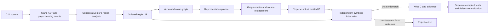

# Architecture

C-SRD uses Clang LibTooling for C11 preprocessing, parsing, typing, declaration
binding and source ranges. There is no regex C parser. The dependency-free
C++17 core contains region/graph structures, representations and emission;
the frontend executable links Clang/LLVM and Z3.

| Subsystem | Implementation | Responsibility |
| --- | --- | --- |
| Frontend | `src/frontend/frontend.cpp` | Macro/pragma/raw-directive boundaries, header hashes, original source, collision-free name reservation, line-preserving replacement and reparse gate |
| Semantic analysis | `src/analysis/analyzer.cpp` | Type/initialization/effect whitelist; local array bounds and finite loop checks; whole-function rejection |
| Region IR | `include/csrd/ir.hpp` | Pure expression trees and ordered declare/assign/if/repeat/return statements |
| Graph lowering | `src/analysis/graph.cpp` | Assignment versions, data dependencies, conditional merges, exact loop unrolling, dead-node pruning |
| Representations | `src/representation/` | Numeric and C rules for identity, affine and XOR; legality, conversions, explicit cost proxies |
| Planning | `src/transforms/planner.cpp` | Coverage constraints, shared conversion costs, exact small-graph optimization and labeled heuristic fallback |
| Algorithm candidates | `src/transforms/algorithms.cpp` | Explicit serial/SWAR low-byte population-count graphs; no name-based equivalence assumption |
| Emission | `src/codegen/graph_emitter.cpp` | Materialize each operation once, cache conversions per producer/destination, encode constants, decode boundaries |
| Translation validation | `src/verification/translation.cpp` | Independent execution of original/reparsed region trees into bit vectors, solver portfolio, concrete counterexamples |
| Compositional validation | `src/verification/composition.cpp` | Independently validate source-to-graph lowering and every reparsed limb fragment under explicit value/range invariants; proposal hints are untrusted |
| Source metrics | `src/frontend/metrics.cpp` | Clang AST traversal and reachable CFG, independent of graph planner |
| Defensive evaluation | `tools/evaluate.py` | Output-only classifier, curated controls, separate compiler/structure/timing measurements |
| Compiled-code audit | `tools/audit_protection.py` | Pairwise source and build-specific validation, frozen preprocessed compilation, code-section comparison and explicit unmeasured protection claims |
| Bounded rule synthesis | `tools/synthesize_rules.py` | Enumerate a finite algebraic template, prune by samples, require universal SMT validation |

The analyzer resolves reads through Clang `ValueDecl` identities before using
names in IR. Unsupported pointers/calls/external state establish the initial
alias/effect boundary; this is not a general alias analysis. Definitions and
uses become explicit graph edges. Each assignment creates a new version, so
conversions can be reused across all consumers of that version.

Pure, total branch computations can be eagerly materialized and selected at
joins. This would be invalid for arbitrary effects or trapping operations, which
the analyzer excludes. Local arrays become finite selections; they cannot escape
or be modified. Bounds are established before lowering. Graph expansion is capped
at 4096 nodes before pruning; planning is capped at 512 live nodes.

The validation interpreter does not call the graph lowerer, planner or emitter.
It directly models the ordered region language, including both branch states
and exact finite iterations. It shares Clang parsing and subset analysis with
the transformer: a shared analyzer/model bug remains a trusted-boundary risk.
Compiled differential and rejection tests provide a different source of evidence.

The compositional path uses an untrusted proposed graph/partition, validates the
source-to-graph relationship with that interpreter, and checks each actual
reparsed limb fragment under a value/range invariant. It then checks the actual
return. The hint generator cannot certify its own output. See
[the proof boundary and induction argument](compositional-validation.md).

Representation parameters use the existing deterministic FNV-1a function-name
hash and SplitMix64 seed derivation. Affine `a` is odd, with 1 remapped to 3;
XOR mask is `a ^ b`, with zero remapped to 1. No path, clock or `std::hash`
affects selection. This is not a cryptographic RNG. Exact ties are resolved by
a weighted label objective; reproducibility is scoped to the recorded solver
version and timeout outcome. Heuristic moves use deterministic iteration order.

New operations require analysis, region interpretation, graph lowering,
representation legality, C emission, rule tests and differential/rejection
cases. New effects require a richer observable-state model before any rewrite
can be admitted. The current single-function pure contract cannot simply be
reused for pointers, strings, APIs or mutable memory.
