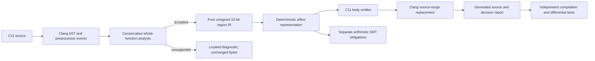

# Architecture

The M1 implementation is a small C++17 tool using Clang LibTooling. Clang owns
lexing, preprocessing, parsing and type checking; C-SRD does not parse C with
regular expressions. The independent core uses standard C++ only.

## Implemented components

| Component | Files | Responsibility |
| --- | --- | --- |
| Frontend and rewrite driver | `src/frontend/frontend.cpp` | Run a C11 frontend, collect macros/pragmas, lex raw directives, select main-file function definitions, replace validated body ranges, preserve unrelated source |
| Semantic analysis | `src/analysis/analyzer.cpp` | Check types, storage, initialization, references, expression operators and statement grammar; reject unsupported functions atomically |
| Region IR | `include/csrd/ir.hpp` | Typed-by-construction pure expression trees and ordered declarations, assignments and return; no Clang dependency |
| Representations | `include/csrd/representation.hpp`, `src/representation/representation.cpp` | Identity and affine numeric rules, C emission rules, deterministic parameters, inverse and static operation cost |
| Code generation | `src/codegen/emitter.cpp` | Encode parameter objects, emit encoded locals and assignments, decode return, preserve line counts |
| CLI and manifest | `src/main.cpp` | Validate real options, protect input paths, report decisions and write output after successful parsing |
| Rule verification | `src/verification/affine-rules.smt2`, `tools/verify_rules.py` | Separate symbolic obligations and a deliberate incorrect-rule control |
| Empirical validation | `tests/` | Numeric unit tests, conservative-rejection tests and compiled differential execution |

The unit of acceptance is an entire function. The analyzer records initialized
`ValueDecl` identities, so a reference cannot accidentally bind to a global or
read an uninitialized self-declaration. Source names are used only after the AST
has resolved bindings. Locals have automatic lifetimes; nested scopes, address
operations, pointers and calls are excluded. That exclusion establishes a
simple alias and effect boundary, without pretending to perform general alias
analysis. Statement order preserves definition/use dependencies.

Representation compatibility is exact equality of width, multiplier and offset.
M1 uses one representation for all values in a function, including constants.
It has no conversion edges inside the region. Constants are encoded at tool
execution time. Each parameter is encoded in its existing local parameter
object, and only the return reconstructs an ordinary value. The interface
reports scalar arithmetic costs (affine add/sub/scale: two operations each;
identity: one), not calibrated hardware cost. Entry and exit each contain two
arithmetic operations; optimizer effects are not estimated.

Seed selection is FNV-1a over UTF-8 function-name bytes, XOR with the decimal
64-bit seed, followed by two SplitMix64 outputs. The low 32 bits of the first
output are made odd; multiplier 1 is mapped to 3. The second supplies `b`.
There is no `std::hash`, clock input, path input or unspecified RNG distribution.
The same function name and seed select the same parameters; this is not a
uniform sampler over all affine encodings and not a security RNG.

## Extension boundaries

Add an operation only after defining a semantic contract, numeric rule,
emission rule, rejection cases, bit-vector obligations and differential tests.
A new representation must specify width, inverses, compatibility, boundary
conversions and cost. No fallback silently decodes an unsupported operation.

M3 should replace the single uniform choice with a data-flow graph and explicit
representation labels/conversion edges. It needs definition versions for
reassignment, legality constraints and a multi-objective cost model. The
current expression IR is a starting point, not a completed planner.

M4 belongs in a separate evaluator that receives original/generated artifacts
and input contracts. It must not use the transform manifest's intended identity
as the classifier's answer. Source, LLVM IR, CFG, machine-code, functional and
algorithmic measurements need separate columns and negative controls.

Data arrays/strings require object and lifetime models; control flow requires
branch joins and loop/termination reasoning; algorithm replacement requires
independent specifications; synthesis requires sound equalities and validation.
None of these modules is implemented by placeholder CLI options.
