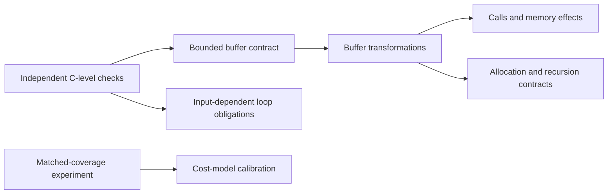

# Evidence-driven research backlog

These are repository-local task IDs, not claims that GitHub issues or assignments
already exist. No dates, staffing commitments or duration estimates have been
invented. Before starting a task, create a journal entry and record its problem,
hypothesis, constraints, protocol and stop/acceptance criteria.

Current baseline: implemented v0.5, in evaluation/maintenance. Future language
coverage remains proposed and requires separate, bounded specifications.

| ID | Status | Specific problem / next action | Dependencies | Acceptance evidence |
| --- | --- | --- | --- | --- |
| DOC-01 | Implemented | Make the existing behavior and evidence inspectable through a technical-spec README, usage guide and journal | v0.5 source and historical reports | Valid links, accurate CLI/constraints, source-linked decisions and explicit historical/proposed distinction |
| PROT-01 | Implemented and tested | Audit whether paired source variants produce different code-section bytes | Single supported function, emitted-source equivalence and matching build environments | [Audit evidence](../reports/protection-audit-validation.md): 11 focused tests, 10/10 native and Linux groups; preprocessing and failure controls; no inference of analysis resistance from byte differences |
| PROT-02 | Proposed | Measure reconstruction effort on compiled benign variants | PROT-01, prespecified observer/tools/budget and held-out corpus | Correctness-scored reconstruction tasks, original baselines, failed recoveries/timeouts and uncertainty; no security-product detection objective |
| PROT-03 | Proposed | Measure inference of intermediate values during execution | Defined observer access and trace/measurement protocol | Paired input/register/memory observations, source-to-machine limitations, correct recovery versus effort; distinguish absence of literal values from inability to infer them; no debugger interference |
| VER-01 | Proposed | Add an independent CBMC comparison backend for the current subset | Specify harness semantics, supported CBMC version and reproducible dependency setup | Original/candidate harnesses, boundary assumptions, unwinding assertions, positive/negative controls, reproducible counterexamples, explicit unavailable/unknown states |
| MEM-01 | Proposed | Define equivalence for a caller-provided bounded uint32 buffer | VER-01 investigation and separate memory specification | Valid object/length assumptions, aliasing policy, equal final observable values, untouched-region checks and no newly introduced undefined behavior |
| MEM-02 | Proposed | Transform eligible arithmetic around admitted buffer loads/stores | MEM-01 accepted contract | AST-aware access analysis, ordinary external memory layout, conversion boundaries, actual-candidate validation and GCC/Clang/sanitizer tests |
| EXP-01 | Proposed | Determine conversion effects at matched encoded coverage | Prespecified corpus and identical coverage rule for comparison | Paired counts per function, all exclusions reported, dependency-aware analysis; runtime and code size measured separately |
| EXP-02 | Proposed | Determine whether planner proxy costs predict compiled costs | EXP-01 and held-out benign corpus design | Raw replicated timings/sizes, measurement-noise analysis, calibration on a separate set, failed predictions retained |
| COV-01 | Proposed | Admit known direct calls and preserve I/O boundaries | Explicit call/effect/environment contracts and relevant memory model | Return/memory/event behavior preserved, negative call-order/effect controls, no unmodeled callbacks or hidden state |
| COV-02 | Proposed | Admit input-dependent loops without arbitrary unrolling claims | General control-flow model and bounds/invariant strategy | Termination/iteration obligations, bound-failure controls and correct post-state |
| COV-03 | Proposed | Admit selected signed operations, allocation and recursion | Separate contracts for each feature; relevant COV/MEM work | Defined-input conditions, promotions/conversions, failure/lifetime/depth behavior and independent verification |
| COV-04 | Proposed | Investigate floating-point transformations | Rounding/exception/representation contract and solver/tool study | Exceptional values and environment behavior preserved; no reuse of integer affine laws without proof |
| COV-05 | Proposed | Investigate shared-memory transformations | C11 memory model, synchronization and observable-execution contract | Explicit thread-local/shared boundary, atomic/order preservation, concurrency-specific negative controls |

The diagram expresses dependencies, not a delivery schedule. Add a dated Gantt
or resource plan only when estimates, owners and start constraints are known.
A task is complete only when its acceptance evidence exists; code presence or
passing an unrelated test does not close a research question.
