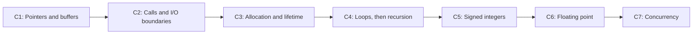

# Evidence-driven research backlog

These are repository-local task IDs, not claims that GitHub issues or assignments
already exist. No dates, staffing commitments or duration estimates have been
invented. Before starting a task, create a journal entry and record its problem,
hypothesis, constraints, protocol and stop/acceptance criteria.

Current baseline: implemented v0.5 plus the first fixed-index C1 buffer slice.
Further language coverage requires separate, bounded specifications.

The next priority is [broader C-SRD support](broader-c-support.md), informed by
published Tigress designs. Follow one coverage sequence, starting with bounded
pointer/buffer transformations. Verification and measurement tasks are acceptance
work inside these milestones; existing experimental results remain unchanged.

| ID | Status | Specific problem / next action | Dependencies | Acceptance evidence |
| --- | --- | --- | --- | --- |
| DOC-01 | Implemented | Make the existing behavior and evidence inspectable through a technical-spec README, usage guide and journal | v0.5 source and historical reports | Valid links, accurate CLI/constraints, source-linked decisions and explicit historical/proposed distinction |
| PROT-01 | Implemented and tested | Audit whether paired source variants produce different code-section bytes | Single supported function, emitted-source equivalence and matching build environments | [Audit evidence](../reports/protection-audit-validation.md): 11 focused tests, 10/10 native and Linux groups; preprocessing and failure controls; no inference of analysis resistance from byte differences |
| PROT-04 | Implemented bounded experiment driver | Select candidates using actual compiled behavior, with original / unencoded algorithm / encoded algorithm controls | PROT-01; [matrix protocol](validation-matrix.md); explicit corpus, build profiles and budgets | Independent correctness gates, optimized IR and instruction/data-flow comparisons, retained collapse cases, measured runtime/size; no protection claim from byte difference alone |
| PROT-02 | Fixed black-box and bounded Ghidra observers implemented; human studies remain proposed | Measure reconstruction of compiled benign variants | PROT-01, [fixed protocol](decompiler-audit.md), tools/budget and held-out corpus | Source-model-scored reconstruction, original baselines, counterexamples and explicit unsupported/timeouts; not a measurement of human effort |
| PROT-05 | First experiment complete; no demonstrated reconstruction benefit | Opt-in parity split tested against matching representation/seed controls | PROT-02, declared compiler matrix and generic arithmetic obligation | [Results](../reports/decompiler-control-flow.md): configuration-specific compiled contribution, black-box arithmetic recovery and explicit Ghidra gaps; no protection claim |
| PROT-06 | Bounded CFG implemented; wide/vector coverage remains open | Admit P-code merges and wide intermediate values before interpreting their rejection as an analysis limit | PROT-02; explicit operation/path semantics and a newly reserved corpus | [CFG validation](../reports/pcode-control-flow.md): five repeated Jenkins recoveries, 12/16 reserved build-cell answers proved under model, four inconclusive but finite checks matched, negative controls and 19 CTest groups passed; no tuning on reserved observer outcomes |
| PROT-03 | Bounded known-intermediate GDB observer implemented | Measure inference of intermediate values during execution | Defined observer access and trace/measurement protocol | Paired input/register/memory observations, source-to-machine limitations, correct recovery versus effort; distinguish absence of literal values from inability to infer them; no debugger interference |
| BENCH-01 | Implemented and validated | Replace toy-only evidence with eight bounded algorithm contracts and a reserved split | Independent oracles, source controls, explicit contracts | [156 compiled runs](../reports/rich-benchmarks.md), three equivalence controls, two incorrect controls and retained false fingerprints |
| PROT-07 | First development experiment complete; no established reconstruction benefit | Compare positional two-piece arithmetic with original, identity, affine, XOR and planned representations without cost cutoffs | BENCH-01; [rule and emitted-C checks](limb-representation.md) | [525 completed / 75 blocked build cells](../reports/limb-exploration.md), measured reconstruction/runtime/size, repeated corrected observer and identical-binary timing controls |
| PROT-08 | Implemented query control; broader observers remain open | Reconstruct whole bit-linear functions without algorithm names | Frozen basis-query model and separate grading | Insufficient-budget, overfit nonlinear and correct XOR controls; CPU/RSS/query measurements, not a secrecy claim |
| PROT-09 | Development comparison complete; no protection winner | Compare verified byte/nibble representations against 16-bit, identity and original before imposing cost limits | PROT-07, VER-02/03; [width contract](positional-widths.md) | [500 validated build cells and 800 measured attempts](../reports/positional-widths.md), paired costs and retained interrupted run; historical grading/coverage gaps are investigated separately in PROT-10/VER-04 |
| PROT-10 | Bounded implementation and comparison complete | Model `PIECE`, signed shifts, wide values, three pinned AArch64 vector operations and immutable mapped constants | PROT-06/09; [explicit observer contract](pcode-wide-values.md); unchanged binaries and budgets | [23 CTest groups on two hosts, 2,011 actual-C obligations per host, hardware/negative controls and 200/200 reconstructed answers after separate grading](../reports/pcode-wide-values.md); no established protection winner |
| PROT-11 | Implementation and development study complete | Separate per-function reconstruction cost from analyzer process startup | PROT-10 frozen observer and cold-process baseline; [persistent-session protocol](persistent-sessions.md) | [120 sessions and 33/33 recovered contracts](../reports/persistent-sessions.md), native/JVM/adapter CPU/RSS, identical-byte controls and retained cold totals; nibble native CPU grows 2.7–39.9×, JVM steady state remains unestablished |
| PROT-12 | Proposed | Test whether the frozen observer findings generalize to reserved algorithm families | PROT-11 observer and PROT-13 sampling protocol frozen before opening reconstruction outcomes; BENCH-01 corpus | All original/identity/candidate outcomes and costs reported; no tuning on held-out results; unsupported and inconclusive remain gaps |
| PROT-13 | Calibration for future cost measurements | Determine whether longer fixed warmup materially changes JVM/export cost ratios | PROT-11 observed last/first JVM batch CPU median 0.695; use development controls only | Declare warmup/batch grid before results, retain original protocol, separate native and JVM behavior, report all conditions without selecting a favorable stabilization point |
| VER-01 | Bounded buffer adapter implemented; broader backend open | Independent CBMC comparison for explicit finite layouts, supplementing shared-memory SMT validation | [Memory contract](buffer-contract.md); CBMC 6.11.0/Z3 on the measured host | [Actual-C checks and controls](../reports/buffers-validation.md), bounds/unwinding assertions, saved traces and explicit unavailable/inconclusive states |
| VER-02 | Implemented, tested and measured | Avoid monolithic proof timeouts for long limb computations | Untrusted partition proposals, independent source-to-graph and actual emitted-fragment checks | [Follow-up evidence](../reports/compositional-validation.md): 88 generated contracts, 13 corruption/budget controls, 17 test groups on macOS/Linux and 100 validated build cells; reconstruction grading still incomplete |
| VER-03 | Saved Jenkins answers resolved; general grading remains open | Resolve grading of optimized limb reconstructions without weakening success criteria | VER-02; frozen answers and original/build-input hashes | [Checked-circuit replay](../reports/circuit-grading.md): ten frozen answer queries unsat, thirteen controls passed, eighteen test groups on macOS/Linux; failed probes/pilot retained; not independent C modeling or a protection result |
| VER-04 | Both positional-width contracts resolved under source model | Investigate Clang nibble Jenkins and GCC nibble RGB answers without changing the observer or accepting finite checks as proof | PROT-09; two frozen answer artifacts, four SMT query artifacts, ten repeated unknown grades | [All four saved queries UNSAT at the declared 30-second tier; five controls passed](../reports/pcode-wide-values.md); artifact bindings retained, original grades/costs immutable; unrelated grading gaps remain open |
| MEM-01 | Fixed-index contract implemented (C1) | Equivalence for caller-provided bounded uint32 storage | [buffers-u32-c11-v1](buffer-contract.md) | Valid initialized/live prefixes, arbitrary aliases, entire final-memory equality and no larger candidate footprint |
| PROT-14 | Development comparison complete; affine protection deferred | Close buffer reconstruction and runtime measurement gaps | [Protocol](buffer-reconstruction.md), PROT-02/11 and MEM-01/02 | 112/112 reconstructions, 5,376 revised runtime executions, complete known-target recovery, 17,280 compiled-answer checks and [frozen evidence](../reports/buffer-reconstruction.md); native calibration and matching application costs remain followups |
| MEM-02 | First bounded slice implemented (C1) | Affine/identity arithmetic around literal-index loads/stores | MEM-01, COV-06 and mandatory actual-C post-state validation | [Buffer validation](../reports/buffers-validation.md): memory-only counterexamples, GCC/Clang/sanitizers, independent checks and compiled audit |
| EXP-01 | Proposed | Determine conversion effects at matched encoded coverage | Prespecified corpus and identical coverage rule for comparison | Paired counts per function, all exclusions reported, dependency-aware analysis; runtime and code size measured separately |
| EXP-02 | Proposed | Determine whether planner proxy costs predict compiled costs | EXP-01 and held-out benign corpus design | Raw replicated timings/sizes, measurement-noise analysis, calibration on a separate set, failed predictions retained |
| COV-01 | Planned C2 | Admit known direct calls and preserve I/O boundaries | C1 memory/effect model; explicit call/environment contracts | Arguments, return, memory and ordered event behavior preserved; negative call-order/effect controls; no unmodeled callbacks or hidden state |
| COV-02 | Planned C4 | Admit input-dependent loops beyond literal-loop expansion | General control-flow/state model and bounds/invariant strategy | Preserved effects, progress and post-state; explicit iteration obligations and bound-failure controls; no universal claim from finite unrolling |
| COV-03 | Split; no implementation claimed | Former combined signed/allocation/recursion task is replaced by COV-07/08/09 | Separate contracts and acceptance evidence for each feature | Close each replacement only on its own implementation and evidence |
| COV-04 | Planned C6 | Investigate exact floating-point transformations within a declared model | Rounding/exception/representation contract and solver/tool study | Exceptional values, signed zero and relevant environment behavior preserved; no approximate substitution under an exact contract |
| COV-05 | Planned C7 | Investigate shared-memory transformations | C11 memory model, synchronization and observable-execution contract | Explicit thread-local/shared boundary, atomic/order preservation, concurrency-specific negative controls |
| COV-06 | Ordered straight-line path implemented; general region selection open | Computation between admitted memory boundaries | MEM-01 memory/effect contract | Declaration identity, reads/writes/order and footprints tracked; aliases admitted, escapes/unknown effects rejected; no pure-graph pruning or repeated evaluation |
| COV-07 | Planned C5 | Admit selected signed types and operations | Defined-input domain and C promotion/conversion/overflow/shift semantics | Negative and boundary-value controls; actual emitted-C validation; no new signed overflow or invalid shifts |
| COV-08 | Planned C3 | Admit selected dynamic allocation/deallocation patterns | C1 memory model and C2 call summaries | Allocation failure, bounds, object identity, aliases, lifetime and release behavior preserved under the declared environment |
| COV-09 | Planned C4 after loop model | Admit selected recursive calls with separate activation state | COV-01 call contracts and COV-02 state/effect model | Correct per-call state, returns and effects; explicit depth/resource assumptions and failure controls |

The diagram expresses the proposed development order, not dates or a claim
that every earlier stage is a semantic prerequisite for every later one. Each
stage includes correctness validation, compiler checks and scoped measurements.
Add a dated Gantt or resource plan only when estimates, owners and start
constraints are known.
A task is complete only when its acceptance evidence exists; code presence or
passing an unrelated test does not close a research question.
