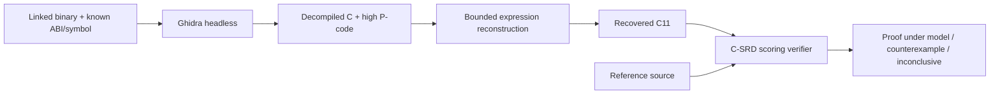

# Compiled reconstruction and parity-split protocol

This experiment asks whether a specified observer can reconstruct the return
function of an admitted pure-u32 binary. It does not score pseudocode ugliness,
compiler instruction count or a decompiler error as software protection.

## Observer contract

`tools/audit_decompiler.py` consumes completed, hash-bound linked artifacts from
`tools/run_matrix.py`. It gives Ghidra a binary, the known function symbol and
its public unsigned-32-bit ABI (one to four parameters). Ghidra does not receive
source, algorithm labels, transformation seeds or encoding parameters. Symbols
are retained. Unknown-function discovery and stripped-binary recovery are outside
this experiment. An LTO-inlined/removed symbol is `missing-function`, not a gain.



The Java export uses Ghidra's `decompile` simplification style. It preserves
decompiled text, P-code, sizes, parameters, function address, language and compiler
specification, status and elapsed time. A separate Python adapter interprets a
bounded scalar graph: unsigned add/subtract/constant scale, bitwise operations,
constant logical shifts, byte/halfword truncation and extension, and unsigned
comparisons. It materializes unsigned C locals and never parses C with regexes.
Schema-2 exports also admit validated branches and phi nodes when complete
bounded expansion reaches a return on every path. The
[control-flow specification](pcode-control-flow.md) defines block/edge order,
SSA validation, simultaneous merges and all expansion budgets. Legacy schema-1
exports admit only expression DAGs (2,048 operations, 4,096 varnodes, depth 128).
Effects, unresolved inputs, general multiplication and wide data values remain
conservatively unsupported. Constant shift/subpiece counts
may occupy 1/2/4/8-byte fields independently of payload width; they are checked
without truncating their value. Oversized logical shifts yield zero as specified
by P-code, never an invalid C shift; subpieces must stay within their source.
SIMD/popcount intrinsics may therefore
be unsupported even when a person can easily understand the decompiled C.

The reference is consulted only after reconstruction, for a full-input-domain
source-model equivalence query. Scoring uses the exact frozen preprocessed input
of the matched original build, with its hash checked before and after, and requires
the same C-SRD frontend/model binary as the matrix. This avoids reinterpreting
changed headers or a different target environment. The same scorer must reject a reconstructed
result deliberately offset by one, with a concrete counterexample. This control
tests the scoring gate, not a population estimate of semantic-recognition errors.
The expanded matrix's unrelated unary/binary corpus supplies fingerprint controls.

| Observation | Meaning |
| --- | --- |
| `recovered-under-source-model` | Recovered C is equivalent to reference for every input under C-SRD's admitted model |
| `counterexample` | A concrete input refutes the reconstructed candidate |
| `unsupported-reconstruction` | This adapter cannot model the exported graph; no protection inference |
| `missing-function` | Known symbol absent, for example after inlining; no reconstruction attempted |
| `analysis-timeout`, `timeout`, `decompiler-error`, `inconclusive` | Budget/tool/model gap; preserve evidence and report separately |
| `error` | Artifact binding, integration or scoring control failed; the observer run fails |

The source-model proof trusts Clang analysis, the symbolic interpreter and Z3.
It is not a machine-code equivalence proof or proof of Ghidra's lifting. Ghidra
and the bounded adapter are additional trusted analysis components. The linked
matrix separately tests actual compiled behavior; neither finite execution nor
this fixed observer establishes human reverse-engineering effort or confidentiality.

Default budgets: 30 seconds analysis, 15 seconds decompilation, 120 seconds per
headless process group and 10 seconds per verification query. Timeout handling
terminates the launcher and its child group. Logs, partial output, artifact and
tool hashes survive failure. `completed` means the protocol ran; inspect each
observation. CLI exits: 0 protocol complete, 1 integration error, 2 unavailable
headless executable. New output directories are required.

## Control-flow candidate

`csrd transform ... --control-flow split-scale` is an opt-in experimental emitter.
For a constant-scale graph node with k>1, a stored operand u and correction c:

```
F(u) = k*u+c (mod 2^32)
if (u is odd): result = k*(u-1)+c+k
else:         result = k*u+c
```

For affine values c=(1-k)*b; for identity c=0. Both branches evaluate F(u), so
the representation remains consistent and no new decode is required. Every
operand is already a pure, evaluated graph value. Generated names are reserved
through the existing collision mechanism; all new arithmetic is unsigned.
The emitted C is reparsed and translation-validated before output publication.
[The generic bit-vector obligation](../src/verification/split-scale.smt2) quantifies
all u, k and c. It proves the arithmetic rule under the bit-vector model, not
the C++ implementation. The planner/emitter count four additional worst-branch
scalar operations per split; this proxy excludes branch prediction and is not a
runtime estimate. `split_scales: 0` means the candidate had no eligible node.

The matrix's `--control-flows none split-scale` generates paired variants. An
encoded split candidate is compared with both the same algorithm's identity
split and the same strategy/seed without splitting. Selection requires a measured
mnemonic-sequence contribution from the split in every required profile, actual
split coverage and existing cost/correctness gates. It never rewards observer
failure. Identical sequences, removed branches and extra cost are retained.

## Reproduction

Ghidra is optional for normal builds. This protocol pins the official
[Ghidra 12.2 release](https://github.com/NationalSecurityAgency/ghidra/releases/tag/Ghidra_12.2_build)
archive and SHA-256. Its distribution requires Java 25. On Linux ARM64 the
headless decompiler is built from the distributed native source; x86-64 uses the
distributed binary. The [container recipe](../experiments/Dockerfile.ghidra)
records this setup. Ubuntu package versions still depend on the package mirror;
retain image/tool identities with measurements.

```sh
docker build -f experiments/Dockerfile.validation -t csrd-dev:validation .
docker build -f experiments/Dockerfile.ghidra -t csrd-dev:ghidra .
docker run --rm -v "$PWD:/work" csrd-dev:ghidra sh -c '
  cmake -S . -B build-ghidra -G Ninja -DCMAKE_PREFIX_PATH=/usr/lib/llvm-18 -DCMAKE_BUILD_TYPE=Release &&
  cmake --build build-ghidra --parallel 2 &&
  ctest --test-dir build-ghidra --output-on-failure &&
  python3 tools/run_matrix.py --csrd build-ghidra/csrd --case calculate --profile clang-O2 \
    --compiler clang=clang-18 --objdump llvm-objdump-18 --control-flows none split-scale \
    --output-dir build-ghidra/matrix &&
  python3 tools/audit_decompiler.py --matrix-report build-ghidra/matrix/matrix.json \
    --csrd build-ghidra/csrd --headless "$CSRD_GHIDRA_HEADLESS" --output-dir build-ghidra/observer'
```

The scripts support repeated `--case`, `--profile` and `--variant` filters. Run
the observer in the same filesystem namespace as the matrix because its paths
are absolute. `CSRD_GHIDRA_HEADLESS` enables the real integration test; without it
CTest explicitly skips that test while exercising adapter and failure controls.
Use `--tier holdout --selection PATH` for frozen matrix evaluation. Separate
development and held-out reports; do not change rules after seeing held-out data.

Primary API references: [DecompInterface](https://ghidra.re/ghidra_docs/api/ghidra/app/decompiler/DecompInterface.html),
[HighFunction](https://ghidra.re/ghidra_docs/api/ghidra/program/model/pcode/HighFunction.html),
[P-code operation semantics](https://ghidra.re/ghidra_docs/languages/html/pcodedescription.html).
