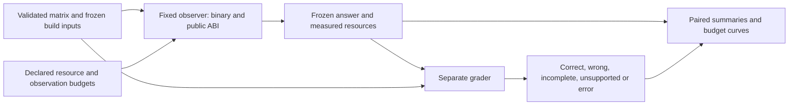

# Measuring reconstruction effort

## Problem and hypothesis

Different source, IR or instructions do not establish increased reconstruction
effort. We need a correct answer, a specified observer, a fixed task and an
original baseline before we can compare cost. The hypothesis is that a candidate
increases resources required for a correct reconstruction or reduces correct
reconstruction within a declared budget. The null hypothesis is no improvement.
An incorrect transformed program fails the prerequisite; reduced **observer
accuracy** is a separate measurement.

`tools/measure_effort.py` implements repeated paired experiments on hash-bound
linked builds from `run_matrix.py`. It does not change transformations or select
them based on failures of analysis tools. Existing structural, compile-time,
binary-size and application-runtime measurements remain separate dimensions.

## Measurements and meanings

| Measurement | Implementation and interpretation |
| --- | --- |
| Observer wall time | Dedicated process launch through worker/descendant exit; includes Python/tool startup, input collection and inference, excludes privileged grading. Polling adds up to approximately one sample interval plus scheduler delay. |
| CPU seconds | `wait4` user and system time, including waited descendants; Linux collector adopts/reaps orphan descendants. CPU seconds may exceed wall seconds on multiple cores. |
| Average cores used | CPU seconds / wall seconds. This is not percentage of total host CPU capacity. |
| Individual peak RSS | Largest process high-water RSS reported by `wait4`; bytes after platform unit conversion. It is **not** the sum of process peaks. |
| Aggregate sampled RSS | Linux `/proc` sample of simultaneous descendant resident sets every 10 ms; shared pages counted repeatedly, short-lived peaks may be missed, scan is not atomic. macOS reports unavailable. |
| Resource side effects | Page faults, voluntary/involuntary context switches, block I/O operations, output byte sizes, process/sample counts. I/O operations are not bytes read/written or network traffic. |
| Queries | Exact submitted/completed input vectors; interrupted batches retain attempted count and unknown completed count. Held-out oracle queries are logged separately. |
| Inference work | Models tested, training fits, common trace locations searched, P-code nodes/operations, target decompile requests. No assertion about uninstrumented Ghidra internals or SMT internal query counts. |
| Runtime observations | Trace count, instruction steps, value observations, stack-read failures, complete versus budget-limited prefixes. General registers and 64 bytes at SP only; no heap/SIMD coverage claim. |
| Phase timings | Query/trace collection versus fitting; headless import/analysis/export versus P-code reconstruction; Java setup versus target decompile. Overall resource measurements include all phases; fine-grained phases currently record wall time only. |
| Recovery correctness | Full-domain source-model verification for emitted C; runtime mappings tested on separate traces. Ghidra binary lifting itself is not proved. |
| Partial accuracy | Held-out return agreement for black-box fits; correct/total predictions and availability for the selected runtime mapping. Finite accuracy can be 100% while formal equivalence fails. |
| Wrong answers | Formally refuted candidates or runtime mappings wrong on fully available held-out locations. Missing locations remain inconclusive. This is a wrong-submission rate, not a universal false-positive rate. |
| Negative controls | Candidate result +1 must yield a counterexample; runtime fits to permuted training targets are scored separately. XOR with three basis probes deliberately tests a false affine fit. |
| Success under budget | Actual wall/CPU/RSS/query/step budget combinations, all attempts retained. CLI accepts Cartesian grids. Timeouts mean no recovery within that measured budget, not unlimited resistance. |
| Relative cost | Per-case/profile/budget paired ratios and differences against original **when both attempts succeed**; outcome counts show the conditioning. No ratio is invented for unsupported cases or timeouts. |
| Variation | Raw repetitions, median/min/max, deterministic bootstrap 95% intervals for medians with at least five pairs; exploratory Wilson intervals for success fractions. Repeats on one artifact are not independent program samples. |
| Human effort | Separate task preparation, active/wall timers, pauses, attempt counts, frozen submissions, correctness grading and time to first correct in-budget submission. Actual human data remains unassessed until a study occurs. |

The collector is for trusted research tools, not an adversarial process sandbox.
CPU and aggregate-RSS limits are sampled **soft** limits with recorded overshoot;
memory exhaustion by the OS is an error, not an inferred protection success.
The collector itself is outside reported analyzer CPU; its polling can perturb
execution. All paired runs use the same instrumentation. Process accounting
details follow [Linux getrusage](https://man7.org/linux/man-pages/man2/getrusage.2.html)
and [child subreaping](https://man7.org/linux/man-pages/man2/PR_SET_CHILD_SUBREAPER.2const.html).
Escaped/unwaited descendants on non-Linux systems are not completely accounted.

## Observer contracts



The observer configuration receives the executable, public ABI/symbol, budgets
and an **input sampling** seed. It receives no representation parameters,
transformed source, original source or equivalence labels. This is a fixed-code
experimental information boundary, not OS filesystem isolation from the grader.

**Black-box:** basis probes plus deterministic boundary/random inputs, without
duplicate probes. Fit modular affine and a fixed library of popcount-low-byte,
XOR and unsigned-minimum models. Freeze the **first** fit in the documented
order, then check its generated C against the original build's frozen `.i`.
Do not use held-out answers to select among fits. Repetitions use matched input
seeds across variants and independent held-out random streams. Query budgets
are exact input counts, not process launches.

**Ghidra:** fresh project/process, fixed known u32 ABI, two analysis CPUs, declared
analysis/decompile/outer-process deadlines. Export high P-code and decompiled C;
apply the existing bounded reconstruction adapter; grade the frozen C against
the matched original build. Missing symbols, unsupported P-code and integration
errors are distinct from incorrect answers and resource exhaustion. Larger
resource budgets do not repair an unsupported adapter rule.

**Runtime:** current task is specifically recovering `calculate`'s known
intermediate `x+y mod 2^32`. Three or more training executions fit invertible
affine maps from this known target to common register/stack locations. Freeze
all maps and choose the lexicographically first training fit before grading.
Score it on four fixed held-out inputs plus twelve independent random ones;
also report all-model results with their multiple-candidate scope. Bounded
trace prefixes are usable observations and are explicitly labeled. This is
not general unknown-program reconstruction or memory confidentiality.

This particular function returns `3*(x+y)+11` modulo 2^32. Since 3 is invertible
in that ring, its public return value already determines the target sum. It is
therefore a useful recovery control; changing its internal representation cannot
make that sum confidential from an observer who knows this relation.

## Reproducible experiment

Build a validation matrix first using [the matrix protocol](validation-matrix.md).
Use the same host/container paths and exact `csrd` binary. The verifier, matrix,
binaries, frozen original inputs and observer implementation are hash-checked
before/after measurement. Tool versions/properties, command lines, outputs,
environment/load, order, all trials and resource samples are retained.

```sh
python3 tools/measure_effort.py \
  --matrix-report build/matrix-core/matrix.json --csrd build/csrd \
  --observer blackbox --case calculate --profile clang-O2 \
  --variant original --variant affine-42 \
  --query-budgets 3 8 32 --wall-budgets 5 \
  --repetitions 5 --warmups 1 --output-dir experiments/runs/effort-blackbox
```

Replace `--observer blackbox` with `ghidra` and supply `--headless PATH` for
decompilation. Query budgets are inapplicable there and are recorded as zero.
Use `--observer runtime --query-budgets 3 4 8 --step-budgets 1 4 16 64` for the
known-intermediate task, with GDB available and tracing permitted. Linux Docker
needs `--cap-add=SYS_PTRACE --security-opt seccomp=unconfined` for GDB.

`--wall-budgets 2 10 60`, `--cpu-budgets 1 4 16` and
`--memory-budgets-mib 256 1024` define an actual Cartesian sweep; size the
experiment before running it. CPU/RSS caps require Linux. The default is no
CPU/RSS cap, a 60-second outer budget, five measured repetitions and one excluded
warmup per budget/variant. Query budgets default to 3, 8, 32; runtime steps to
4, 16, 64. Internal Ghidra budgets default to 30/15 seconds and source proofs to
10 seconds. `--grading-seconds` bounds executable/trace scoring separately.

Variants run in seeded random order within matched blocks, serially. A checkout
lock prevents overlapping participating effort drivers. OS/filesystem caches
are not flushed; projects/processes are fresh. External host workloads can still
interfere. Do not run tests/builds alongside the measured pilot. Record hardware
and repeat on a dedicated host before making a performance conclusion.

Outputs: `protocol.json`, `effort.json`, `summary.json`, `trials.csv`, and per-trial
observer configuration/answer, raw logs/samples, query or trace data, candidate C,
proofs and corruption-control results. `summary.groups` are budget-curve points.
The report also lists tested budget combinations where every measured repeat
succeeded. Such a point is not a theoretical minimum or a success guarantee.

Decide a practically meaningful slowdown threshold and resource overhead ceiling
**before** a confirmatory study; this pilot does not establish either. Inspect
paired intervals, absolute costs and all outcome counts. A larger ratio caused
only by startup, an unsupported baseline, compiler-erased symbol or observer
bug is not evidence that a program is harder to understand. No automatic
"successful protection" classification is implemented.

## Human study workflow

`tools/human_effort.py` creates participant slots, not recruited participants.
Choose one case per functional family. Across slots, original/candidate
assignment alternates by family; task order is seeded and randomized. Each slot
gets one version per family, avoiding direct before/after learning. Public
packets omit variant labels and source. Known symbols and a public corpus make
perfect blinding impossible; record prior exposure and reserve a new corpus for
confirmatory studies. Specify permitted tools, training, experience strata and
stopping rules before recruitment. Counterbalance skill and family effects in
analysis; do not treat many tasks from one person as independent participants.

```sh
python3 tools/human_effort.py prepare --matrix-report build/matrix-core/matrix.json \
  --case calculate --case xor --profile clang-O2 --variant affine-42 \
  --participants 4 --budget-seconds 1800 --output-dir experiments/runs/human-pilot

python3 tools/human_effort.py start --task PACKET/task.json --session-dir SESSION \
  --experience 'describe tool experience' --prior-exposure no
python3 tools/human_effort.py pause --session-dir SESSION --note 'interruption'
python3 tools/human_effort.py resume --session-dir SESSION
python3 tools/human_effort.py submit --session-dir SESSION --candidate answer.c
python3 tools/human_effort.py finish --session-dir SESSION
python3 tools/human_effort.py score --session-dir SESSION \
  --private-key experiments/runs/human-pilot/private-key.json --csrd build/csrd
```

Keep the private grading key with the coordinator. Submissions are copied and
hashed; correctness feedback is available only after finishing. Analysis and
script development count as active time; pauses are for interruptions. Timers
use monotonic intervals plus wall-clock consistency checks and flag clock
discontinuities. Logs are auditable local records, not tamper-proof attention
measurement. Record manual tool configuration/setup separately in event notes
and the study journal; automated warmups do not measure analyst preparation.

The grader reports first correct in-budget submission time, attempts, time spent,
early withdrawal versus exhausted budget, and unsupported grading separately.
An unfinished/early-withdrawn task must not automatically be scored as a full
budget failure. Source-model limitations apply to submitted reconstructions.
Do not publish identities or turn synthetic recorder tests into human findings.
