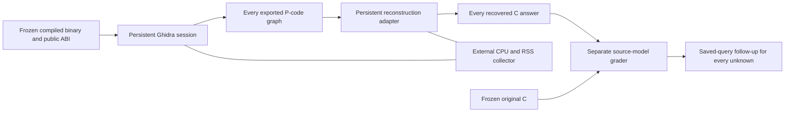

# Persistent per-function reconstruction measurements

## Problem and hypothesis

Fresh-process totals can hide an increase in the work spent analyzing one
function. The hypothesis is that separating native decompiler, JVM/export and
adapter costs exposes increases hidden by startup/import costs. Whether those
increases justify the application's runtime and size costs remains a question.

This experiment holds the input binaries and semantic observer fixed. It adds
measurement infrastructure; it does not add a protection technique. The
[journal](journal/2026-11-10-persistent-observer.md) declares the protocol before
the full experiment. Source-model grading remains separate from reconstruction.

## Interface and flow



`tools/measure_sessions.py` requires a completed prior cold Ghidra effort report,
the same frozen semantic modules, the unchanged build matrix/binaries and a
headless installation. It runs on Linux because phase CPU accounting uses
process CPU clocks and RSS uses `/proc`. The collector shares the existing
checkout-local effort lock; it does not isolate other host activity.

```sh
python3 tools/measure_sessions.py \
  --prior-cold experiments/runs/pcode-wide-observer-20261110/effort/effort.json \
  --headless experiments/runs/dependencies/ghidra_12.2_PUBLIC/support/analyzeHeadless \
  --output-dir experiments/runs/persistent-observer-20261110
```

Optional implemented filters are repeatable `--case`, `--profile`, `--variant`;
every selected case/profile must include its `original`. Default session counts
are `--repetitions 3 --warmup-calls 32 --batches 5 --calls 32`, randomized by
`--order-seed 731123`. Deadlines are `--analysis-seconds 30`,
`--decompile-seconds 15`, and `--session-seconds 120` for the complete worker.
Output directories must be new. Runs never overwrite historical evidence.

## Request and measurement contracts

One fresh JVM imports one binary and opens one `DecompInterface`/native process.
The first request and next 31 initial requests are recorded but excluded from
the primary comparison. Each subsequent batch performs 32 real requests; five
batches share the session. Every request calls `flushCache()` before decompiling
the same function with the existing style and public `uint32_t` interface.
There is no claim that flushing removes every internal cache or that 32 requests
guarantee steady state. Neither `openProgram` nor process startup repeats per
request. An empty phase measures boundary overhead without a native request.

The Java exporter generates the graph every time using a block mechanically
checked against the existing exporter. Only storage is deduplicated by SHA256.
After Ghidra exits, a separate persistent Python process reconstructs every
corresponding graph, without original C, representation settings or seeds.
It retains all distinct answers, graph memberships and per-request metrics.
This is an analysis experiment, not a sandbox for untrusted executables.

`session_worker.py` accepts ordered, acknowledged loopback events only from its
own process descendants, with a per-session token. `process_counters.py` reads
POSIX process clocks externally at phase boundaries. These clocks include every
thread of the identified process and exclude children. JVM and native child
CPU are reported separately; adapter CPU comes from its separate process. Raw
clock values/resolutions and PID/start-time/executable identities are retained.
Lost/replaced processes, nonmonotonic clocks and malformed events invalidate a
phase/run. They never imply zero cost or successful protection.

RSS is sampled every 5 ms and at boundaries. It is absolute resident memory,
including retained heaps/caches and shared pages counted in each process. It
is not bytes allocated per request. Sampling can miss peaks; a child first
created during setup has only an endpoint until the next phase. Measured native
request phases require the same already-existing child throughout. Tiny phases
may have only one sample plus endpoints. Raw samples/errors remain available.

Phase CPU includes boundary/serialization work and background threads active
during the interval. Native CPU isolates the decompiler; JVM CPU includes graph
export/hashing, JIT and garbage collection. Adapter CPU includes C generation,
hashing and metrics. The sampling collector's CPU is excluded from these process
clocks, though its scheduling/memory interference remains possible. Direct
`decompileFunction`, cache-flush and Python reconstruction wall times are retained
separately. No subtraction of an empty-phase measurement is assumed valid.

The existing reaping collector also records the whole session's CPU/wall/RSS,
faults, switches and I/O, including startup and cleanup. The difference between
whole-session and measured-phase CPU is work outside those phases, including
collector/launcher work; it must not all be labeled startup. A 192-request
session total is not directly comparable with a historical one-request total.

## Correctness and analysis

`experiments/grade_session_answers.py` validates the complete schedule, input
bindings, counters and graph-to-answer sequence before grading. It grades every
distinct `(original C hash, answer C hash)` pair, including initial requests, with
the frozen Linux C-SRD verifier and ten-second SMT budget. An output-plus-one
mutation must produce a counterexample for every answer. Shared grades retain
all request memberships; they are not independent correctness samples.

`experiments/grade_session_queries.py` separately replays every inconclusive
answer's exact saved SMT bytes with a declared 30-second ABC and 35-second stage
budget. Actual Boolean circuits are checked against their SMT gate contracts;
wrong-output and generic arithmetic controls accompany replay. All unknowns and
failures remain explicit. Neither source grading nor circuit replay proves
Ghidra's lifting or the whole C frontend.

Primary cost summaries use the median of five batch totals divided by request
count within each session, then three paired session ratios per case/profile.
Every pair and its range remains visible. Fifteen batches are not fifteen
independent repetitions. No confidence interval, minimum benefit or cost ceiling
is selected after seeing results. Existing application runtime/size measurements
remain bound to the same build matrix. Identity and identical-byte variants are
noise controls. Initial and empty phases are reported separately.

This measures repeated same-function automated analysis on four development
families. It does not measure human comprehension, one-time observer development,
whole-program reconstruction, secrecy during execution or debugger resistance.
The reserved-family comparison needs a separate frozen protocol.

## Primary API references

[Ghidra DecompInterface](https://ghidra.re/ghidra_docs/api/ghidra/app/decompiler/DecompInterface.html)
documents one-program persistence, cache flushing and process restart behavior.
[Linux process CPU clocks](https://man7.org/linux/man-pages/man3/clock_getcpuclockid.3.html)
document reading owned process CPU clocks. These existing mechanisms supply the
measurement apparatus; no novelty is claimed for them.
